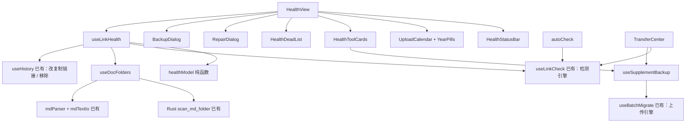

# 阶段 5 链接健康 · 实施方案

> 读者：维护者，以及做阶段 5 的 AI。依据：交接说明 8.3、13.4、第 15 节，画板 L01–L18 K04 K08（`HealthScreen.dc.html`）。做完后本文件并入 README 的「设计没画、开发时补的（链接健康）」，然后删除。

## 这一页要替用户回答的问题

有没有坏图 → 一键修好（连同已经写进文章里的旧链接）→ 以后少坏（补备份、定期自动检测）。

理想状态：打开页面就知道有几张坏、坏在哪年哪个图床；点一次「修复 N 张」，复制链接切到能用的备份，文档文件夹里的旧链接一起换掉，能撤销；仅 1 份的图一键补到第二个图床；之后每 7 天自动查一次。

## 做法（已定：按理想状态重写）

只留真正的「引擎」：检测（`useLinkCheck` + Rust 批量检测，含暂停 / 继续）、上传（`useBatchMigrate` 的执行部分）、文档扫描（Rust `scan_md_folder`）、链接替换（`mdParser.replaceImageLinks`）、UTF-8 读写保护（`mdTextIo`）；新写一层「健康模型」纯函数 + 文档文件夹模块 + 页面；旧页面和 `useMdRescue` 整套会话状态机删掉。预计新增约 3.0k 行、删除约 8–9k 行。文档写入与撤销重写时沿用旧代码踩过的坑（非 UTF-8 跳过、备份目录、并发上限、具体失败原因）并补测试。

不做「新页面套旧状态机」：旧 `useMdRescue` 是「选一个文件夹 → 扫描 → 逐条挑备份修」的一次性会话，与设计的「文档文件夹常驻、修复 = 改用备份 + 换文档旧链接、撤销两者一起还原」对不上，适配层绕且旧代码约一半服务于已去掉的功能。

## 架构骨架

### 模块

| 文件 | 一句话职责 |
|---|---|
| `src/views/health/HealthView.vue` | 页面编排：标题行、状态栏、日历、工具卡、失效清单、两个弹窗；只接线，不算数 |
| `src/views/health/HealthStatusBar.vue` | 状态栏五种状态（尚未检测 / 检测中 / 已暂停 / 有失效 / 修复中 / 全部正常）+「⋯」菜单 |
| `src/components/biz/UploadCalendar.vue` | 一年 7 × 53 的日历格子 + 悬停气泡 + 点选一天（只吃数据，不查库） |
| `src/components/biz/YearPills.vue` | 年份胶囊：最近 6 年平铺 +「更早 ▾」，琥珀数字 |
| `src/components/biz/ToolCard.vue` + 3 张插画 | 工具卡外壳（插画、标题 + 数量、说明、按钮 / 进度） |
| `src/views/health/HealthToolCards.vue` | 三张卡各自的文案与状态：文档修复、补充备份、找不回 / 自动检测 |
| `src/views/health/HealthDeadList.vue`、`HealthDeadRow.vue` | 全部失效图片：两组、筛选（原因 / 图床 / 年份 / 某一天）、行菜单、行内「改用 X / 重试 / 仍然失效」 |
| `src/views/health/RepairDialog.vue`、`BackupDialog.vue` | 文档修复弹窗、补充备份弹窗 |
| `src/views/health/healthModel.ts` | 纯函数：每张图的状态、原因（不存在 / 拒绝访问 / 连接超时 / 可能受限）、改用哪一份（可访问的里响应最快的）、两组、按天 / 按年的失效数、状态栏那句说明、「仅 1 份」 |
| `src/views/health/useLinkHealth.ts` | 页面状态（单例）：接 `useLinkCheck` 的检测 / 暂停 / 继续 / 取消 / 单条重检；「修复 N 张」与行内「改用」（改复制链接 + 换文档旧链接 + 一条带撤销的通知）；修复进度 |
| `src/views/health/useDocFolders.ts` | 文档文件夹：增删（记进配置）、扫描建「链接 → 用在哪些文档哪一行」的索引、替换并备份、撤销、失败原因（被占用 / 没有写入权限 / 文件找不到了） |
| `src/views/health/useSupplementBackup.ts` | 补充备份：范围固定「仅 1 份」，只选目标图床；暂停 / 继续；进度给工具卡与传输中心 |
| `src/views/health/autoCheck.ts` | 自动检测：应用运行时到期就在后台跑一次检测（启动时补跑过期的一次） |
| `src/shell/TransferCenter.vue`（已有） | 加「备份」「检测」两组 |

### 数据

```ts
/** 一张图在健康页里的样子（由 useLinkCheck 的行 + 上传时间推出来） */
interface HealthImage {
  id: string; name: string; uploadedAt: number;
  copyHost: string;                 // 「复制时使用」
  copies: HealthCopy[];             // 复制时使用的那份排第一
  state: 'unchecked' | 'ok' | 'limited' | 'fixable' | 'unfixable';
  reason?: 'gone' | 'denied' | 'timeout';   // 失效原因（筛选用）
  fixTo?: string;                   // 改用哪一份（可访问的里最近一次响应最快的）
}
interface HealthCopy { host: string; url: string; status: 'ok' | 'gone' | 'denied' | 'timeout' | 'limited' | 'unchecked'; latencyMs?: number }

/** 文档文件夹扫描结果：旧链接用在哪些文档的哪一行 */
type DocIndex = Map<string /* url */, { path: string; line: number }[]>;

/** 新配置字段（只加不改，有默认值，不迁移） */
linkHealth: { docFolders: string[]; autoCheck: { enabled: boolean; intervalDays: number } }  // 默认 [] / 开、7 天
```

- 「失效」= 复制时使用的那份 `gone / denied / timeout`；`limited` 单独计数、不算失效（交接说明 13.4）。现有的 `imageHealth.ts` 已有大部分判定，扩展它而不是另写。
- 上次检测时间：取全部检测结果里最新的一次，不另存。
- 日历每天的上传数：沿用图库按天汇总的查询；每天的失效数由内存里的模型算（检测中边查边点亮）。检测用的轻量行要补一个上传时间字段（`HistoryDatabase` 是高风险文件，补测试）。

### 依赖



## 会删掉的

- `src/components/views/LinkCheckView.vue`、`src/components/views/link-check/**`（约 6.2k 行）及其视觉测试与基准图。
- `useMdRescue` 的会话层（`useMdRescue`、`useMdRescueMru`、`useRepairStrategy`、`useMdLinkFilter`、`useFlatBrokenRows`、`rescueVerdict` 等，按最后实际引用清点）。
- 外壳里「链接健康页不接拖入」的过渡例外（`PAGES_WITH_OWN_DROP`），改回全局上传入口。

## 开发时自定的（全部阶段做完后统一请维护者过目）

- 「仅有 1 份」= 没被查出失效的副本只剩 1 份（尚未检测的当作可用）。
- 自动检测只在应用开着时跑；到期时应用没开，下次启动补跑一次。
- 文档文件夹扫描在进入页面、增删文件夹、修复后各做一次，结果只放内存。

## 下一步

Phase 2 流程与状态机（检测 / 修复 / 撤销 / 补充备份 / 自动检测）、Phase 3 边界清单、实现顺序，补进本文件后开始写代码。
