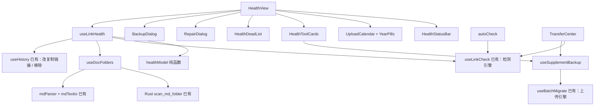
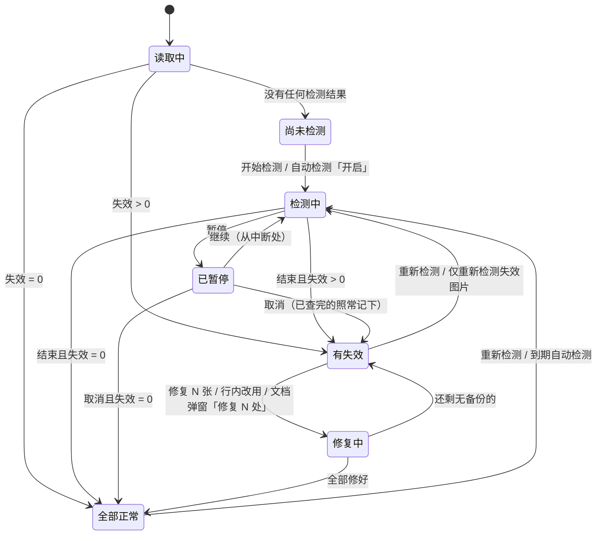
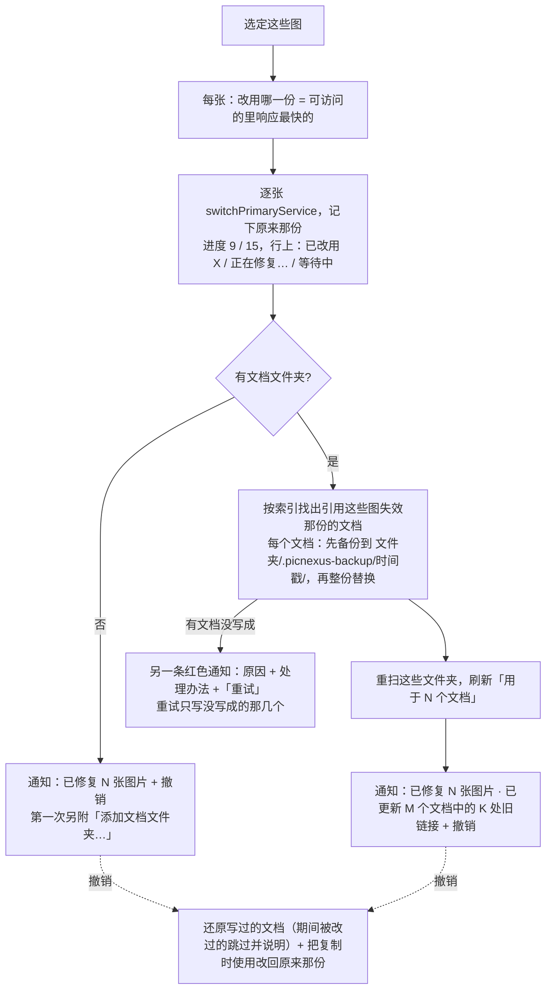
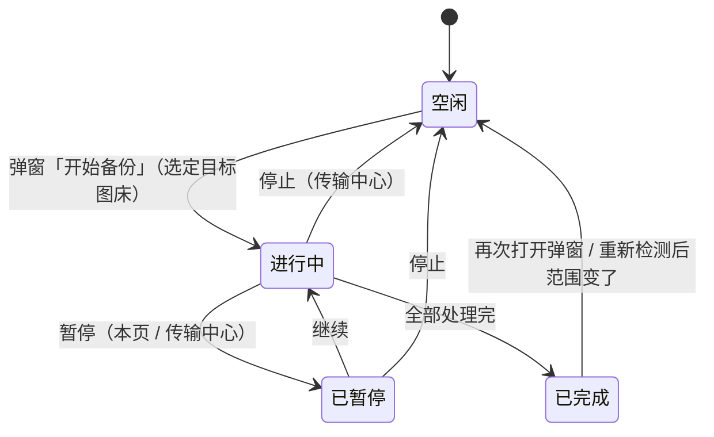

# 阶段 5 链接健康 · 实施方案

> 读者：维护者，以及做阶段 5 的 AI。依据：交接说明 8.3、13.4、第 15 节，画板 L01–L18 K04 K08（`HealthScreen.dc.html`）。做完后本文件并入 README 的「设计没画、开发时补的（链接健康）」，然后删除。

## 这一页要替用户回答的问题

有没有坏图 → 一键修好（连同已经写进文章里的旧链接）→ 以后少坏（补备份、定期自动检测）。

理想状态：打开页面就知道有几张坏、坏在哪年哪个图床；点一次「修复 N 张」，复制链接切到能用的备份，文档文件夹里的旧链接一起换掉，能撤销；仅 1 份的图一键补到第二个图床；之后每 7 天自动查一次。

## 做法（已定：按理想状态重写）

只留真正的「引擎」：检测（`useLinkCheck` + Rust 批量检测，含暂停 / 继续）、上传（`useBatchMigrate` 的执行部分）、文档扫描（Rust `scan_md_folder`）、链接替换（`mdParser.replaceImageLinks`）、UTF-8 读写保护（`mdTextIo`）；新写一层「健康模型」纯函数 + 文档文件夹模块 + 页面；旧页面和 `useMdRescue` 整套会话状态机删掉。预计新增约 3.0k 行、删除约 8–9k 行。文档写入与撤销重写时沿用旧代码踩过的坑（非 UTF-8 跳过、备份目录、并发上限、具体失败原因）并补测试。

不做「新页面套旧状态机」：旧 `useMdRescue` 是「选一个文件夹 → 扫描 → 逐条挑备份修」的一次性会话，与设计的「文档文件夹常驻、修复 = 改用备份 + 换文档旧链接、撤销两者一起还原」对不上，适配层绕且旧代码约一半服务于已去掉的功能。

## 架构骨架

### 模块

| 文件 | 一句话职责 |
|---|---|
| `src/views/health/HealthView.vue` | 页面编排：标题行、状态栏、日历、工具卡、失效清单、两个弹窗；只接线，不算数 |
| `src/views/health/HealthStatusBar.vue` | 状态栏五种状态（尚未检测 / 检测中 / 已暂停 / 有失效 / 修复中 / 全部正常）+「⋯」菜单 |
| `src/components/biz/UploadCalendar.vue` | 一年 7 × 53 的日历格子 + 悬停气泡 + 点选一天（只吃数据，不查库） |
| `src/components/biz/YearPills.vue` | 年份胶囊：最近 6 年平铺 +「更早 ▾」，琥珀数字 |
| `src/components/biz/ToolCard.vue` + 3 张插画 | 工具卡外壳（插画、标题 + 数量、说明、按钮 / 进度） |
| `src/views/health/HealthToolCards.vue` | 三张卡各自的文案与状态：文档修复、补充备份、找不回 / 自动检测 |
| `src/views/health/HealthDeadList.vue`、`HealthDeadRow.vue` | 全部失效图片：两组、筛选（原因 / 图床 / 年份 / 某一天）、行菜单、行内「改用 X / 重试 / 仍然失效」 |
| `src/views/health/RepairDialog.vue`、`BackupDialog.vue` | 文档修复弹窗、补充备份弹窗 |
| `src/views/health/healthModel.ts` | 纯函数：每张图的状态、原因（不存在 / 拒绝访问 / 连接超时 / 可能受限）、改用哪一份（可访问的里响应最快的）、两组、按天 / 按年的失效数、状态栏那句说明、「仅 1 份」 |
| `src/views/health/useLinkHealth.ts` | 页面状态（单例）：接 `useLinkCheck` 的检测 / 暂停 / 继续 / 取消 / 单条重检；「修复 N 张」与行内「改用」（改复制链接 + 换文档旧链接 + 一条带撤销的通知）；修复进度 |
| `src/views/health/docIndex.ts` | 纯函数：扫描结果 → 「链接 → 用在哪些文档哪一行」索引；每张图「用于 N 个文档」；某次修复要改哪些文档、各换哪几条 |
| `src/views/health/docFiles.ts` | 文档读写：先备份再替换、按备份还原（改过的跳过）、失败原因（被占用 / 没有写入权限 / 文件找不到了 / 非 UTF-8） |
| `src/views/health/useDocFolders.ts` | 文档文件夹：增删（记进配置）、申请访问权限、逐个扫描、持有索引 |
| `src/views/health/useSupplementBackup.ts` | 补充备份：范围固定「仅 1 份」，只选目标图床；暂停 / 继续；进度给工具卡与传输中心 |
| `src/views/health/autoCheck.ts` | 自动检测：应用运行时到期就在后台跑一次检测（启动时补跑过期的一次） |
| `src/shell/TransferCenter.vue`（已有） | 加「备份」「检测」两组 |

### 数据

```ts
/** 一张图在健康页里的样子（由 useLinkCheck 的行 + 上传时间推出来） */
interface HealthImage {
  id: string; name: string; uploadedAt: number;
  copyHost: string;                 // 「复制时使用」
  copies: HealthCopy[];             // 复制时使用的那份排第一
  state: 'unchecked' | 'ok' | 'limited' | 'fixable' | 'unfixable';
  reason?: 'gone' | 'denied' | 'timeout';   // 失效原因（筛选用）
  fixTo?: string;                   // 改用哪一份（可访问的里最近一次响应最快的）
}
interface HealthCopy { host: string; url: string; status: 'ok' | 'gone' | 'denied' | 'timeout' | 'limited' | 'unchecked'; latencyMs?: number }

/** 文档文件夹扫描结果：旧链接用在哪些文档的哪一行 */
type DocIndex = Map<string /* url */, { path: string; line: number }[]>;

/** 新配置字段（只加不改，有默认值，不迁移） */
linkHealth: { docFolders: string[]; autoCheck: { enabled: boolean; intervalDays: number } }  // 默认 [] / 开、7 天
```

- 「失效」= 复制时使用的那份 `gone / denied / timeout`；`limited` 单独计数、不算失效（交接说明 13.4）。现有的 `imageHealth.ts` 已有大部分判定，扩展它而不是另写。
- 上次检测时间：取全部检测结果里最新的一次，不另存。
- 日历每天的上传数：沿用图库按天汇总的查询；每天的失效数由内存里的模型算（检测中边查边点亮）。检测用的轻量行要补一个上传时间字段（`HistoryDatabase` 是高风险文件，补测试）。

### 依赖



## 会删掉的

- `src/components/views/LinkCheckView.vue`、`src/components/views/link-check/**`（约 6.2k 行）及其视觉测试与基准图。
- `useMdRescue` 的会话层（`useMdRescue`、`useMdRescueMru`、`useRepairStrategy`、`useMdLinkFilter`、`useFlatBrokenRows`、`rescueVerdict` 等，按最后实际引用清点）。
- 外壳里「链接健康页不接拖入」的过渡例外（`PAGES_WITH_OWN_DROP`），改回全局上传入口。

## 开发时自定的（全部阶段做完后统一请维护者过目）

- 「仅有 1 份」= 没被查出失效的副本只剩 1 份（尚未检测的当作可用）。与图库「状态 · 仅 1 份」筛选（按上传成功的份数）口径不同。
- 失效原因只分三种：图片已不存在 = 404 / 410；连接超时 = 超时、连不上、图床 5xx；拒绝访问 = 其余（401 / 403 / 429、被本机安全策略拦下、返回的不是图片等）。
- 状态栏说明里的「集中在…」：失效图片的上传年份写成「Y 年」或「Y1–Y2 年」（跨度超过 6 年不写年份）；某个图床占失效的八成以上才写「上传到 X」；两样都不成立就不写这一句。
- 自动检测默认开、每 7 天；从没检测过不自动开始，卡片「开启」= 立即开始第一次检测；关掉后卡片同样写「开启」（重新打开）。「更改」与状态栏「⋯ › 自动检测」是同一个子菜单：每天 / 每 3 天 / 每 7 天 / 每 30 天 / 关闭。
- 第一次修复时没有文档文件夹：成功通知照常带「撤销」，另起一条通知「文档中的旧链接未更新」+「添加文档文件夹…」（通知只能放一个按钮）。只出现一次，记在本机 localStorage。**待拍板**：交接说明 15 节写「在成功通知里附」，与第 4 节「改用备份通知带撤销」只能二选一放进同一条。
- 行内「改用 X」的通知：「已改用 X」+「已更新 N 个文档中的 M 处旧链接」（没有文档引用时写「复制的链接将来自 X」）+「撤销」。
- 清单行的备份说明：有可访问的备份写「X 有备份」；备份尚未检测写「备份尚未检测」；备份可能受限写「备份可能受限」；备份都失效写「备份也已失效」；只有一份写「无备份」。「用于 N 个文档」在没有文档文件夹时不写，有文件夹但没引用写「未被文档引用」。
- 按「可能受限」筛选时清单只有一组「可能受限 N 张」，行上没有按钮。
- 年份筛选选「与上方日历同步」后按钮写「年份 与日历同步」，跟着日历选中的年份走。
- 日历的年份胶囊：有上传的年份加上今年，从新到旧最多 6 个，其余进「更早 ▾」菜单（每项带失效张数）。默认年份只在第一次读完数据时按规则选，之后保留用户的选择。
- 日历键盘：整张日历只有一个 Tab 停留点，方向键按天 / 周移动，Enter 或空格筛到这一天，再按一次取消；悬停与聚焦都出气泡。
- 补充备份弹窗的图床：列「已添加」的图床（含停用的），按配置顺序，默认选第一个可选的；有警示的变淡不可选（Cookie 图床写「登录已过期，暂不可选」）。可用图床少于 2 个时卡片换成「添加图床」。
- 补充备份预计时间按每张 0.9 秒估（设计稿 1,206 张 ≈ 18 分钟），不足 1 分钟写「不到 1 分钟」；进行中的剩余时间按已用速度估。暂停时卡片写「已暂停 · 复制到 X」+「继续」；结束有失败时卡片写「已完成 · N 张未能备份」+「重试」（只重传失败的）。
- 「重新上传原图…」：选一张本地图片，传到这张图原来所在、现在仍可用的图床（都不可用时传到「上传到」勾选的图床），新链接替换失效的那几份并设为复制时使用，文档里的旧链接一并换掉；通知带撤销（记录与文档都还原）。
- 状态栏「⋯」里数量为 0 的项不出现（没有失效就没有「仅重新检测」「清理找不回的图片」）。「清理找不回的图片…」确认后移除这些记录，通知带「撤销」（原样放回）。
- 读取中状态栏只留位置不写字；检测引擎改成一次读完全部记录（原来先读有问题的再后台读其余）。
- 传输中心「备份」组有「暂停 / 停止」，「检测」组有「暂停 / 取消」（照 H14）；结束后进「已完成」：「补充备份到 X · N 张」「链接检测 · N 个链接」。
- 侧栏「链接健康」的琥珀点：复制时使用的那份失效的图片数 > 0（与图库「失效」筛选同一条 SQL），启动时与每次检测、修复后刷新。
- 自动检测只在应用开着时跑；到期时应用没开，下次启动补跑一次。
- 文档文件夹扫描在进入页面、增删文件夹、修复后各做一次，结果只放内存。

## 流程与状态机

### 页面状态（状态栏五种 + 读取中）



- 状态全由数据推出来（`healthModel` 纯函数），页面不另存「现在是哪种状态」：检测中 / 已暂停看 `useLinkCheck`，修复中看 `useLinkHealth.repair`，其余看失效张数与「有没有检测结果」。
- 检测中，清单与日历只算「这一轮查出来的」：在用那份属于这一轮、且检测时间早于这一轮开始的，先当作待查（L02「边查边出现」）；不在这一轮里的图（如「仅重新检测失效图片」）保持原样。
- 有失效但一张都修不了时，状态栏只给「重新检测」，说明写「均无可用备份」，本次会话修过的加「· N 张已修复」（L11）。

### 检测

1. 「开始检测 / 重新检测」= `checkAllHistoryLinks`；「仅重新检测 N 张失效图片」= `checkSubset({ historyIds })`。
2. 进度：`已查 / 本轮链接数 · 等待 X 响应 · 已发现 N 张失效`。X = 本轮还没查完的链接里最多的那个图床。
3. 暂停 / 继续 / 取消走现有的 `pause_batch_check / resume_batch_check / cancel_batch_check`；取消时已查完的结果照常落库（现有守卫不变）。
4. 单行「重试」/「重新检测这张」：这张图的每一份各查一次（`recheckSingle`，不占全局「检测中」）；在用那份结果没变就在按钮位置停 2 秒「仍然失效」，不弹通知；变了就按新结果归组。
5. 检测引擎读数据改成一次读完再交出去（去掉「先读有问题的、后台再读其余」两段式）：健康页的总数、日历、「仅 1 份」都要全量才对，半截数据会让「全部正常」闪一下。

### 修复（「修复 N 张」/ 行内「改用 X」/ 文档弹窗「修复 N 处」同一条路）



- 文档弹窗的「修复 N 处」：引用了失效链接、且这张图还有可访问副本的那几处，换成这张图修复后「复制时使用」的那份；在用那份本身失效、能修的图一并改用。
- 不弹确认；同一时间只跑一个修复（再点按钮置灰）。

### 撤销

- 撤销 = 文档逐个用备份还原 + 「复制时使用」改回原来那份；两件事各自做完，一件失败不拦另一件。
- 还原前比对：文档当前内容 ≠ 我们写进去的内容（修复后又被改过）→ 不还原，红色通知说明是哪个文档；备份留在 `.picnexus-backup/` 里。
- 撤销只对最近一次修复有效（通知消失即不能撤销，备份照旧保留，按「每个文件夹留最近 5 次」清理）。

### 补充备份



- 范围在点「开始备份」时定下（当时「仅有 1 份」的那些），目标图床上已有的跳过；每张走 `migrateOneItem`（下载好的那份 → 传到目标），同时 3 张。
- 暂停：没开始的不再取；正在下载的放回队首，继续时重来。进度是应用级状态：离开页面不影响，传输中心同步显示。
- 结束：全部成功 → 卡片「已完成」；有失败 → 一条红色通知写第一条原因 + 处理办法（与图库补充备份同一套说法）。成功的写库后广播一次，健康模型重读。

### 自动检测

- 开着、且距上次检测（全部检测结果里最新的时间）满 N 天 → 后台跑一次全量检测，不弹通知；查出失效只在侧栏「链接健康」上点琥珀点。
- 启动后 30 秒判一次，之后每小时判一次；正在检测 / 修复 / 补充备份时跳过这一次。
- 从没检测过不自动开始（第一次全量检测约十几分钟网络请求，由用户点）；卡片的「开启」在从没检测过时 = 立即开始第一次检测。

## 边界清单

| 情况 | 处理 |
|---|---|
| 没有任何图片 | 状态栏「尚未检测 · 共 0 张图片」，「开始检测」置灰；日历空格子；工具卡照常 |
| 读取中 | 状态栏只占位不写字，不出清单；不闪「全部正常」 |
| 检测中又点修复 / 补充备份 | 修复按钮在检测中不出现（状态栏换成检测进度）；行内「改用」照常可用（只用已有结果） |
| 修复中又开始检测 | 修复中状态栏没有检测按钮；自动检测跳过这一次 |
| 改用的那份在修复前一刻被别处删了 | 这一张记为失败，其余照常；通知如实写修好几张 |
| 文档非 UTF-8 | 不写、不备份，红色通知「编码不受支持（非 UTF-8），已跳过」 |
| 文档被占用 / 没有写入权限 / 找不到了 | 按错误归成这三种说法 + 处理办法；只重试这几个 |
| 文档修复后又被编辑过，再点撤销 | 不还原这一个，说明原因；其余照常还原 |
| 文档文件夹被删 / 改名 / 没权限 | 弹窗里这一行写「文件夹不存在」/「没有读取权限」，不影响其他文件夹 |
| 添加的文件夹已在列表里（或是其中某个的子文件夹） | 不重复添加，通知「已在文档文件夹中」 |
| 应用重启后读文档文件夹 | 每次扫描前重新申请访问权限（授权只活在本次进程内） |
| 同一张图同时在多个文档、同一文档多处引用 | 一次替换掉；「用于 N 个文档」按文档数，处数按出现次数 |
| 文档里不是 PicNexus 上传的图片 | 不检测、不计入、不替换 |
| 文档里写的是加了前缀的链接 | 原始链接、加前缀后的链接、剥掉已知前缀后的链接都能对上 |
| 备份目录 `.picnexus-backup` | 扫描时跳过（Rust 已做），写入时建在被修文档所在的文档文件夹下 |
| 补充备份只有 1 个可用图床 | 卡片「需要另一个图床，当前只有 1 个可用图床」+「添加图床」 |
| 补充备份的目标图床登录过期 | 弹窗里这一行变淡、不可选 |
| 补充备份中途目标图床失效 | 这几张记为失败，其余继续；结束时一条红色通知 |
| 补充备份中「仅 1 份」又变了（检测 / 修复） | 已开始的范围不变；目标图床上已有的照样跳过 |
| 年份很多（> 6 年） | 最近 6 年平铺，其余进「更早 ▾」菜单 |
| 这一年有 366 天、1 月 1 日是周日 | 日历画 54 列，不截掉 12 月 31 日 |
| 跨过午夜 / 跨年 | 每次显示页面与每个午夜重算「今天」与未来格 |
| 筛选后清单为空 | 写「没有符合条件的失效图片」，筛选按钮照常可改 |
| 失效几千张 | 每组先 3 / 2 行，「显示其余 N 张」每次多出 100 行 |
| 别处删掉 / 修好了某张 | 收到 history 事件后模型重算，行离开清单 |
| 800×600 | 日历 9px 格；工具卡去插画、按钮下移；清单去日期与文档两列、去筛选按钮；年份汇总隐藏 |

## 实现顺序

1. 数据：检测行带上传时间、一次读完；配置加 `linkHealth`。
2. `healthModel` 纯函数 + 单测。
3. 文档：索引与替换计划（纯函数）+ 读写备份还原 + 单测。
4. `useLinkHealth`（修复、撤销、重试）、`useSupplementBackup`、`autoCheck` + 单测。
5. 页面组件与路由。
6. 外壳：传输中心两组、侧栏琥珀点、命令面板「开始链接检测」直接开始、拖入改回全局。
7. 删旧页面与跟着没人用的代码；改 flows 与 API 文档。
8. 截图基准、审查、并入 README。
