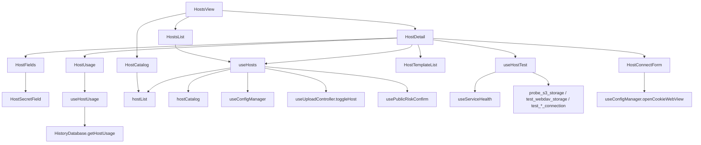
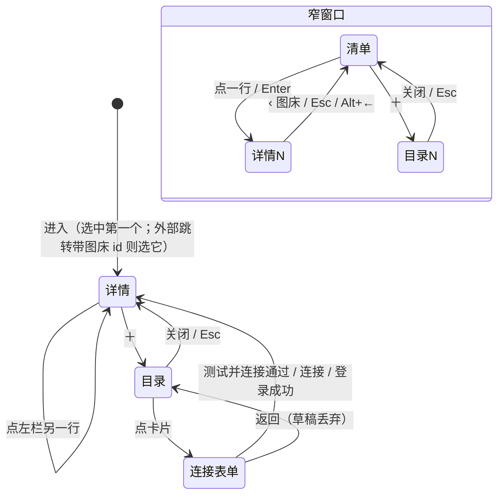
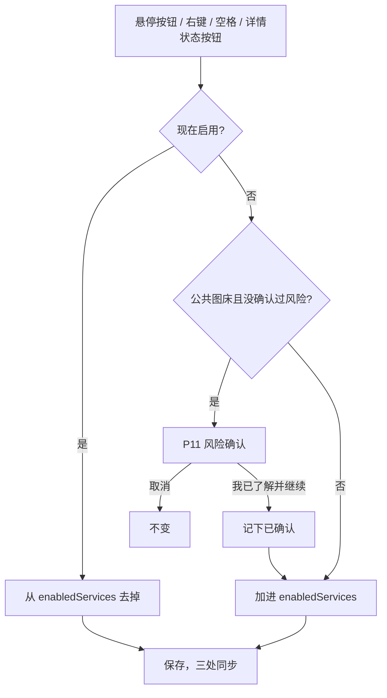
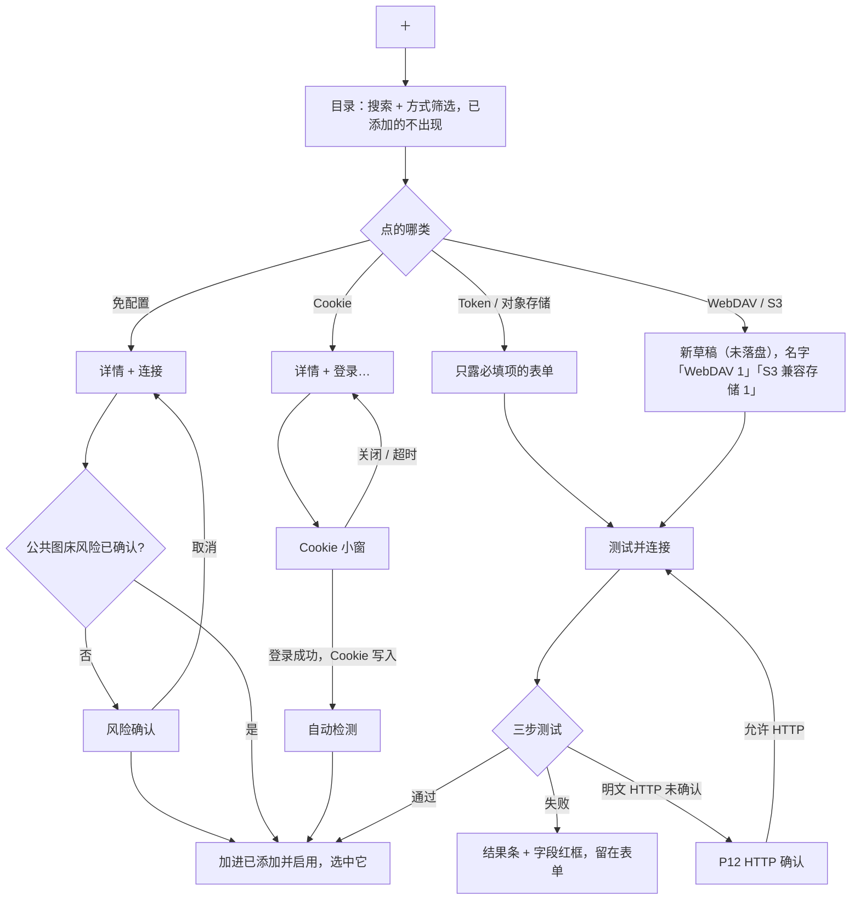
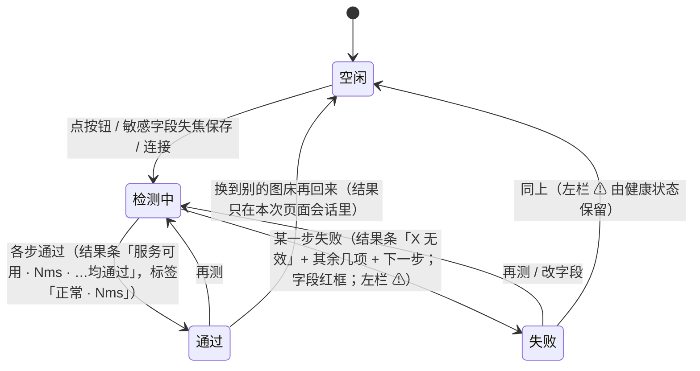
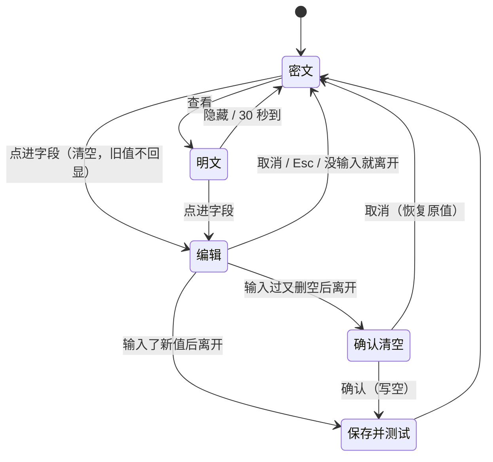
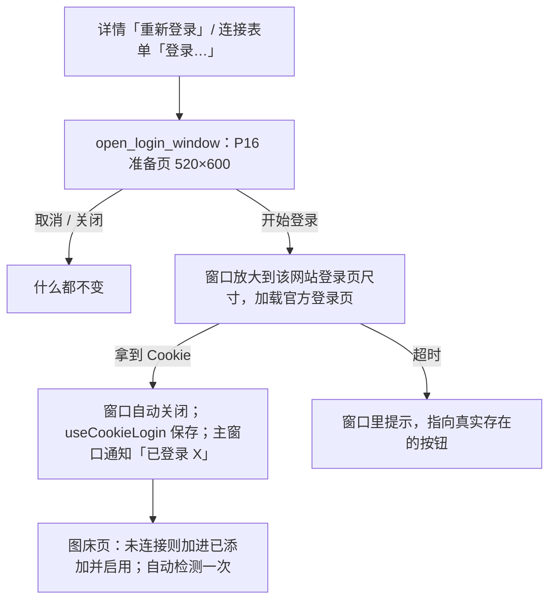

# 阶段 6 图床 · 实施方案

> 读者：实现这一页的 AI、做最后过目的维护者。阶段完成后，「开发时自定的」并入 README，本文件删除。
> 依据：HANDOFF 第 4、8.4、9、12、15 节；`HostsScreen.dc.html`（P01–P15、K09）、`CookieWindow.dc.html`（P16 = Cookie 登录窗准备页，STATES.md 第 133 行）。

## 1. 这一页替用户回答什么

1. **我的图床都还正常吗？** 左栏只列已添加的图床，出问题的排最前、第二行琥珀 ⚠ + 原因；正常时干干净净。
2. **哪几个在用？** 停用的整行变淡、写「已停用」；悬停一行浮出「启用 / 停用」，详情头部一个状态按钮。首页「上传到」、托盘、这里改的是同一份设置（`enabledServices`）。
3. **接一个新图床。** 「＋」→ 右侧换成目录 → 点卡片 → 连接表单 →「测试并连接」，通过才连上。
4. **偶尔改设置、查问题。** 详情：使用情况 → 设置 → 断开连接；「测试连接」原地依次测、结果条写清哪一项过了、失败指到具体字段。

理想状态：一页一个心智模型——「已添加 = 左栏」「启用 = 一个按钮」「设置改动即保存」；不再有设置页那种「勾选 + 卡片 + 批量检测」三套并存的界面。

## 2. 方案取舍

| 档 | 做法 | 改完后 | 结论 |
|---|---|---|---|
| 最小补丁 | 新页面外壳 + 复用 `useSettingsForm` / `useConnectionTest` / 旧 hosting 子组件换皮 | 旧表单状态机（整份 formData、防抖整存、PrimeVue）原样留着；三步测试、字段指错、密文新规则都塞不进去；设置页与图床页仍各握一份 formData 互相覆盖 | 不选 |
| 按理想状态重写 | `src/views/hosts/` 新建：图床描述表（一份数据驱动目录、表单、测试）+ 页面模型（直接读写配置，逐项即存）+ 三步测试；删掉设置里的整套 hosting 代码，`useSettingsForm` 不再写图床字段 | 新增约 14 个文件、删掉约 20 个；图床字段只有一个写入方；设置页不会再用旧值盖掉图床凭证 | **选这个** |

## 3. 架构骨架

### 3.1 模块（`src/views/hosts/`）

| 文件 | 一句话职责 |
|---|---|
| `hostCatalog.ts` | 图床描述表：每种图床的分类（免配置 / 登录 / Token / 对象存储 / 自建）、目录副标题、头部说明、表单字段（标签、配置键、必填、密文、帮助、跨列、等宽）、高级字段、测试按钮文案、测试覆盖哪几步 |
| `hostList.ts` | 纯函数：配置 + 健康状态 → 左栏行（已添加判定、排序「有问题 → 已启用 → 停用」、第二行文字）与目录分组（排除已添加、搜索、方式筛选） |
| `useHosts.ts` | 页面模型（单例、独立 effect scope）：读配置、逐项保存、启用 / 停用（走 `useUploadController.toggleHost`，风险确认同一处）、连接 / 断开（带撤销）、WebDAV / S3 多份的新建草稿、重命名、删除 |
| `useHostTest.ts` | 测试连接：按图床分派到后端，收成统一的 `HostTestState`（检测中 / 通过 + 耗时 + 过了哪几步 / 失败 + 哪一步 + 哪个字段 + 原因）；结果写回 `useServiceHealth`（左栏 ⚠ 的来源） |
| `useHostUsage.ts` | 使用情况：传到这里 N 张、最先完成 N 张、失效 N 张、近 14 天每天张数（`HistoryDatabase.getHostUsage`） |
| `HostsView.vue` | 页面：宽窗口双栏 / 窄窗口两级（清单 → 详情）、`Esc` / `Alt+←` 返回、接外部跳转（`settingsSection` = 选中某图床） |
| `HostsList.vue` | 左栏：标题「图床」+「＋」、行（图标 30 底板、名字、第二行）、悬停浮出「启用 / 停用」、右键菜单、`↑↓` 换行、空格切换 |
| `HostDetail.vue` | 详情：头部（48 图标块、名字 + 重命名 + 状态标签、说明、状态按钮、检测按钮）、结果条、使用情况、按类型的设置区、断开 / 删除 |
| `HostUsage.vue` | 三个数字 + 竖线 + 近 14 天总数 + 14 根柱子（底边对齐） |
| `HostFields.vue` | 两列表单网格（窄窗口单列）：普通字段失焦即存；`HTTP · 已允许` 标记；失败字段红框 + 红字原因 |
| `HostSecretField.vue` | 敏感字段：密文 →「查看」明文 30 秒自动收回 → 点进即清空等待粘贴、失焦保存并测试、「取消」恢复 |
| `HostTemplateList.vue` | 单选模板列表（微博链接前缀、GitHub 加速）：每项名称 + 模板 + 预览，添加 / 恢复默认 |
| `HostCatalog.vue` | 添加图床目录：标题 + 关闭、搜索、方式分段、按方式分组三列卡片、悬停「连接 ›」、底部 S3 提示 |
| `HostConnectForm.vue` | 未连接图床的连接区：Token / 对象存储 / 自建填表 +「测试并连接」；免配置「连接」；Cookie「登录…」+「手动粘贴」 |

改动的现有文件：`src/router.ts`（`/hosts` → `HostsView`）、`src/components/login/LoginPanel.vue` + `src/login-titlebar.ts`（P16 准备页）、`HistoryDatabase.ts`（加 `getHostUsage`）、`src-tauri` 的 S3 / WebDAV 测试命令（返回分步结果，见 3.4）。

### 3.2 数据

```ts
type HostKind = 'builtin' | 'cookie' | 'token' | 'object' | 'webdav' | 's3';
type TestStep = 'credentials' | 'write' | 'public';

interface HostField {
  key: string;            // 配置里的键（services.r2.accountId / profile.url）
  label: string;          // 逐字照设计稿：「Account ID」「存储桶」「公开访问域名」
  required?: boolean;     // Token 类标 *
  secret?: boolean;       // 走 HostSecretField
  mono?: boolean;
  span?: 2;               // 跨两列
  help?: string;
  advanced?: boolean;     // 收进「高级选项」
}

interface HostDescriptor {
  id: string;             // jd / weibo / r2 …；多份的是模板 id：webdav / s3
  kind: HostKind;
  catalogSub: string;     // 「AccessKey 与空间名」
  intro: string;          // 头部说明「对象存储 · S3 兼容」
  testLabel: '检测可用性' | '测试连接';
  steps: TestStep[];      // 这一种测试实际验到哪几步
  fields: HostField[];
}

interface HostRow {        // 左栏一行
  id: string; name: string; enabled: boolean;
  problem: string | null;  // 「登录失效」「凭证无效」；null = 正常
  sub: string;             // 问题原因 / 类型 / 「已停用」 / 「检测中…」
}

type HostTestState =
  | { phase: 'idle' }
  | { phase: 'testing' }
  | { phase: 'ok'; ms: number; steps: TestStep[] }
  | { phase: 'fail'; step: TestStep; field?: string; reason: string; advice: string; passed: TestStep[] };

interface HostUsage { uploaded: number; firstDone: number; dead: number; last14: number[] }
```

配置不迁移：已添加 = `availableServices` 里且免配置或已填凭证；启用 = `enabledServices`；微博前缀沿用 `linkPrefixConfig`（「不加前缀」= `enabled: false`）、GitHub 加速沿用 `github.cdnConfig`、R2 缩略图加速沿用 `r2.thumbnailProxyEnabled`、WebDAV / S3 多份沿用 `webdav_profiles` / `custom_s3_profiles`。

### 3.3 依赖



### 3.4 三步测试的后端

| 图床 | 凭证 | 写入 | 公开访问 | 做法 |
|---|---|---|---|---|
| R2 / 腾讯 / 阿里 / 七牛 / 自定义 S3 | 列桶 | 传探针图 | 匿名 GET 公开链接 | 新命令 `probe_s3_storage`（`storage_probe.rs`）：列桶 → 传探针 → 匿名 GET → 删除探针，失败带 `step` 与 `field`；只列桶的旧 `test_s3_connection` 删掉（SignatureDoesNotMatch → Secret、InvalidAccessKeyId → Access Key、NoSuchBucket → 存储桶、公开链接无法访问 → 公开访问域名） |
| 又拍云 | REST + S3 两套凭证 | — | — | 沿用 `test_upyun_connection`，只报凭证一步 |
| WebDAV | PROPFIND | PUT 探针 | 匿名 GET | `test_webdav_storage` 已是三步，补上 `step` / `field` |
| GitHub | 读仓库 + 有写权限 | 写入并删除测试文件 | — | 前端 GitHub API；公开访问不测（CDN 有缓存延迟，测了也不准） |
| SM.MS / Imgur | Token | — | — | 沿用现有请求 |
| Cookie 类 | 登录有效 | — | — | 沿用 `test_*_connection` |
| 京东 / 七鱼 | 可用性 | — | — | 沿用 `probeBuiltinServiceAvailability` |

## 4. 流程与状态

### 4.1 页面导航（宽 / 窄）



### 4.2 启用 / 停用



### 4.3 添加图床



### 4.4 测试连接



- 检测中：按钮原地「正在检测…」并禁用，左栏这一行第二行「检测中…」。
- 不弹通知（结果已在页面上）；只在离开这一页后才结束的测试也不弹。

### 4.5 敏感字段



### 4.6 Cookie 登录



### 4.7 两个确认弹窗

- **P11 公共图床风险**：第一次把公共图床（京东、七鱼、Cookie 类）设为启用 / 连接时，`usePublicRiskConfirm`（与首页、托盘同一处、同一个配置位）。
- **P12 明文 HTTP 域名**：测试或连接时公开访问域名 / WebDAV 地址是公网 `http://`（S3 系 `needsHttpDomainConsent`）或判不出是否局域网（WebDAV `lanHttpUnconfirmed`）时弹，代码框写这个地址；确认只对这一个地址生效（S3 记主机名、WebDAV 记 `lanHttpConfirmed`，换地址即作废，沿用现有规则）。

### 4.8 窄窗口两级

窗口宽 < 1000：侧栏收成图标栏（外壳已做）；清单占满主栏宽，顶部是「图床」「＋」和窗口按钮（P14）；点一行进详情，左上「‹ 图床」（P15），表单改单列，不横向滚动。

## 5. 边界清单

| 方向 | 场景 | 预期 | 处理 |
|---|---|---|---|
| 中断 | 测试进行中切到别的图床 / 离开页面 | 测试照常跑完，结果写进健康状态；回来时结果条按那次结果显示（同一会话） | 测试状态按图床 id 存在单例里 |
| 中断 | 敏感字段编辑中切图床 | 当作「没输入就离开」或「输入了新值后离开」 | 失焦先于路由切换触发 |
| 中断 | 连接表单填一半关掉目录 | 草稿丢弃，不落盘 | 草稿只在页面模型内存里 |
| 中断 | Cookie 小窗开着时主窗口关到托盘 | 登录照常完成并保存 | 保存在应用级 `useCookieLogin` |
| 空值 | 一个已添加的都没有 | 左栏只有标题和「＋」；右侧直接是目录 | `HostsView` 选不到行时显示目录 |
| 空值 | 详情图床被别处删了（托盘 / 云同步） | 选中项消失，退回第一行 | 监听配置变化重算 |
| 空值 | 图床没有任何上传 | 使用情况三个 0、14 根空柱（最低 3px 灰） | — |
| 异常 | 测试网络断 / 超时 | 失败在「凭证」一步，原因「无法连接 X，请检查网络后重试」 | 统一错误归类 |
| 异常 | 写入通过、公开访问 404 / 非图片 | 失败在「公开访问」，字段 = 公开访问域名 | 后端 step / field |
| 异常 | 断开最后一个图床（`availableServices` 只剩它） | 拦下，通知「至少需要启用一个图床」 | `saveConfig` 现有校验 |
| 并发 | 同一图床连点两次测试 | 第二次忽略 | 检测中按钮禁用 + 模型去重 |
| 并发 | 首页 / 托盘同时改启用 | 图床页跟着变 | `config-updated` 后重读 |
| 并发 | 失焦保存与测试先后到达 | 测试用保存后的值 | 先 await 保存再测 |
| 规模 | 0 / 1 / 20+ 个图床（多份 WebDAV） | 左栏自己滚动，详情独立滚动 | 两栏各自 overflow |
| 规模 | 14 天里某天几百张 | 柱高按最大值归一，最小 3px | 同设计稿算法 |
| 跨功能 | 断开图床后历史里它的链接 | 不受影响（「已传的图片和链接不受影响」） | 只动配置 |
| 跨功能 | 断开的图床正被「复制」固定 | 固定退回「最先完成」 | 断开时清掉 `copyFromService` |
| 跨功能 | 设置页还开着旧表单 | 不再写图床字段，不会盖掉新凭证 | `useSettingsForm` 去掉图床字段 |
| 跨功能 | 链接健康「添加图床」、首页「去图床页」、托盘带 section | 打开图床页（带 id 的选中它） | 外部跳转 |
| 状态机 | 未连接图床测试通过但没点连接 | 只是测试；「测试并连接」才连上 | 两个按钮分开 |
| 状态机 | 连接失败后改字段再试 | 失败字段红框在改动后清掉 | 字段 input 时清该字段错误 |

## 6. 会删掉的旧代码

- `/hosts` 对 `SettingsView` 的复用（`fixedTab`、`applyHostingTargetSection`、`targetCardId`）与 `meta.legacyTitle: '图床'`。
- `src/components/settings/HostingSettingsPanel.vue`、`HostingCard.vue`、`hosting/*`（9 个）、只被它们用的 `ServiceChipGrid.vue`、`ServiceSelectorDropdown.vue`、`CollapsibleSettingsCard.vue`（逐个 grep 确认没有别的使用者）。
- `src/composables/settings/` 里只服务图床的：`useConnectionTest.ts`、`useStorageProfiles.ts`、`useWebDAVProfileEditor.ts`、`useSensitiveDraft.ts`、`useSecretClearConfirm.ts`、`profileServiceSync.ts` 中图床部分（`syncProfileUploaders` 还被启动流程用的话留着）；`useServiceCheckRunner.ts`（批量检测随旧面板一起去掉）。
- `useSettingsForm` 里的图床字段（services.*、profiles、链接前缀、`availableServices`、`publicServiceRiskAccepted`）及其加载 / 保存 / 前缀增删；`settingsFormTypes` / `settingsFormSnapshot` 跟着收窄。
- 对应的旧单测与 `tests/visual` 里图床面板的截图（若有）。
- 文档：`docs/reference/api/` 里被删 composable 的条目、`docs/flows/settings-ui-architecture.md` 的图床部分。

## 7. 实现顺序

| 序 | 块 | 依赖 | 门禁 |
|---|---|---|---|
| 1 | `hostCatalog.ts` + `hostList.ts` + 单测（已添加判定、排序、目录分组 / 搜索 / 筛选） | — | 单测 |
| 2 | `getHostUsage` + `useHostUsage` + 单测（真 SQLite 夹具） | — | 单测 |
| 3 | 后端分步测试（S3 补写入 / 公开访问、WebDAV 带 step）+ cargo test | — | cargo check / test |
| 4 | `useHostTest` + `useHosts` + 单测（启用、连接、断开撤销、草稿、密文规则） | 1、3 | 单测 |
| 5 | 页面组件（列表、详情、表单、敏感字段、模板、目录、窄窗口）+ 路由切换 | 1–4 | lint / typecheck / e2e |
| 6 | P16 Cookie 准备页 | — | lint / typecheck |
| 7 | 删旧代码（SettingsView fixedTab、hosting 面板、useSettingsForm 图床字段） | 5 | 全部单测 |
| 8 | 截图基准 `tests/redesign/hosts.visual.spec.ts`（P01–P15、K09，两尺寸两主题） | 5 | 逐张看 |
| 9 | 审查子助手 → 补记 → 并入 README → 更新 flows / reference | 8 | — |

每块配合 `/triple-check`：初版 → 边界压测 → 规范审查（令牌、字号刻度、文案逐字、主按钮数）。

## 8. 开发时自定的（阶段完成后并入 README）

- 断开连接 = 从已添加、启用里去掉并清掉这个图床的凭证，不弹确认（按钮没有「…」），通知「已断开 X」带「撤销」（凭证与启用状态原样放回）；它若是「复制」固定的图床，固定退回「最先完成」。WebDAV / S3「删除这份…」同样带撤销。
- 连接 = 加进已添加**并启用**（刚接上就是要用它）；公共图床先过 P11。
- WebDAV / S3 新建的那份在「测试并连接」通过前只是页面里的草稿，关掉目录或换图床就丢弃，不留半成品配置。名字照仓库已有的规则「WebDAV 1」「S3 兼容存储 1」（现存最大序号 + 1），可点铅笔改。
- 敏感字段：点进去不输入就离开 = 取消；输入过又删空再离开 = 清空，先确认（「清空某个敏感字段需要确认」）。明文 30 秒收回（旧设置页是 15 秒）。
- 普通字段（已连接的图床）失焦且有改动即保存并自动测试一次，与敏感字段同一规则；未连接的图床只改草稿，「测试并连接」时才写入。
- 测试结果条只在本次页面会话里保留；左栏的 ⚠ 来自持久的健康状态（上传失败也会让它变琥珀）。测试进行中左栏第二行写「检测中…」（P06 说明如此；设计稿数据里第二行仍写类型）。
- 测试覆盖的步数按图床不同（3.4 表）；结果条：三步的写「服务可用 · Nms · 读取、写入、公开访问均通过」，只有一步的写「服务可用 · Nms · 凭证有效 / 登录有效」，京东 / 七鱼写「服务可用 · Nms」。GitHub 测「读取、写入」两步，公开访问不测（CDN 缓存延迟）。
- 失败结果条：标题「<字段名> 无效」（指不到字段时写原因本身），后面接已通过的几步（「凭证有效」「读取与写入均通过」）+ 处理办法（按这个图床表单上的叫法：WebDAV 写「请检查公开访问地址」）；字段下面红字写后端给的原因。不写设计稿的「其余各项均通过」：凭证这一步没过时，后面几步根本没测，说「都通过」不真实。
- 连不上存储服务：R2 的 TLS 握手被拒指到 Account ID（「Cloudflare 找不到这个 Account ID」）；DNS / 连接失败不指字段，写「无法连接存储服务，请检查网络后重试」；SDK 的原始错误只进日志。
- 「张最先完成」= 复制时使用的链接在这个图床上（`primary_service`）的张数；「张失效」= 复制时使用的那份在这个图床上、且被查出失效的张数（与图库「失效」、链接健康「图床」筛选同一口径），数字大于 0 时可点，跳到链接健康并按这个图床筛选。
- R2 的「高级选项」摘要写实际收起的字段（R2 只有「自定义路径」，没有「地域」这一项）；其他对象存储按各自的高级字段写。
- 设计稿没画的图床按最接近的画法：对象存储照 R2、Token 照 GitHub、Cookie 照微博、免配置照京东、自定义 S3 照 WebDAV（可多份、可重命名、可删除）；知乎的「让知乎图片正常显示」沿用现有开关 + 参数值。
- Cookie 字段旁「手动粘贴」= 把字段切成编辑态（同敏感字段），粘贴后失焦保存并检测。过期日期拿不到时只写「登录信息将自动填入」。
- Cookie 小窗：准备页 520×600（P16），点「开始登录」后窗口放大到该网站登录页需要的尺寸（官方登录页在 520 宽里排不下）；标题栏 40 高、侧栏底色，标题写「微博登录」。登录成功主窗口通知「已登录 微博」；60 秒超时通知「微博登录超时」，处理办法指向图床页的「重新登录」与「手动粘贴」。
- 左栏：指针在清单里时先不重排，离开清单再按「有问题 → 已启用 → 停用」排（真机走查：点「停用」后那一行立刻挪走，浮出的按钮落到另一个图床上，再点一下就停错了）。右键菜单只有「启用 / 停用」一项。
- 侧栏「图床」旁的琥珀点：已添加的图床有问题（登录失效等）时出现（HostsScreen.dc.html 侧栏画了，交接说明没写）。
- 「张失效」大于 0 时用琥珀色（交接说明第 4 节规则 5：失效是需要留意的状态）。
- 微博链接前缀右下角写实际支持的变量「{url} {path} {url_encoded}」（设计稿写的 {filename} 不支持）；GitHub「存储路径」帮助写「图片在仓库中的目录」（设计稿的 {yyyy} {mm} 变量上传器不支持），「分支」帮助写「默认 main」（留空不会自动用仓库默认分支）。
- GitHub 加速列表沿用现有数据（出厂只有 jsDelivr），「原始地址」= 不用 CDN，放在最后；「添加 CDN」填整条地址模板，自动拆成域名 + 模板。
- 「添加模板 / 添加 CDN」用弹窗填名称与模板；自己加的模板悬停可删，出厂的不可删。
- 搜索目录没有结果时写「没有符合条件的图床」。
- 编辑器服务（Typora / Obsidian / CLI）的图床凭证改由应用级同步从配置里取：启动时下发一次，之后每次配置变化重下发（以前只在打开设置页时下发；图床页改了凭证，编辑器跟着用新的）。

## 9. 待拍板

- 「张失效」的颜色：设计稿画的红色，交接说明第 4 节规则 5 说失效用琥珀色；现在照规则用琥珀。

- Cookie 小窗标题：`CookieWindow.dc.html` 标题栏写「微博登录」，交接说明 8.7 写「登录 微博」；现在照设计源文件。
- P01 说明开头写「左栏每个图床带状态点」，同一段后面与第 4 节规则 4 都说正常不打标记；照规则不画状态点。
