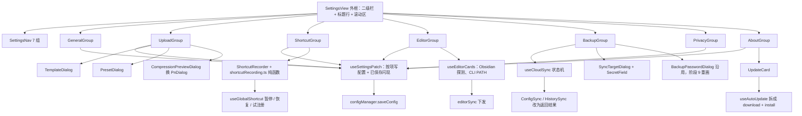
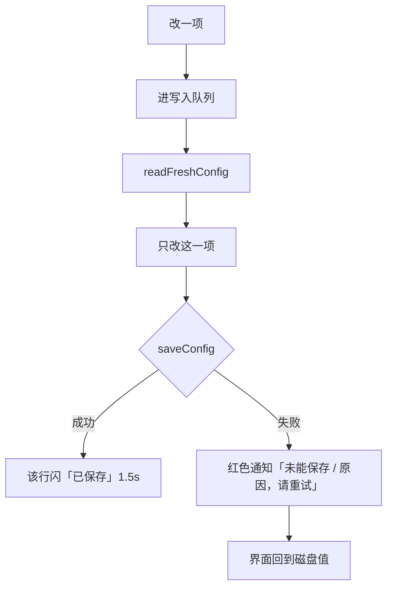
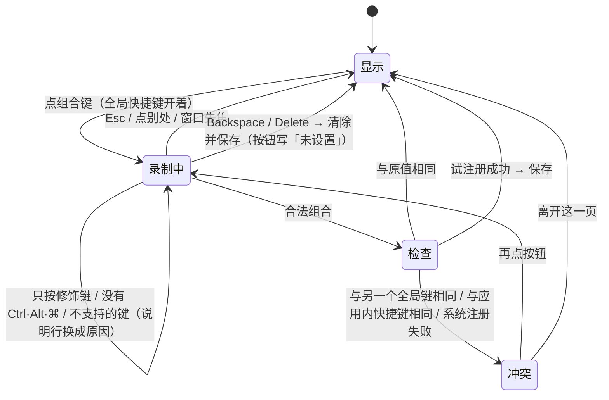
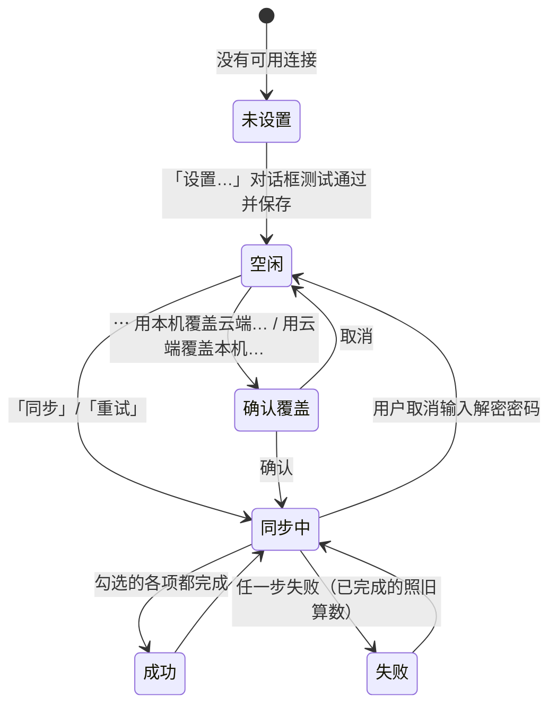
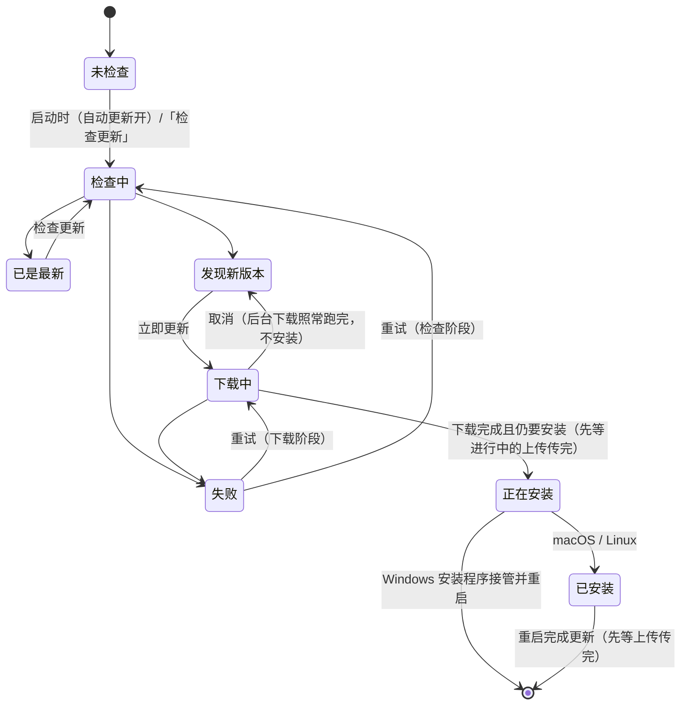

# 阶段 7 设置 · 实施方案

> 读者：实施这一阶段的 AI 与维护者。依据：HANDOFF 4 / 8.5 / 9 / 12 / 15 节、STATES S01–S21 K05 K10、`SettingsScreen.dc.html`。阶段做完后「开发时自定的」并进 README，本文件删除。

## 这一页替用户回答什么

1. 应用长什么样、怎么启动（通用）。
2. 上传完复制成什么、要不要压缩（上传与链接）。
3. 在别的程序里按什么键上传（快捷键）。
4. 在 Typora / Obsidian / 终端里怎么直接上传（编辑器与命令行）。
5. 现在安全吗？换电脑能恢复吗？（备份与同步）
6. 数据在哪、怎么清掉、怎么回到初始（数据与隐私）。
7. 我用的是哪个版本、有没有新版（关于）。

理想状态：每项改动即保存、只在改动处闪一下「已保存」；同步、更新的进度与结果都写在卡片里，不弹通知；危险操作单独成组、先确认；图床的东西一个都不出现。

## 两档方案

| | 最小补丁 | 按设计重写（选这档） |
|---|---|---|
| 做法 | 保留 4 个旧面板与 `useSettingsForm` 表单副本，换皮成 7 组，PrimeVue 控件逐个换成 Pn | 新建 `src/views/settings/`，每组一个组件；表单副本换成「按项写配置」（读最新配置 → 只改这一项 → 保存）；同步、更新各一个状态机 composable |
| 改完后的整体 | 旧面板 + 表单副本 + 防抖整份回写仍在；同步结果仍走通知，要在旧 composable 里加开关 | 一套组件、一个写配置入口；旧 `components/settings/**`（约 6,000 行）整块删除 |
| 代码量 | 改动约 3,000 行，删得少 | 新增约 3,500 行，删除约 7,000 行 |
| 效果 | 「整份表单防抖回写」仍可能用旧值盖掉别的窗口刚改的配置；结构与设计稿对不上，后续每改一处都要在两套概念间翻译 | 每次只写自己那一项，结构与设计稿一一对应，「从不写图床配置」由写入口统一保证 |

## 骨架

文件（`src/views/settings/`）：

| 文件 | 职责 |
|---|---|
| `SettingsView.vue` | 外框、当前分组、外部跳转（旧 tab 名映射到新分组）、高亮命令面板跳来的那一项 |
| `SettingsNav.vue` | 二级栏：「设置」标题 + 7 组，「关于」有新版本时一个品牌蓝小点 |
| `settingsGroups.ts` | 分组 id / 名称 / 说明 / 图标、旧 tab → 新分组、每一行的 id（命令面板用） |
| `SettingsSection.vue` / `SettingRow.vue` | 分组小标题 + 卡片 + 脚注；一行：名称、说明、「已保存」、右侧控件 |
| `useSettingsPatch.ts` | `patch(rowId, mutate)`：排队读最新配置、只改这一项、保存；成功闪「已保存」1.5 秒，失败红色通知「未能保存」并回到磁盘值 |
| `GeneralGroup.vue` | 外观三卡、首页背景装饰、启动三项 |
| `UploadGroup.vue` + `TemplateDialog.vue` + `PresetDialog.vue` | 默认复制为、自定义模板、自动复制、自动上传剪贴板、压缩方案 |
| `ShortcutGroup.vue` + `ShortcutRecorder.vue` + `shortcutRecording.ts` | 全局快捷键开关与录制、应用内快捷键表 |
| `EditorGroup.vue` + `EditorCard.vue` + `useEditorCards.ts` | Typora / Obsidian / 命令行三张卡 |
| `BackupGroup.vue` + `CloudSyncCard.vue` + `SyncTargetDialog.vue` + `useCloudSync.ts` + `backupFiles.ts` | 云同步、备份密码、手动备份、最近操作、刷新横幅 |
| `PrivacyGroup.vue` + `resetPreferences.ts` | 统计、数据位置、缓存、清空记录、恢复默认 |
| `AboutGroup.vue` + `UpdateCard.vue` + `WechatDialog.vue` | 版本、更新卡、自动更新、帮助与反馈 |

数据：新增字段只加不改、有默认值——`theme.homeDecor`（首页背景装饰，默认开）、`appBehavior.autoUploadClipboard`（默认关）、`webdav.syncItems`（`{ config, history }`，默认都开，本机设置不随云同步）、`ProfileSyncRecord.lastSyncAt`（毫秒时间戳，算「2 小时前」）、同步日志新操作 `password_set / password_change / password_disable`。

## 流程与状态机

### 写配置

带副作用的项先做副作用再写配置，副作用失败不写：开机自启（autostart 插件，写失败再回滚插件）、关闭到托盘（`set_close_to_tray`）、统计、编辑器下发、主题（`ThemeManager` 落盘改走同一入口）。文本类（模板、端口）失焦或回车才写。

### 快捷键录制（S03 / S08 / S09）

录制期间先注销全局快捷键（否则按到原组合键时系统直接触发上传，网页收不到按键），并在捕获阶段拦住应用内快捷键；结束后按配置重新注册。冲突不保存，配置保持原值。系统不告诉是谁占用，原因写「该组合键已被其他程序占用，请更换」。

### 云同步（S05 / S11–S15）

- 一个「同步」按钮依次同步勾选的「配置」「上传记录」，状态行写正在做哪一步；结果写在状态行，不弹通知。
- 状态行：未同步过「尚未同步」；空闲「已同步 · 2 小时前」；同步中「正在同步配置…」「正在同步上传记录…」；成功「已同步 · 上传 N 条 · 下载 M 条」（为 0 的一半不写；只有配置变了写「已同步 · 配置已更新」；都没变写「已是最新」）；失败「同步失败：原因 + 处理办法」红字，按钮变「重试」。
- 勾了「配置」而未设置备份密码：点「同步」打开设置备份密码对话框，不发请求（云端配置含图床密钥）。
- 下载过云端配置（合并或覆盖本机）后出现刷新横幅 S15，直到刷新；从文件导入配置后同一条横幅。
- 覆盖只作用于配置（S14 写明上传记录不受影响）；上传记录只有合并同步。

### 更新卡（S07 / S16–S21）

`useAutoUpdate` 的 `downloadAndInstall` 拆成 `download` + `install`：插件的下载不能中途停，「取消」= 不再安装，再点「立即更新」接着显示同一次下载的进度，下载完了直接安装。

## 边界清单

| 方向 | 场景 | 预期 | 处理 |
|---|---|---|---|
| 中断 | 录制中切页面 / 窗口失焦 | 退出录制，原值不变，全局快捷键恢复注册 | `onDeactivated` + `blur` 都收口到 `stopRecording()` |
| 中断 | 同步中离开设置页 | 同步照常跑完，回来看到结果 | 状态放模块级单例，不随组件卸载 |
| 中断 | 下载更新中离开页面 | 继续下载（S18 说明） | 同上 |
| 中断 | 重启更新时有上传在跑 | 等传完再重启 / 安装 | `waitUploadsIdle()` 看上传控制器的 `busy` |
| 空值 | 从没设置云同步 | 卡片写「未设置云同步」+「设置…」，不列同步内容 | `未设置` 状态 |
| 空值 | 没有最近操作 | 「最近操作」整组不显示 | — |
| 空值 | 快捷键被清除 | 按钮写「未设置」，不注册 | `registerShortcuts` 已跳过空值 |
| 空值 | 压缩方案只剩 1 个 | 编辑对话框里不给「删除方案」 | — |
| 空值 | 没有已添加的图床 | 编辑器「上传到」菜单只有「不使用」+「去图床页添加…」 | — |
| 异常 | 同步时坚果云 401 | 状态行「同步失败：坚果云拒绝访问，应用密码可能已失效」类说法（原因 + 处理） | `describeSyncFailure()` 把 `extractErrorCode` 的结果套成「原因，处理办法」 |
| 异常 | 云端配置文件 0 字节 / 格式坏 | 中止、不覆盖云端，状态行写原因 | 沿用 ConfigSync / HistorySync 现有中止逻辑 |
| 异常 | 解密密码输错 | 对话框计次重试；取消 = 整次同步回到空闲 | 沿用 `passwordRequest` |
| 异常 | 写配置失败 | 红色通知，开关弹回 | `useSettingsPatch` |
| 异常 | 开机自启插件失败 | 开关弹回、红色通知，不写配置 | 先插件后配置 |
| 异常 | Obsidian 端口被占 | 状态「端口 N 被占用，请更换端口」（琥珀 ⚠） | 进入分组时静默探测一次 |
| 异常 | CLI 平台不支持加入 PATH | 状态写原因，没有按钮，命令显示完整路径 | `get_cli_path_status.supported` |
| 并发 | 双击「同步」 | 第二下无效 | 按钮在同步中禁用 + 现有全局锁 |
| 并发 | 两项设置连着改 | 两次都落盘，互不覆盖 | 写入队列串行，每次读最新配置 |
| 并发 | 图床页 / 托盘同时改配置 | 设置页从不写图床字段、不拿旧副本回写 | 单测守卫：写入后图床字段与磁盘一致 |
| 并发 | 主题切换时别处刚改过配置 | 不回退别处的改动 | `ThemeManager.setTheme` 改为读最新配置只改 `theme`（先写复现测试） |
| 规模 | 上传记录 1 万条以上 | 「12,483 条」千分位；同步只报变化条数 | `toLocaleString('en-US')` 统一格式 |
| 规模 | 发布说明很长 | 只列前 6 条要点 | 按行截 |
| 跨功能 | 首页「复制为」与默认格式 | 同一个设置，两处同步变化 | 都读 `linkOutput.defaultFormat` |
| 跨功能 | 关掉全局快捷键 | 首页提示句消失（已有）、行变灰不可录 | — |
| 跨功能 | 命令面板跳到某一项 | 切到那一组，那一行滚到可见处并浅蓝高亮 1.5 秒 | `settingsTargetSection` 传行 id |
| 跨功能 | 旧入口（托盘、首页）带旧 tab 名 | 映射：`compression`/`advanced` → 上传与链接，`general` → 通用 | `settingsGroups.ts` |
| 跨功能 | 恢复默认设置 | 偏好回默认；图床、云同步连接、文档文件夹、上传记录保留；不重新弹引导 | `resetPreferences.ts` 白名单 |
| 状态机 | 冲突后不再操作 | 冲突提示一直在，离开页面清掉；配置一直是原值 | — |
| 状态机 | 更新「取消」后再点「立即更新」 | 接着显示同一次下载进度，不重复下载 | 见更新状态机 |

## 要删的旧代码

整块删除：`src/components/views/SettingsView.vue`、`src/components/settings/**`、`src/components/common/SensitiveField.vue`、`ReloadBanner.vue`、`InlineEmptyState.vue`（只被旧设置页用）、`src/styles/settings-shared.css`、`src/composables/settings/{useSettingsForm,settingsFormSnapshot,useSettingsActions,useSettingsReset,useCompressionPresets,useSensitiveDraft,useSecretClearConfirm,useWebDAVProfileEditor}.ts`（可复用的纯逻辑先搬进新文件），以及它们的单测。`HistorySync` / `ConfigSync` 里只为旧界面服务的强制上传 / 下载记录、菜单开关状态。`settingsFormTypes.ts` 只留 `SettingsFormShape`（editorSync 用）。删前逐个 grep 引用。

## 实施顺序（每块门禁全绿即提交，配合 /triple-check）

| 顺序 | 块 | 依赖 |
|---|---|---|
| 1 | `ThemeManager` 旧副本回写的复现测试与修复 | — |
| 2 | 外框、二级栏、`useSettingsPatch`、通用组；路由切到新页 | 1 |
| 3 | 上传与链接（含模板、压缩方案、压缩预览换 PnDialog） | 2 |
| 4 | 快捷键（录制、冲突、暂停全局快捷键） | 2 |
| 5 | 编辑器与命令行 | 2 |
| 6 | 备份与同步（同步状态机、对话框、导入导出） | 2 |
| 7 | 数据与隐私（含 `open_user_data_dir` 命令） | 2 |
| 8 | 关于与更新卡 | 2 |
| 9 | 自动上传剪贴板（后台监听） | 3 |
| 10 | 删旧代码、命令面板设置项、文档 | 2–9 |
| 11 | 真机走查、视觉基准、审查、收尾 | 10 |

## 开发时自定的

（实施中逐条补；阶段结束并进 README「设计没画、开发时补的（设置）」）

- 敏感字段统一用图床页那套（看 30 秒、点进即清空等粘贴），从 `views/hosts/HostSecretField.vue` 挪到 `components/biz/SecretField.vue` 两页共用；设置页只有云同步密码一处用到。旧的 `SensitiveField` + `useSensitiveDraft`（15 秒）删除。
- 正常状态不打标记：同步状态、编辑器卡、最近操作照第 4 节规则不画绿点（设计稿画了，见待拍板）。
- 云同步没设置时卡片写「未设置云同步」+「设置…」；「更换同步方式…」与「设置…」打开同一个对话框（地址、用户名、密码、远程目录，「测试并保存」）。已存多份连接时对话框顶部可切换；「停用云同步」只清掉当前选中，连接本身留着。
- 编辑器卡：Typora 不放「打开 Typora」（拿不到 Typora 的安装位置）；命令行没有「上传到」菜单，改写「在命令中用 --service 指定」（命令行不带 `--service` 会报错，没有「跟随首页」）；Obsidian 端口在卡片底行可改。

## 待拍板

（实施中逐条补；阶段结束编号接 TODO ⑫ 起）

- 设计稿在同步状态、编辑器卡状态、最近操作画了绿点，与第 4 节「正常状态不打标记」冲突；现在照规则不画。
- 「更换同步方式…」说明写「WebDAV、S3、本地文件夹」，现在只支持 WebDAV（新增两种同步方式属于扩大功能），说明只写「WebDAV」。
- 编辑器「上传到」设计稿写「跟随首页设置」「京东、Cloudflare R2」（多选），现在每个编辑器只能选一个图床（Rust 侧上传只认一个）。
- 「自动更新」说明「在后台下载新版本，下次启动时安装」做不到（插件下载的安装包不跨重启保留），现在写实际行为「启动时自动检查新版本」。
