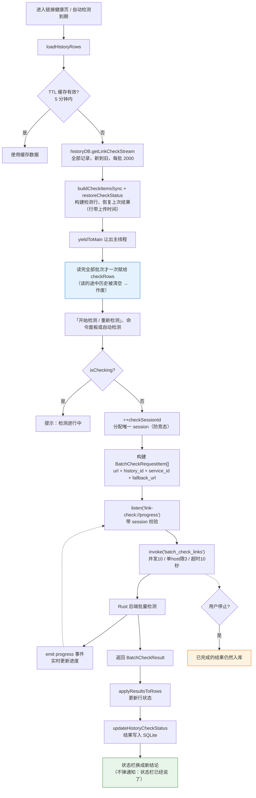
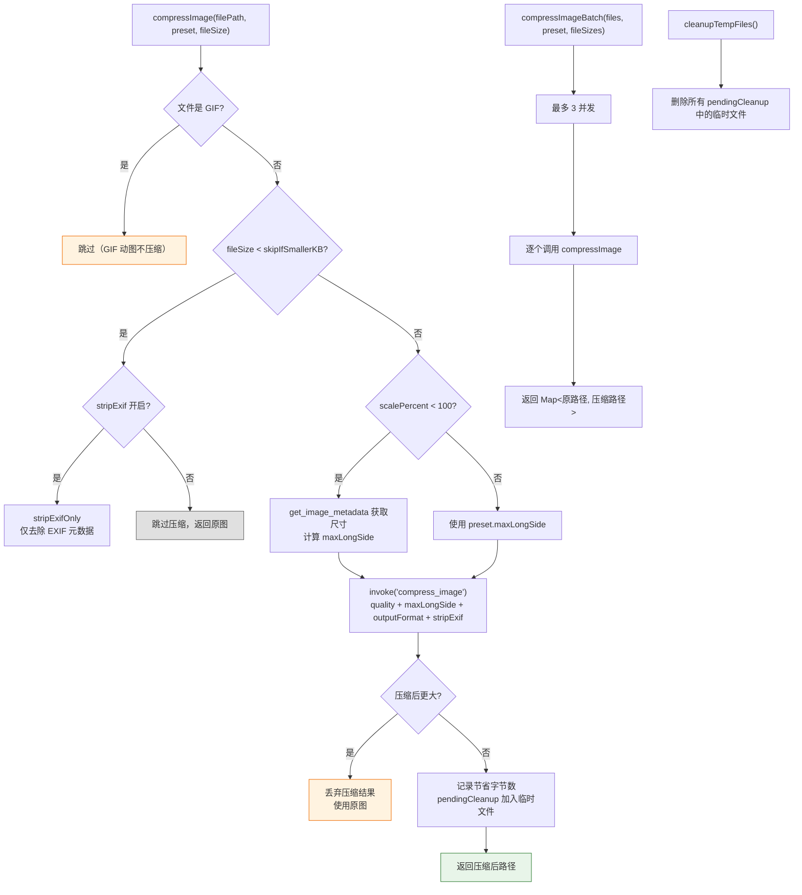

# 辅助功能流程

> WebDAV 同步、链接检测、图片压缩、备份恢复的数据流图解。

---

## 图 10：WebDAV 同步流程

云同步（设置 › 备份与同步的「同步」与「⋯」里的两个覆盖操作）完整流程见 [sync-flow.md](./sync-flow.md)。

> **关键源文件**：`src/views/settings/useCloudSync.ts`（状态机）、`src/composables/backup-sync/ConfigSync.ts`（配置）、`HistorySync.ts`（上传记录）、`backupSyncUtils.ts`（建连、远程路径、中止判定）

---

## 图 11：链接检测流程

展示读取与批量检测的完整路径。排查**检测卡住**或**结果不准**时查看。
> 深度展开（服务感知请求、并发控制、健康模型、链接健康页的状态）见 [链接检测流程](./link-check-flow.md)。

> **关键源文件**：`src/composables/link-check/useLinkCheck.ts`、`src/composables/link-check/linkCheckDataBuilder.ts`

---

## 图 12：图片压缩预处理流程

展示上传前的图片压缩决策逻辑。排查**压缩不生效**或**输出文件异常**时查看。

> **关键源文件**：`src/composables/image/useImageCompress.ts`

### 压缩预设参数说明

| 参数 | 说明 | 默认值 |
|------|------|--------|
| quality | 压缩质量（1-100） | 80 |
| maxLongSide | 最长边像素上限 | 0（不限） |
| scalePercent | 缩放百分比 | 100（不缩放） |
| outputFormat | 输出格式 | 保持原格式 |
| stripExif | 去除 EXIF 元数据 | false |
| skipIfSmallerKB | 小于此值跳过压缩 | 0（不跳过） |

压缩命令会在解码前解析图片头并执行 5000 万像素预检；图片头无法解析时直接拒绝。WebP 输出额外限制单边不超过 16383 像素，编码器错误会作为可读错误返回，不会触发内部 panic。

各上传命令会在读取文件内容前检查 metadata 大小。已有服务限制保持不变（5–200MB）；牛客、纳米、七鱼、知乎和 S3 兼容上传统一使用 50MB 上限，避免超限或稀疏文件先触发大块内存分配。

---

## 图 13：手动备份（导出 / 导入文件）

设置 › 备份与同步 ›「手动备份」三行。导出结果用通知说（本机操作），每次导出 / 导入都记一条「最近操作」。

> **关键源文件**：`src/composables/backup-sync/backupFiles.ts`、`src/views/settings/BackupGroup.vue`

```mermaid
flowchart TD
    subgraph 导出配置
        EC1[点「导出配置…」] --> EC2{设了备份密码?}
        EC2 -- 否 --> EC3[S10「先设置备份密码？」]
        EC3 -- 直接导出 --> EC5
        EC3 -- 先设置密码 --> EC4[设好密码] --> EC5
        EC2 -- 是 --> EC5[exportConfigFile<br/>有密码就 secureStorage.encrypt]
        EC5 --> EC6[系统保存对话框 → 写文件<br/>通知 + 最近操作写保存路径]
    end

    subgraph 导出上传记录
        EH1[点「导出上传记录…」] --> EH2{有记录?}
        EH2 -- 否 --> EH3[「还没有上传记录」]
        EH2 -- 是 --> EH4[exportHistoryFile<br/>明文 JSON 数组]
    end

    subgraph 从文件导入
        I1[点「从文件导入…」] --> I2[pickBackupFile<br/>系统打开对话框]
        I2 --> I3{加密的?}
        I3 -- 是 --> I4[先用本机密钥解<br/>解不开弹「输入备份密码」]
        I3 -- 否 --> I5
        I4 --> I5{认出是什么?}
        I5 -- 对象 = 配置 --> I6[确认「导入配置？」<br/>替换本机配置，无法撤销]
        I6 -- 确认 --> I7[importConfig<br/>mergeCloudConfig 留本机同步连接与文档文件夹]
        I7 --> I8[刷新横幅「配置已导入，刷新后生效。」]
        I5 -- 数组 = 上传记录 --> I9[importHistory 合并<br/>已有的不删]
        I9 --> I10[通知「已导入 N 条上传记录」]
        I5 -- 都不是 --> I11[「无法识别这个文件，请选择 PicNexus 导出的配置或上传记录」]
    end

    style EC6 fill:#e8f5e9,stroke:#2e7d32
    style I8 fill:#e8f5e9,stroke:#2e7d32
    style I10 fill:#e8f5e9,stroke:#2e7d32
    style I11 fill:#ffebee,stroke:#c62828
```

---

## 排查指南

| 现象 | 可能原因 | 对照图表位置 |
|------|---------|-------------|
| 云同步失败 | 见 [sync-flow.md](./sync-flow.md) 排查指南 | 图10 |
| 导入配置后同步连接变了 | `mergeCloudConfig` 没保留本机 `webdav` | 图13 I7 |
| 链接检测进度不更新 | Rust 后端未 emit progress 事件 / session 不匹配 | 图11 节点 Q → T |
| 检测取消后数据丢失 | 正常现象：已完成的结果会入库 | 图11 CANCEL 分支 |
| 压缩后文件反而更大 | 原图已高度压缩，回退使用原图 | 图12 节点 I → I1 |
| 小图片未被压缩 | skipIfSmallerKB 阈值跳过了小文件 | 图12 节点 C |
| GIF 上传后不动了 | 压缩跳过 GIF，但图床可能不支持 | 图12 节点 B → B1 |
| 导入备份提示密码 | 备份文件用别的备份密码加密（来自其他设备，或本机换过密码） | 图13 I4 |

---

## 相关文档

- [同步流程](./sync-flow.md) — 云同步的完整流程与排查
- [链接检测性能优化](../reference/patterns/link-check-large-dataset.md) — 5 万条记录场景的优化方案
- [同步流程](./sync-flow.md) — WebDAV 配置/历史同步的完整流程
- [链接检测流程（深度展开）](./link-check-flow.md) — 服务感知请求、并发控制、动画状态机
- [文档修复流程](./md-rescue-flow.md) — MD 文件失效图片链接的自动检测与修复
- [批量迁移流程](./batch-migrate-flow.md) — 跨图床批量迁移图片
