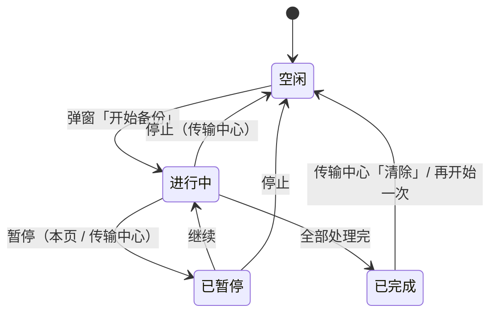
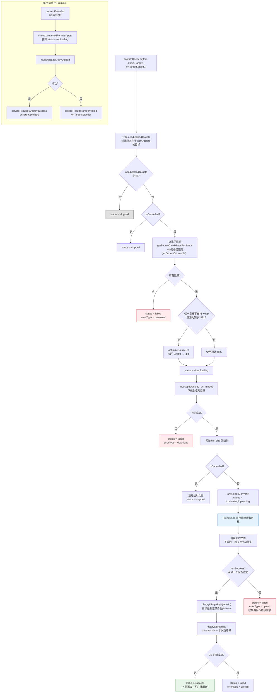

# 补充备份流程

> 链接健康的「补充备份」（交接说明第 4 节规则 8）：范围固定为「仅有 1 份的图片」，只选目标图床；在后台进行，进度显示在本页工具卡和传输中心。
> 图库详情 / 多选的补充备份走同一条单图管线（图 2）。文件名沿用 `batch-migrate`。
> 排查「备份没开始 / 卡住」「备份完还是只有 1 份」「格式不兼容」时查看此文档。

---

## 图 1：一次补充备份

> **关键源文件**：`src/views/health/useSupplementBackup.ts`（应用级状态、并发、暂停 / 继续 / 停止）、`src/views/health/BackupDialog.vue`、`src/views/health/HealthToolCards.vue`、`src/shell/TransferCenter.vue`

- **范围**：点「开始备份」这一刻定下——「仅有 1 份」（没被查出失效的副本只剩 1 份，尚未检测的当作可用）、且那 1 份不在目标图床上的图。范围由健康模型算（`healthModel.ts` 的 `singleCopy`），不是数据库里的上传成功份数。
- **目标图床**：弹窗列「已添加」的图床，按配置顺序；默认选能复制过去最多张的那个可选图床；有警示的（登录过期等）变淡不可选。可用图床少于 2 个时卡片换成「添加图床」。
- **执行**：3 个 worker 从队列取图，每张 `historyDB.getById` 取最新记录后走 `migrateOneItem`（图 2），只从没被查出失效的那几份下载（`getBackupSourceIds`：检测过、没通过、也不是「可能受限」的不试；图库的单图补充备份同样）。暂停时 worker 停在取下一张之前；正在下载的那张被退回 `pending`，放回队首，继续时重来。停止 = 置取消标志，没开始的不再做，已备份的留着。
- **刷新**：成功的每 20 张广播一次 `history-updated`（`notifyMigrationPersisted`），结束前把最后一批广播完；页面在结束时强制重读检测行，「仅 1 份」跟着变。
- **结束**：有失败 → 一条红色通知写第一条原因 + 处理办法（`describeUploadFailure`），卡片「已完成 · N 张未能备份」+「重试」（只重传失败的）；全部成功且已没有「仅 1 份」的图 → 「已完成 · 每张图片至少保存在 2 个图床」。

## 图 2：单图迁移管线（并行上传版）

展示 `migrateOneItem` 中单张图片从下载到**多目标并行上传**的完整管线，包含格式转换逻辑。

> **关键源文件**：`src/composables/batch-migrate/migrateCore.ts`（`migrateOneItem`、`optimizeSourceUrl`、`convertIfNeeded`）
>
> **status 取值**：`pending | downloading | converting | uploading | success | failed | skipped`。并行上传后，`status` 在"当前阶段聚合值"语义下工作：
> - 有任一目标还在转换 → `converting`
> - 任一目标已进入上传（或无需转换） → `uploading`
> - 所有目标落定 → 终态（hasSuccess ? success : failed）
>
> `convertedFormat` 字段：只要任一目标真触发了 `compress_image`，就写入 `'jpeg'`，UI 用它区分「已转 JPEG」与「格式兼容」。`sourceUrl` 在下载入口处填充。
>
> **并行上传关键点**：
> - 所有目标通过 `Promise.all` 同时发起（内部 try/catch，Promise.all 不会因单目标失败而 reject）
> - 每个目标完成后**立即写 `status.serviceResults[targetId]`**，然后调用 `onTargetSettled` 回调（可选）
> - 若至少一个目标成功、另有目标失败，条目保持 `success`，失败的目标写进 `failureDetails`
> - 取消（`isCancelled=true`）不会打断已发起的并行上传；只影响下一张图不被取出
> - 图片级并发由调用方掌握：链接健康的补充备份同时 3 张（`useSupplementBackup` 的 `CONCURRENCY`），图库按 `UPLOAD_CONCURRENCY`
>
> **落库不变量（2026-08-13）**：`historyDB.update` 前必须 `historyDB.getById` 重读一次，用最新记录当合并 base。传进来的 `item` 是 chunk 开头（大批量下可能几分钟前）取的快照——直接拿它当 base 会把这期间用户在灯箱删掉的镜像整个写回去、"复活"。重读把读-改-写窗口从**分钟级缩到毫秒级**；`linkCheckSummary` 的累加同样以重读值为准。记录已被删除（`getById` 返回 `null`）时退回旧快照，由 `historyDB.update` 抛「记录不存在」走失败分支。
>
> 彻底消除竞态需要 DB 层原子合并 `results`，成本不成比例，列在 `docs/audits/fix-plan-2026-08-13.md` 的暂缓清单。

### 格式兼容性表

| 场景 | 检测方法 | 处理 | 行上的终态 |
|------|---------|------|--------------|
| 知乎 webp → 不支持 webp 的目标 | `needsFormatConversion(targetId, 'webp')` | URL 改后缀 `.webp` → `.jpg`（知乎原生支持），下载后 ext='jpg' | **已完成**（URL 优化已生效，未调 `compress_image`，`convertedFormat` 未写入） |
| 下载文件格式不被目标支持 | `needsFormatConversion(targetId, ext)` 在循环内按 target 探测 | `status='converting'` → `compress_image` 转 jpeg（quality=92）→ `convertedFormat='jpeg'` → `status='uploading'` | **已转 JPEG**（由 `convertedFormat` 字段驱动） |
| 目标图床无格式白名单（对象存储类） | `needsFormatConversion` 返回 false | 直接上传原文件 | **已完成** |

> 公共图床（有白名单）：京东、牛客、B 站、知乎、超星、SM.MS、Imgur、奇遇；对象存储（无限制）：R2、腾讯云、阿里云、七牛、又拍、GitHub、微博、纳米。详见 `src/constants/serviceFormats.ts`。

> 转换失败统一归 `errorType='upload'`，不引入独立的 `convert`。

## 排查指南

| 现象 | 可能原因 | 对照位置 |
|------|---------|---------|
| 卡片写「需要另一个图床」 | 可用（已添加、无警示）的图床少于 2 个 | 图 1 目标图床 |
| 备份完卡片还写「N 张」 | 这 N 张的那 1 份就在刚才的目标图床上（被跳过）；换个目标再备份一次 | 图 1 范围 |
| 点「暂停」后进度还涨了几张 | 已经在上传的不打断；暂停只拦住还没开始下载的 | 图 1 执行 |
| 暂停后某张又下载了一遍 | 设计行为：下载到一半被暂停的那张退回队首，继续时重来 | 图 1 执行 |
| webp 图片上传失败 | 目标图床不支持 webp 且格式转换失败 | 图 2 `convertIfNeeded` |
| 知乎图片备份后变模糊 | webp→jpg URL 优化生效但原图质量已低 | 图 2 知乎 URL 优化 |
| 备份完历史里看不到新链接 | 落库后没广播 `history-updated`，或 `historyDB.update` 失败（`errorType='upload'`） | 图 1 刷新 / 图 2 DB 更新失败分支 |
| 备份完被删的镜像又出现 | 落库前没重读最新记录，用了陈旧快照当合并 base | 图 2 落库不变量 |
| 失败通知的原因是英文 | 原始错误没命中 `MIGRATE_ERROR_PATTERNS`，保留原文 | `src/utils/uploadFailureMessage.ts` |

---

## 相关文档

- [上传流程](./upload-flow.md) — MultiServiceUploader 上传机制
- [链接检测流程](./link-check-flow.md) — 健康模型与「仅有 1 份」
- [文档修复流程](./md-rescue-flow.md) — 同一页的另一个工具
