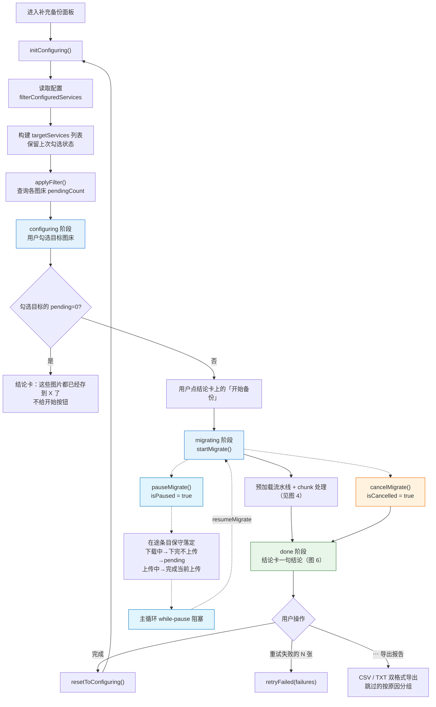
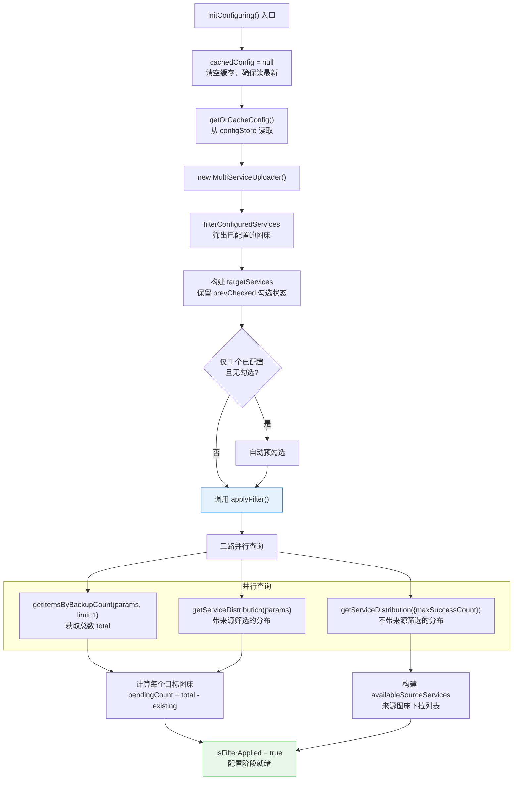
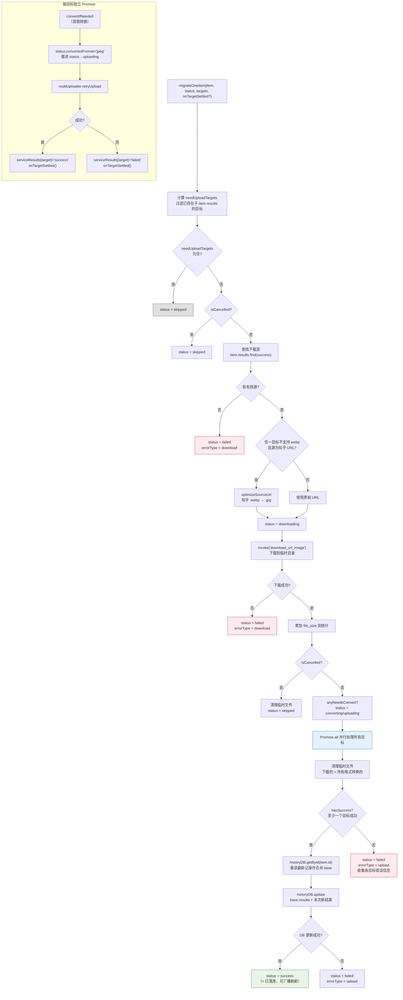
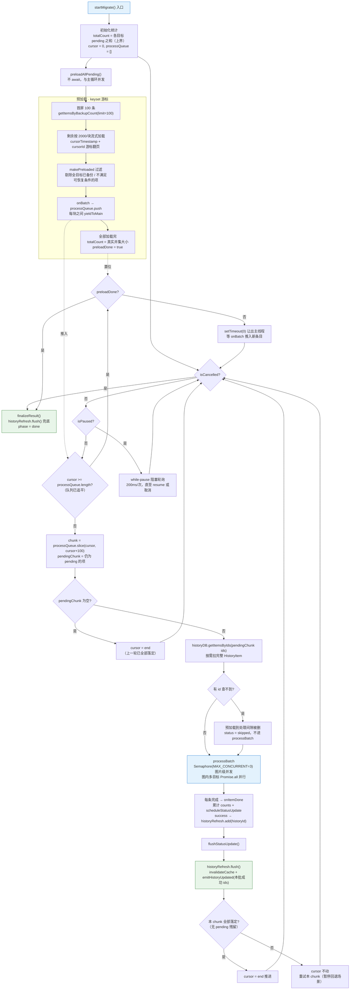
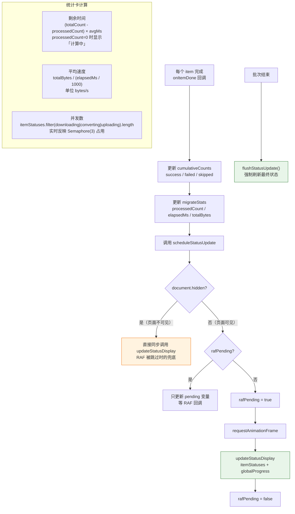

# 补充备份流程（批量迁移）

> 把图片复制到另一个图床多存一份，原来的不动（界面叫「补充备份」，代码沿用 migrate 词源）。选择目标 → 筛选范围 → 下载 + 上传 → 更新历史记录 → 广播刷新。
> 排查「迁移速度慢」「格式转换失败」「重复迁移」「迁移完其它视图不刷新」「被删的镜像又出现」时查看此文档。

---

## 图 1：四阶段总览

展示从 configuring 到 done 的整体流程，以及各阶段间的状态转移。

> **关键源文件**：`src/types/batchMigrate.ts`（`MigratePhase`）、`src/composables/batch-migrate/useBatchMigrate.ts`（`useBatchMigrateManager`）
>
> **UI 组装**：三个阶段顶部都是同一张结论卡（`common/SummaryCard.vue`），文案与按钮由 `composables/batch-migrate/migrateVerdict.ts` 的纯函数决定：
> - **configuring**（`MigrateSelectPhase.vue`）：卡片说要做什么（「把 286 张图复制到 Cloudflare R2 · 原来的图片不动 · 大约 10 分钟」）+「开始备份」；没选目标 / 来源全取消 / 数字重算中时按钮灰着并在悬停提示里说原因。下面是「备份到哪里」的目标卡片（`TargetCard`）和默认收起的「更多选项」（`MigrateOptions`）。
> - **migrating / done**（同一个 `MigrateProgressPhase.vue`）：卡片报进度、成败与剩余时间（暂停 / 停止），完成后一句结论 + 这一刻该点的按钮（有失败先「重试失败的 N 张」，否则「完成」）；导出报告在卡片的「⋯」。下面「全部 / 失败」二选一 + 搜索，一张图一行（`MigrateItemRow`），进入完成态时有失败自动停在「失败」。
> - **行**：缩略图 + 文件名 + 一句白话状态（等待中 / 上传中… / 已复制到 X / 没成功 · 原因 / 目标图床上本来就有 / 没来得及处理），右侧 `existing` 徽章（迁移前已在的图床）→ `target` 徽章（本次目标，按 `serviceResults` 着色：success 绿 / failed 红 / 未写入或 pending 蓝；迁移前已在的目标不重复显示，在对应 existing 徽章上加「你选了它但已在」角标）。完成态失败行带「重试」。

---

## 图 2：配置与筛选阶段

展示 `initConfiguring` 和 `applyFilter` 中双重分布查询的逻辑。解答「pendingCount 怎么算」。

> **关键源文件**：`src/composables/batch-migrate/useBatchMigrate.ts`（`initConfiguring`、`applyFilter`）

### 双重分布查询说明

| 查询 | 参数 | 用途 |
|------|------|------|
| 带来源筛选 | `maxSuccessCount` + `hasServiceId` + `timestampAfter` | 计算满足筛选条件的图片中，各目标图床的已有数量（total - existing = pending） |
| 不带来源筛选 | `maxSuccessCount` + `timestampAfter` | 列出所有有记录的来源图床及其数量（构建筛选下拉列表） |

### 更多选项（MigrateOptions）

目标是用户唯一必须做的决定；其余细分默认收起在「更多选项」里。设过任何一项时标题写出「已设：……」（`migrateFilterNote`），结论卡副标题也会写「只备份……」，并给「恢复默认」。

| 维度 | Composable 状态 | 作用面 | 选项 / 默认 |
|------|----------------|--------|--------|
| 来源图床 | `sourceServiceFilter` | 只备份这些图床上有的图（全部勾选 = 不限） | 默认全选 |
| 上传时间 | `timestampAfterMs` | 数据库 `timestamp >= X` | 不限 / 最近 7 天 / 30 天 / 3 个月 / 1 年 |
| 备份情况 | `maxSuccessCount` | 数据库 `success_count <= X`（图片目前存在的图床数） | 不限（999）/ 只有 1 份的 / 不超过 2 份的 / 不超过 3 份的 |
| 补哪些 | `migrateScope` | `broken-with-valid-source` 只处理链接检测发现坏了一份、别处还有好的 | 所有还没存过去的 |

`resetToConfiguring()` 会把这几项一并复位。

---

## 图 3：单图迁移管线（并行上传版）

展示 `migrateOneItem` 中单张图片从下载到**多目标并行上传**的完整管线，包含格式转换逻辑。

> **关键源文件**：`src/composables/batch-migrate/migrateCore.ts`（`migrateOneItem`、`optimizeSourceUrl`、`convertIfNeeded`）
>
> **status 取值**：`pending | downloading | converting | uploading | success | failed | skipped`。并行上传后，`status` 在"当前阶段聚合值"语义下工作：
> - 有任一目标还在转换 → `converting`
> - 任一目标已进入上传（或无需转换） → `uploading`
> - 所有目标落定 → 终态（hasSuccess ? success : failed）
>
> `convertedFormat` 字段：只要任一目标真触发了 `compress_image`，就写入 `'jpeg'`，UI 用它区分「已转 JPEG」与「格式兼容」。`sourceUrl` 在下载入口处填充。
>
> **并行上传关键点**：
> - 所有目标通过 `Promise.all` 同时发起（内部 try/catch，Promise.all 不会因单目标失败而 reject）
> - 每个目标完成后**立即写 `status.serviceResults[targetId]`**，然后调用 `onTargetSettled` 回调——外层用它触发 RAF 节流的 `scheduleStatusUpdate`，让目标徽章一个个变色（不是等整条落定一起跳）
> - 若至少一个目标成功、另有目标失败，条目保持 `success`，同时写入 `partialFailures` 和一条 `isPartial` 的 `failures` 记录；结果页「失败」筛选和重试按钮会只针对失败目标重试，不会重复上传已成功目标
> - 取消（`isCancelled=true`）不会打断已发起的并行上传；只影响主循环下一张图不被取出
> - 信号量 `MAX_CONCURRENT=3` 控制图片级并发。由于每张图只向每个图床发 1 次上传，**每图床的峰值并发数 = MAX_CONCURRENT（= 3），与目标数无关**
>
> **落库不变量（2026-08-13）**：`historyDB.update` 前必须 `historyDB.getById` 重读一次，用最新记录当合并 base。传进来的 `item` 是 chunk 开头（大批量下可能几分钟前）取的快照——直接拿它当 base 会把这期间用户在灯箱删掉的镜像整个写回去、"复活"。重读把读-改-写窗口从**分钟级缩到毫秒级**；`linkCheckSummary` 的累加同样以重读值为准。记录已被删除（`getById` 返回 `null`）时退回旧快照，由 `historyDB.update` 抛「记录不存在」走失败分支。
>
> 彻底消除竞态需要 DB 层原子合并 `results`，成本不成比例，已列入 `docs/audits/fix-plan-2026-08-13.md` 的暂缓清单。

### 格式兼容性表

| 场景 | 检测方法 | 处理 | 行上的终态 |
|------|---------|------|--------------|
| 知乎 webp → 不支持 webp 的目标 | `needsFormatConversion(targetId, 'webp')` | URL 改后缀 `.webp` → `.jpg`（知乎原生支持），下载后 ext='jpg' | **已完成**（URL 优化已生效，未调 `compress_image`，`convertedFormat` 未写入） |
| 下载文件格式不被目标支持 | `needsFormatConversion(targetId, ext)` 在循环内按 target 探测 | `status='converting'` → `compress_image` 转 jpeg（quality=92）→ `convertedFormat='jpeg'` → `status='uploading'` | **已转 JPEG**（由 `convertedFormat` 字段驱动） |
| 目标图床无格式白名单（对象存储类） | `needsFormatConversion` 返回 false | 直接上传原文件 | **已完成** |

> 行状态由 `MigrateItemRow.vue` 直接渲染：文件名下一句白话（`statusLine`）+ 圆点（pending 灰 / active 蓝 / success 绿 / failed 红 / skipped 黄），完整错误在悬停提示（`useErrorPresentation`）。过程态分别说「下载中… / 转换格式… / 上传中…」。「已转 JPEG」这类终态信息由 `convertedFormat` 字段驱动。

> 公共图床（有白名单）：京东、牛客、B 站、知乎、超星、SM.MS、Imgur、奇遇；对象存储（无限制）：R2、腾讯云、阿里云、七牛、又拍、GitHub、微博、纳米。详见 `src/constants/serviceFormats.ts`。

> 转换失败统一归 `errorType='upload'`——不引入独立 `convert` errorType 是为了避免 `getErrorInfo` / CSV 导出多处映射联动。

---

## 图 4：预加载流水线与 chunk 处理

展示 `startMigrate` 的执行循环：预加载与处理**并发**跑，首批 100 条加载完就开始迁移。排查「漏处理」「进度卡住」「迁移完视图不刷新」。

> **关键源文件**：`src/composables/batch-migrate/useBatchMigrate.ts`（`startMigrate`）、`src/composables/batch-migrate/preloadPending.ts`（`preloadAllPending`）、`src/composables/batch-migrate/historyRefresh.ts`
>
> ⚠️ **已废弃的旧机制**：`skipOffset` 翻页 + `processedIds` 去重（本图 2026-08-13 前的画法）早已被 **keyset 游标预加载 + processQueue 流水线**替换。去重责任前移到预加载：`makePreloaded` 直接剔除"所有勾选目标都已存在"的项，主循环只按 `cursor` 单向推进，天然不会重复处理同一条。

### cursor 推进与去重策略

| 场景 | cursor 变化 | 原因 |
|------|------------|------|
| chunk 全部落定（无 pending 残留） | `cursor = end` | 单向推进，不回头——重复处理由此天然规避 |
| chunk 有 pending 残留（暂停回退） | 不动 | 下一轮重试同一段；`pendingChunk` 会把已落定的项过滤掉，不会重跑 |
| `pendingChunk` 为空 | `cursor = end` | 整段都在上一轮落定了，直接跳过 |
| `getItemsByIds` 查不到某 id | 该项 `status = skipped` | 预加载到处理之间被别处删掉，计入 skipped 统计 |
| `cursor >= processQueue.length` 且 `preloadDone` | 退出循环 | 队列追平且不会再有新条目 |
| `cursor >= processQueue.length` 且预加载未完 | `setTimeout(0)` 后重试 | 处理比加载快，让出主线程等 `onBatch` |
| 「所有勾选目标已备份」的项 | 根本不入队 | `preloadPending.makePreloaded` 返回 `null` 提前剔除——不计入 skipped，也不显示在结果列表 |

### 进度上界说明

`totalCount` 有两个阶段的值，因为选多个目标时真实待迁移集合是各目标 pending 的**并集**（满足 `max ≤ union ≤ sum`）：

| 阶段 | totalCount | 作用 |
|------|-----------|------|
| 启动时 | `totalPendingUpperBound`（各目标 pending 之**和**） | 上界估计，保证 percent 永远不溢 100% |
| 预加载完成后 | `all.length`（真实并集大小） | 覆盖上界，进度条收敛到准确值 |

### 落库后的视图刷新

**不变量（见 `docs/flows/mirror-fallback-flow.md`）：先写 DB，再经 `emitHistoryUpdated` 让视图重查。** 迁移链路 2026-08-13 前只写库不广播——迁移完 100 张图，历史表格「备份数」、灯箱链接菜单、时间轴候选全要等重启才看得到。

| 项 | 做法 | 为什么 |
|----|------|--------|
| 触发条件 | `status.status === 'success'` 才 `historyRefresh.add(historyId)` | `migrateOneItem` 只在 `historyDB.update` 成功后才置 `success`，等价于「已落库」；failed / skipped 没写库，广播了会让视图白重查 |
| 广播粒度 | 按 chunk（≤100 条）攒一次，不按条 | `useTimelineDayPagination` 收到 `history-updated` 会**无条件 `reloadAll()`（无防抖）**，逐条广播等于把整棵时间轴重刷 N 次 |
| 收尾兜底 | `finalizeResult` 再 `flush()` 一次 | 主循环抛异常时会跳过该 chunk 的 flush，已落库的成功项不能丢广播 |
| 重试路径 | `retryFailed.ts` 的 `runRetry` 返回「是否落库」，单条重试发 1 次、批量重试攒成 1 次 | 同一套粒度理由；`retrySingleFailed` / `retryFailed` 共用内部 `runRetry` |

### 暂停的保守策略说明

用户点击暂停后 `isPaused.value = true`，主循环在拉取下一批前阻塞。在途条目的落定分三种情况：

| 在途阶段 | 保守策略 | 代码位置 |
|---------|---------|---------|
| 未开始下载（刚拿到 semaphore permit） | `migrateOneItem` 入口 `if (isPaused) return` —— 保持 `status='pending'`，`onItemDone` 不计入统计，不入 `processedIds` | `migrateCore.ts` `migrateOneItem` 入口 |
| 下载中 | 下载本身无法中断（Tauri `download_url_image` 无 abort），下载完成后检查 `isPaused`——清理临时文件 + 状态回退为 `'pending'` | `migrateCore.ts` 下载成功分支 |
| 上传中 | 不中断——所有目标已通过 `Promise.all` 并行发起，等每个目标自然完成或 HTTP 超时；暂停/取消都只影响下一张图不被主循环取出 | `migrateCore.ts` Promise.all 并行块 |

**UI 反馈**：`isPausing = isPaused && concurrentCount > 0` —— 只要有条目还在途，结论卡就显示「正在暂停… / 手上这几张传完就停」且不给按钮；所有在途条目落定后 `isPausing` 自然 flip 到 false，卡片切换为「已暂停 · 3 / 18」+「继续 / 停止」。

---

## 图 5：RAF 节流与 UI 更新

展示 `scheduleStatusUpdate` 中 requestAnimationFrame 节流和页面隐藏同步更新的机制。

> **关键源文件**：`src/composables/batch-migrate/useBatchMigrate.ts`（`scheduleStatusUpdate`、`flushStatusUpdate`、统计卡 computed）

### 实时统计卡计算

| 统计项 | 公式 | 边界情况 |
|--------|------|---------|
| 剩余时间 | `(totalCount - processedCount) × (elapsedMs / processedCount)` | `processedCount=0` 时显示「计算中」 |
| 平均速度 | `totalBytes / (elapsedMs / 1000)` bytes/s | `elapsedMs=0` 时返回 0 |
| 并发数 | `itemStatuses.filter(s => downloading \| converting \| uploading).length` | 实时反映 Semaphore(3) 占用数 |

---

## 图 6：结论卡与列表

`migrating` 和 `done` 共用一条数据路径：数据源 → 搜索 →「全部 / 失败」→ 分页 → `MigrateItemRow`。结论卡的文字全部来自 `migrateVerdict.ts`。

> **关键源文件**：`src/components/views/link-check/migrate/MigrateProgressPhase.vue`（`rawList` / `listed` / `verdict`）、`src/composables/batch-migrate/migrateVerdict.ts`、`src/components/views/link-check/migrate/components/MigrateItemRow.vue`

| 态 | 数据源 |
|----|--------|
| `migrating` | `allItemStatuses`（批次开始时 prepend，新批在前） |
| `done` | `migrateResult.itemsSnapshot`（失败行合并 `failures[].details`） |

「失败」收 `status === 'failed'` 与「部分目标失败」（`serviceResults` 里有 failed）。每页 100 条，只有一页时不出现翻页；切视图、改搜索回到第一页。

### 完成态的数字口径

| 数字 | 算法 | 为什么 |
|------|------|-------|
| 已备份 | `successCount − 部分失败数` | 部分目标没传上的图没按要求备份齐，不算「已备份」 |
| 没成功 | `failures.length`（完全失败 + 部分失败） | 与「失败」列表、「重试失败的 N 张」三处一致 |
| 本来就有 | `skipReason` 为 already-there / not-needed（旧数据无原因按本来就有） | 目标上本来就有，不用补 |
| 没处理 | `skipReason` 为 not-attempted / deleted | 停止或中止时还没轮到；收尾归一时写入，说成「本来就有」就是撒谎 |

| 结束方式 | 卡片 |
|---------|------|
| 全部成功 | 「已备份 N 张到 X」· 本来就有 · 用时；按钮「完成」 |
| 有失败 | 「N 张已备份，M 张没成功」；主按钮「重试失败的 M 张」，次按钮「完成」 |
| 用户停止 | 「已停止」· 已备份 · 本来就有 ·「N 张没处理，下次开始会接着补」 |
| 连续失败自动停 | 「连续失败，已自动停下」·「可能是 X 出了问题，先去设置里测一下连接」；主按钮「完成」，重试放次要 |
| 出错中断 | 「出错中断」 |

> `isCancelling = isCancelled && isMigrating`——用户点「停止」后 `isCancelled` 立即置 true，但在途的 `processBatch` Promise.all 要等所有目标自然落定（或 HTTP 超时），这段窗口卡片显示「正在停止… / 已成功的会保留」且不给按钮。`finalizeResult` 里 `isMigrating=false` 后进入完成态。

---

## 排查指南

| 现象 | 可能原因 | 对照位置 |
|------|---------|---------|
| 目标图床 pendingCount 显示 0 | 所有图片已存在于该图床 | 图 2 `pendingCount = total - existing` |
| 迁移速度很慢 | `MAX_CONCURRENT=3` 图片级 + 图内多目标并行；进一步提高要同步评估 CPU（`compress_image` 峰值）和上行带宽 | 图 3 并行管线 / 图 4 循环 |
| webp 图片上传失败 | 目标图床不支持 webp 且格式转换失败 | 图 3 `convertIfNeeded` |
| 同一图片被重复迁移 | `cursor` 未推进（chunk 里有 pending 残留会重试本段）；或预加载 `makePreloaded` 的"全目标已备份"剔除失效 | 图 4 cursor 推进与去重策略 |
| 进度条到 100% 但 phase 未变 done | 最后一批的 `flushStatusUpdate` 延迟 | 图 5 `flushStatusUpdate` |
| 卡片一直不报剩余时间 | `estimatedTimeRemaining` 依赖 `processedCount > 0`；一张都还没落定时不估算 | 图 5 统计卡计算 |
| 知乎图片迁移后变模糊 | webp→jpg URL 优化生效但原图质量已低 | 图 3 知乎 URL 优化 |
| 迁移完成后历史记录未更新 | `historyDB.update` 失败 → `errorType='upload'` | 图 3 DB 更新失败分支 |
| 重试按钮点击后 pending=0 | `retryFailed` 先 `applyFilter` 重算，失败项可能已被其他操作处理 | 图 1 `retryFailed` |
| 「更多选项」设了没效果 | 来源图床全取消时卡片会说「没选来源图床」并锁住开始；其余几项变化后 `applyFilter` 防抖 150ms 重算 | 图 2 `applyFilter` 参数 |
| 列表空窗期没有任何条目显示 | 批次初始化时会对 `allItemStatuses` prepend，如果列表一直空——检查 `useBatchMigrate.startMigrate` 的 prepend 是否被跳过；或 `rawList` 的过滤条件把全部项都踢掉了 | 图 6 数据源表 |
| 终态显示「已完成」但期望「已转 JPEG」 | `convertedFormat` 未写入 → 检查 `migrateCore` 里 `willConvert` 探测与 `status='converting'` 赋值顺序；渲染见 `MigrateItemRow.vue` | 图 3 converting 分支 |
| 暂停后卡片一直是「正在暂停…」 | `isPausing` 依赖 `concurrentCount` 归零，若有条目卡在 downloading，下载本身无法中断（`download_url_image` 无 abort），必须等 HTTP 超时或完成 | 图 1 暂停分支 |
| 恢复后已暂停的条目没重新迁移 | 暂停回退的条目靠 `status==='pending'` 被下一轮 `pendingChunk` 重新捡起——检查 `cursor` 是否被误推进（`allSettled` 判定） | 图 4 cursor 推进与去重策略 |
| 迁移完成后历史表格「备份数」不变、灯箱看不到新链接 | 落库后没广播 `history-updated`——检查 `onItemDone` 里 `historyRefresh.add` 与 chunk 末尾的 `historyRefresh.flush()` | 图 4 落库后的视图刷新 |
| 迁移完成后被删的镜像又出现 | 落库前没重读最新记录，用了 chunk 开头的陈旧快照当合并 base | 图 3 落库不变量 |
| 迁移中时间轴/历史表格频繁重刷、界面卡顿 | 广播粒度退化成按条——`useTimelineDayPagination` 收到 `history-updated` 无防抖直接 `reloadAll()` | 图 4 落库后的视图刷新（广播粒度行） |
| 单条重试成功但其它视图不刷新 | `runRetry` 的返回值被吞掉，或 `retrySingleFailed` 没调 `notifyMigrationPersisted` | `batchMigrate/retryFailed.ts` |
| 失败项显示的错误信息是英文 | 原始错误未命中 `categorizeMigrateError` 的映射规则，fallback 到"未知错误"，悬停 ⓘ 看 tooltip 原文 | `src/utils/uploadFailureMessage.ts` 的 `MIGRATE_ERROR_PATTERNS` |
| 停止后卡片仍给「重试失败的 N 张」| 停止只把在途 / 没轮到的条目转 skipped（没处理），停止前已落定的失败条目保留——语义正确 | `migrateVerdict.ts` `buildDoneVerdict` |
| 停止后卡片说「N 张本来就有」，但其实是没轮到 | 收尾归一时没写 `skipReason: 'not-attempted'`，或新加的跳过分支漏写原因 | `useBatchMigrate.ts` `finalizeResult` / `migrateCore.ts` 各 skipped 分支 |
| 目标徽章只显示尝试过的那几个 | 目标徽章按 `targetServiceIds` 中「非 `existingServiceIds`」的目标渲染；已在图床的目标过滤出 target 组、在 existing chip 上加「你选了但已在」角标 | `MigrateItemRow.vue` `targetChips` / `alsoTargetSet` computed |
| 目标徽章没有一个一个变色，全部一起跳 | `onTargetSettled` 回调未触发或 `scheduleStatusUpdate` 没挂到批次状态 → 检查 `useBatchMigrate.startMigrate` 里 `processBatch` 的第 10 个参数 | 图 3 并行上传关键点 |

---

## 相关文档

- [上传流程](./upload-flow.md) — MultiServiceUploader 上传机制
- [数据持久化](./data-persistence.md) — historyDB 的查询和更新
- [链接检测流程](./link-check-flow.md) — 链接检测结果是迁移的数据来源
- [文档修复流程](./md-rescue-flow.md) — 另一个复用历史数据的功能
