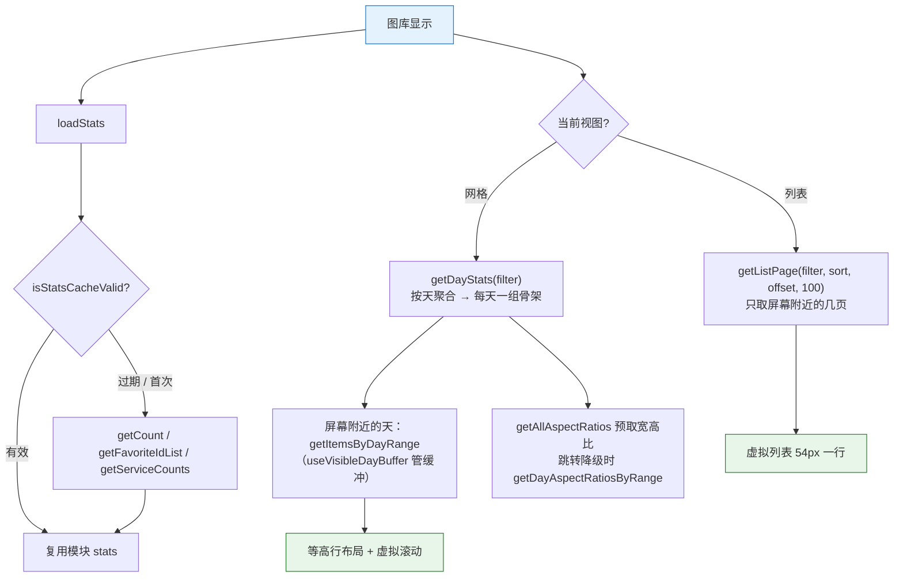
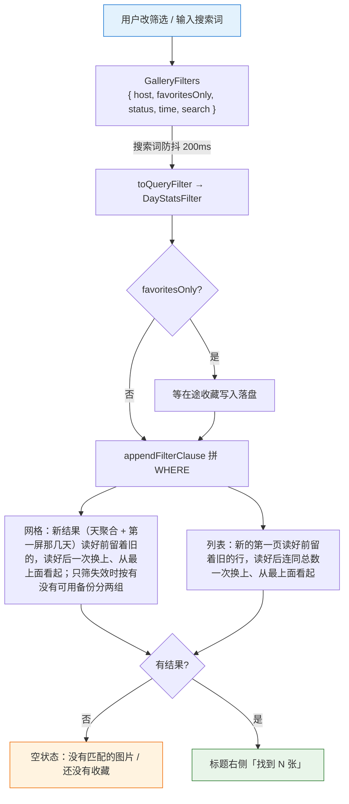
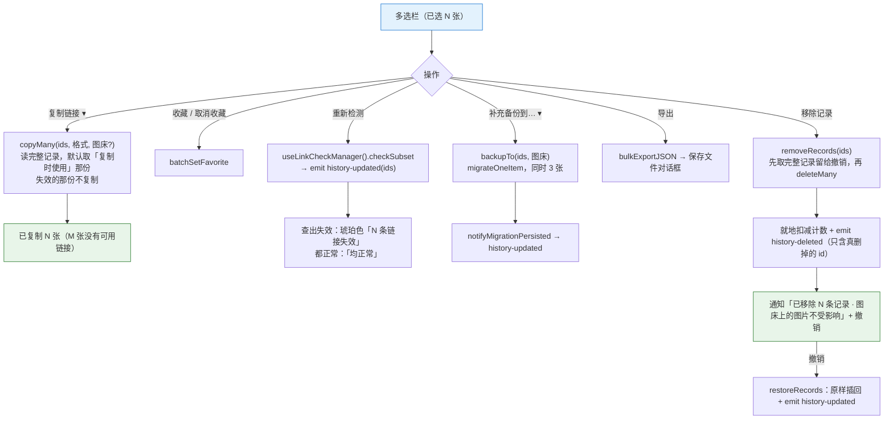

# 历史查询流程（图库）

> 图库（网格 / 列表）读取、筛选、搜索、批量操作的可视化图解。排查图片不显示、筛选结果不对、操作后列表不更新时查看此文档。

---

## 图 1：数据从哪来

`useHistory` 模块级只维护 **stats**（totalCount / favoriteSet / favoriteCount / serviceCounts / timePeriodStats），不全量加载记录。图库的两种视图各自按需查：

- **网格**：`useGalleryGrid` → `useTimelineDayPagination`。先按天聚合（`getDayStats`）并读回第一屏那几天的记录，一起换上（其余的天是骨架），之后只读屏幕附近那几天（`getItemsByDayRange`，`useVisibleDayBuffer` 管前后缓冲）；等高行布局需要的宽高比在换上之后整批预取（`getAllAspectRatios`），量太大时跳过、跳转时按月补取（`getDayAspectRatiosByRange`）。格子按算出布局的那份分组画（`useVirtualTimeline` 的 `layoutGroups`），新布局换上之前画面一直是上一份完整的布局。
- **列表**：`useGalleryList` → `getListPage(filter, sort, offset, 100)`，只取屏幕附近的那几页，表头可按上传时间 / 文件名 / 大小排序。

两种视图用同一份筛选（图 2）。模块 stats 有 5 分钟 TTL，图库每次显示时 `loadStats()`，`history-updated` 事件 / `invalidateCache()` 让它失效。

**格子的比例**按 ImageRatios（G13）换算：长图裁到 1:2.5、超宽图裁到 4:1、短边小于 120 的小图放进方格，规则在 `src/utils/imageDisplay.ts` 的 `layoutRatio`。还没加载的天（骨架）用的预取比例与按天汇总也换算过（汇总在 SQL 里，`TimelineQueryService` 的 `LAYOUT_RATIO_SQL`），所以图片加载时格子不跳。

**灯箱翻页**：网格里打开按天翻（`useTimelineLightbox`），列表里打开按列表眼前的顺序翻（`useListLightbox`），由 `useGalleryLightbox` 二选一。

> **关键源文件**：`src/composables/history/useHistory.ts`、`src/views/gallery/useGalleryGrid.ts`、`src/composables/timeline/useTimelineDayPagination.ts`、`src/views/gallery/useGalleryList.ts`、`src/services/database/TimelineQueryService.ts`

---

## 图 2：筛选与搜索

工具栏的筛选（`GalleryFilters`）经 `toQueryFilter` 换成 `DayStatsFilter`，再由 `TimelineQueryService` 的 `appendFilterClause` 拼进每一条图库查询（网格的天聚合 / 按天取记录 / 宽高比，列表的分页）。

| 筛选 | 查询条件 |
|------|---------|
| 图床 | 这个图床上有成功的一份：`EXISTS (json_each(successful_service_ids) = 图床)` |
| ★ 收藏 | `is_favorited = 1`；查询前先等在途的收藏写入落盘（见下文「读己之写」） |
| 状态 | 失效 / 可能受限 / 尚未检测 = 「复制时使用」那份（`primary_service`）在 `link_check_status` 里的检测结果；仅 1 份 = `success_count = 1`；多选之间是「或」 |
| 时间 | `timestamp >= since`（最近 7 天 / 最近 30 天 / 今年 1 月 1 日起） |
| 搜索 | 只搜文件名：`local_file_name_lower LIKE %词% ESCAPE '\'`；输入后 200ms 才查 |

「状态」只勾了「失效」时网格不按天分（`useDeadSections`）：带 `backup: 'available' | 'none'` 各查一次全部记录，分「失效 · 有可用备份」「失效 · 无可用备份」两组；有可用备份 = 别的图床上还有一份没被查出失效（`USABLE_BACKUP_SQL`，与详情顶上的提示同一口径）。这时没有刻度条，灯箱按两组的顺序翻。

**读己之写**：点星标是「先乐观改 favoriteSet、后写盘」，而 tauri-plugin-sql 的连接池对读写不排队（WAL 下 SELECT 读提交前快照）。所以带「★ 收藏」筛选的图库查询，以及 `getFavoriteIdList` / `getFavoriteCount`，入口都先等在途收藏写入（`HistoryDatabase.pendingFavoriteWrites`）落盘再查。

> **关键源文件**：`src/views/gallery/galleryFilters.ts`、`src/services/database/TimelineQueryService.ts`、`src/services/database/HistoryDatabase.ts`

---

## 图 3：批量操作（多选栏）

选中图片后，底部多选栏的操作都在 `src/views/gallery/useGalleryActions.ts`（导出与记录增删在 `useHistory`）。结果都报数字（「已复制 N 张」「N 张未能备份到…」）。

「移除记录」不弹确认，靠通知里的「撤销」反悔；只删本地记录，图床上的图片不动。

`Ctrl/⌘ A` 全选当前结果：`historyDB.getIdsByFilter(filter)` 按当前筛选查出全部 id 交给 `selectMany`，不只是已经加载出来的那几天。

---

## 记录变化后视图怎么刷新

| 事件 | 网格（useTimelineDayPagination） | 列表（useGalleryList） | 模块 stats（useHistory） |
|------|------|------|------|
| `history-updated`（上传、重试、补充备份、改用、重新检测、撤销移除、收进软件外的上传） | `reloadAll(ids)`：重读按天汇总；张数变了或装着这些 id 的已加载天、第一屏里新出现的天先重读，读好再与新汇总一起换上（旧格子留到那一刻，不退回骨架）；其余没读过的天照旧是骨架 | 屏幕上的那几页（和第一页）重读，读好连同总数原地换上 | 防抖 300ms 后重查 |
| `history-deleted` | `removeItemsByIds` 增量去掉；有 id 不在已加载的天里时兜底 `reloadAll` | 同上：屏幕上的那几页重读后原地换 | 本窗口删的已就地扣减，跳过；别的窗口删的按 ids 扣减 |
| `history-cleared` | `reloadAll` | 同上 | 清零 |
| 点星标 | 不重查，格子上的星标跟着 favoriteSet 变 | 同左 | favoriteSet 乐观更新，写盘失败回滚 |

---

## 软件外的上传

命令行（`picnexus --service <id>`、`--profile typora`）和编辑器服务（Obsidian 插件、PicGo 兼容的 `/upload`、`/upload/file`）走 Rust 链路，传完不经过前端的 `useHistorySaver`。它们的记录走一个收件箱：

1. Rust 每传成功一张，`ExternalUploadSink::record` 趁图片还在时读好尺寸，在用户数据目录的 `pending-uploads/` 写一个 `<id>.json`（先写 `.tmp` 再改名）。
2. 前端 `installExternalUploads`（`AppShell` 装）在三个时机收件：启动时、窗口拿到焦点时、编辑器服务发 `external-uploads://recorded` 时。命令行是单独的进程，通知不到开着的主界面，所以靠切回窗口那一下。
3. `drainExternalUploads` 用 `list_external_uploads` 取出全部记录，逐条 `insertOrIgnore`（记录 ID 是 `external-<收件箱 id>`，重复收到会被忽略），发 `history-updated`，再用 `remove_external_uploads` 删掉写成功的那几条；写失败的留着下次再收。

- **图床编号**：`--service` 给的是完整编号，原样记。Typora 配置档和编辑器服务只知道图床类型：WebDAV / 自定义 S3 记成 `webdav` / `custom_s3`，收件时按设置里 Typora / Obsidian 用的图床补成 `webdav:<档案>`（`resolveServiceId`）；设置已经换成别的图床就保留原样。
- **没有的字段**：这条链路只拿得到链接，`fileKey` 为空；`/upload/file` 只收到图片内容，`filePath` 不写。
- **不做**：命令行直接写历史库。表结构只由前端的 `SchemaManager.ts` 维护，Rust 再抄一份就要两边同步改。

> **关键源文件**：`src-tauri/src/external_uploads.rs`、`src-tauri/src/commands/external_uploads.rs`、`src/composables/history/externalUploads.ts`

---

## 缓存机制

| 层级 | 策略 | TTL | 失效条件 |
|------|------|-----|---------|
| 模块级 stats（useHistory） | totalCount + favoriteSet + serviceCounts + timePeriodStats | 5 分钟 | `isStatsCacheValid()` 失败 / `history-updated` 事件 / `invalidateCache()`；删除 / 清空路径就地扣减计数并重查 timePeriodStats（`refreshTimePeriodStats`） |
| 详情缓存（useImageDetailCache） | 按条目 LRU | 无限制 | 收藏切换 / 删除 / 清空 |
| 按天缓存（useTimelineDayPagination 的 dayMetaCache） | 已加载天的 ImageMeta | 页面存活期 | 换筛选（新结果换上的那一刻）、`history-*` 事件 |
| 已加载的缩略图（useImageLoadManager 的 loadedImages） | 格子的 `` 加载过的图片 id，上限 500，超过时淘汰最久没在屏幕上的 | 页面存活期 | 不因离开屏幕过期（再出现时直接显示）；确认明文 HTTP 域名只清失败态 |
| 列表页缓存（useGalleryList） | 已取的页（每页 100 行） | 页面存活期 | 换筛选 / 排序（新的第一页读好后整份换上）、`history-*` 事件（屏幕上那几页重读后原地换，其余作废） |
| 候选列表缓存 · HistoryItem 版（`thumbnailCandidatesCache`） | 按 `item.id` 的 Map，上限 500 | 会话级 | `history-updated/deleted/cleared` 事件 + 前缀 / 知乎配置 watch（**注册于 `useThumbCache()` 首次调用，目前只有图库灯箱会触发**） |
| 候选列表缓存 · ImageMeta 版（`metaCandidatesCache`） | 以 meta 对象为键的 WeakMap | 随 meta 对象被 GC | 换新 meta 对象（镜像变化后重查 DB）或配置指纹变化；**不接事件、不受上一行的 watch 影响** |

---

## 排查指南

| 现象 | 可能原因 | 对照图表位置 |
|------|---------|-------------|
| 图库空白、计数为 0 | 数据库没连上（`historyDB.open` 失败），或 `loadStats` 报错 | 图 1 节点 B / D |
| 一整天只有灰色占位块 | 那一天的记录没读回来：`getItemsByDayRange` 报错，或可见天缓冲没触发 | 图 1 节点 G2 |
| 换筛选时网格先空一帧（只有日期标题）、出整屏灰块，或旧位置上出现新图 | 新结果没连同第一屏那几天一起换上（`firstScreenDays`），或画格子没按布局自己的那份分组取图（`layoutGroups`）；两组 ↔ 按天看 `useGalleryGrid` 的 `shown` 是否等目标读好 | 图 2 节点 F1 |
| 列表换筛选 / 排序、上传后整屏先变成骨架条 | `useGalleryList` 没等新的页读回来就换掉了旧的页，或换上时没把虚拟列表的位置一起归零 | 图 2 节点 F2 |
| 图库开着时上传，今天那一行先变灰块 | `reloadAll` 没把张数变了的已读天先重读再换上 | 记录变化表 |
| 换筛选后加载过的缩略图又淡入一遍 | `loadedImages` 被提前清掉（它不该按离开屏幕的时间过期） | 缓存机制 |
| 搜索无结果 | 搜索只匹配文件名（`local_file_name_lower`），不包含链接 | 图 2 搜索一行 |
| 状态筛选「失效」漏了图 | 判的是「复制时使用」那份的检测结果；备份失效、复制来源正常的不算 | 图 2 状态一行 |
| 刚点了星标，打开「★ 收藏」却没有它 | 查询没等在途收藏写入：检查 `pendingFavoriteWrites` 的注册是否在写方法入口同步完成、查询是否走了 `dbForFilter` | 图 2「读己之写」 |
| 移除记录后列表没更新 | `history-deleted` 事件监听没挂上 | 记录变化表 |
| 移除后通知条数与选中数不符 | 部分记录已被别处删掉，按实际删除数上报是契约行为 | 图 3 节点 H1 |
| `jumpToMonth` 对某月份的判断与刻度条不一致 | 刻度条来自 `dayStats` 聚合，`jumpToMonth` 校验的是 `sharedTimePeriodStats`；删除 / 清空路径需触发 `refreshTimePeriodStats` | 缓存机制第 1 行 |
| 拖动刻度条停下后画面停在别的月份 | `useTimelineJump` 跳转中的请求只留最后一个、落地后接着跳；检查是否被改回了「跳转中直接丢弃」 | 图 1 网格 |
| 切回图库后数据丢失 | KeepAlive 缓存失效后重新加载，但 stats 缓存已过期 | 图 1 节点 B1 |
| 图片加载时格子跳一下 | 骨架天的预取比例与真图排版不是同一套：`toAspectRatioRow`、`LAYOUT_RATIO_SQL` 与 `layoutRatio` 要一致（`galleryFilters.spec` 在真 SQLite 上对照） | 图 1「格子的比例」 |
| 打开详情后顶部几行不见了 | 网格变窄重排时滚动锚点在最顶上也去补偿了：`useScrollAnchor` 在 `scrollTop` 为 0 时应不动 | 图 1 网格 |
| GIF 格子一片空白 | 停在第一帧时原图要 `display: none`：只隐藏不让位，画第一帧的 canvas 被挤到格子外面（`GalleryTile`） | 图 1 网格 |
| Tab 进不了网格 / 方向键走了焦点没跟 | 网格只有一格 `tabindex=0`（`GalleryGrid` 的 `tabStopId`）；走到的格子还没画出来时由 `focusTile` 等它出现再给焦点 | 图 1 网格 |
| 命令行 / Typora / Obsidian 传的图不在图库里 | 主界面还没收件（没打开过、没切回窗口），或用户数据目录的 `pending-uploads/` 里有写不进库的记录（看日志 `[ExternalUploads]`） | 软件外的上传 |
| 重新检测后格子上的 ⚠ 没变 | 检测结果写回后没带 id 广播 `history-updated`，或那一天不在已加载的天里 | 记录变化表第 1 行 |

---

## 相关文档

- [数据持久化流程](./data-persistence.md) — 配置 / 历史 / 缩略图的完整数据流
- [多图床镜像与切换](./mirror-fallback-flow.md) — 详情面板里的「改用」「移除这条链接」
- [同步流程](./sync-flow.md) — 历史记录的 WebDAV 云同步
- [Composables API](../reference/api/composables.md) — useHistory 接口索引
- [模块依赖图](../reference/architecture/dependencies.md) — 修改前查影响范围
- [图库占位策略](../reference/troubleshooting/timeline-view-switch-blank.md) — 冷启动骨架、按天占位、跳转
