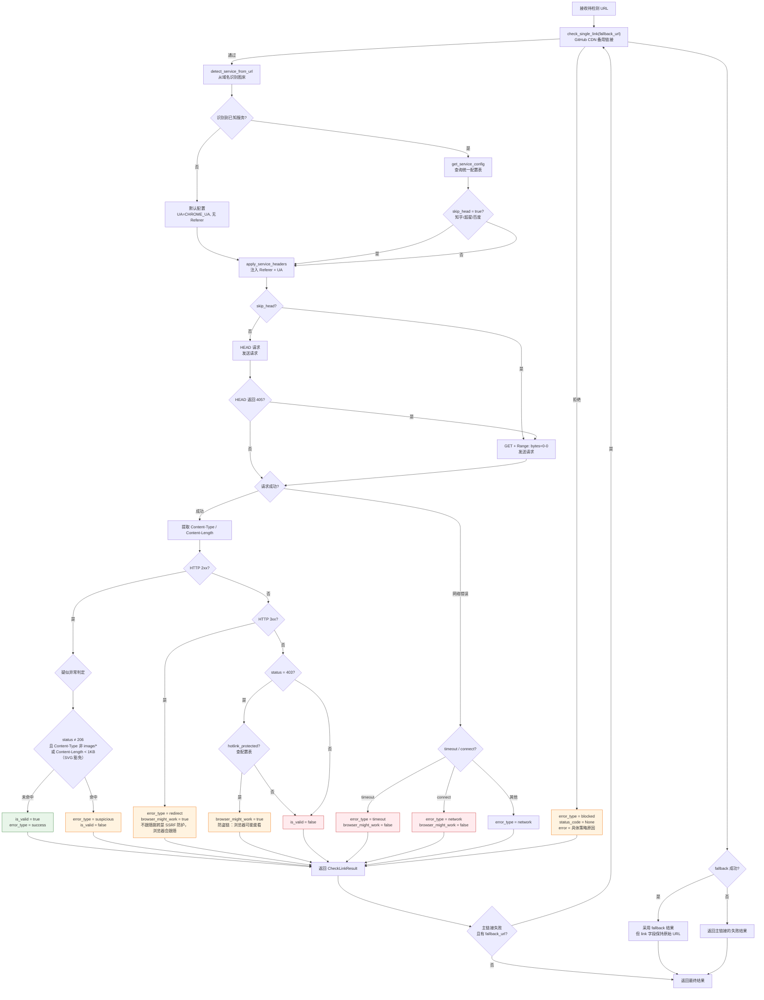
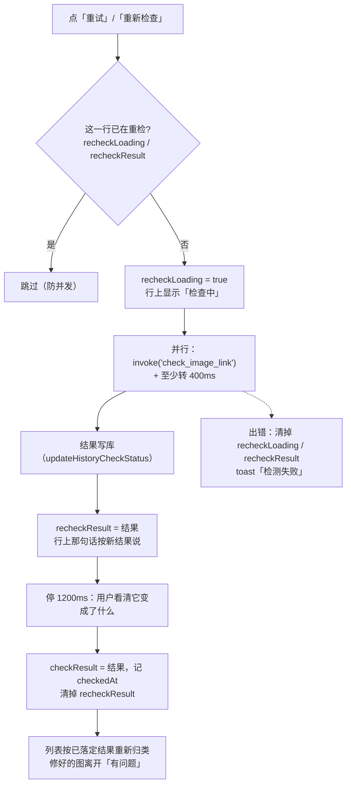
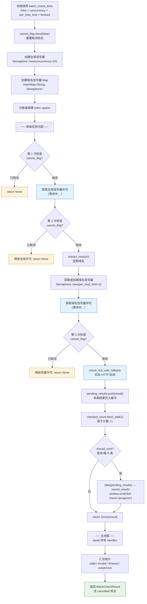
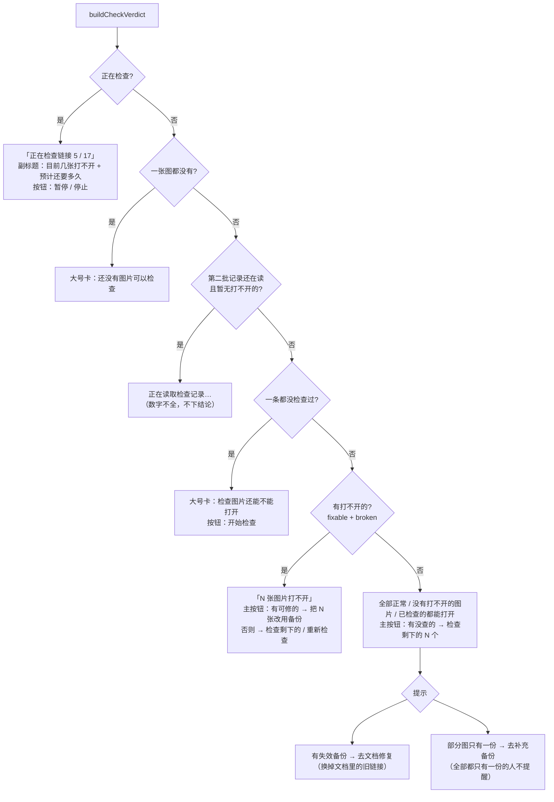
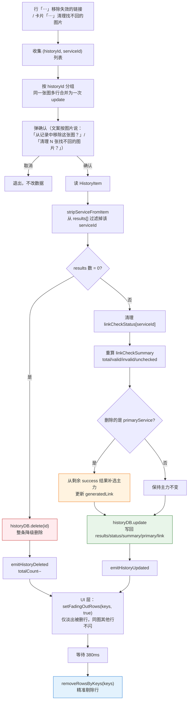

# 链接检测流程（深度展开）

> 链接检测的深层机制图解：服务感知请求、并发控制、单条重检、按图片归类与结论卡。
> 基础检测主流程见 [auxiliary-flows.md 图 11](./auxiliary-flows.md#图-11链接检测流程)，本文档是其深度展开。

---

## 图 1：服务感知请求流程

展示 Rust 后端 `check_single_link` 中从 URL 到最终判定的完整决策路径。排查「微博返回 403 但浏览器能看」「200 却标记为疑似」等问题时查看。

> **关键源文件**：`src-tauri/src/commands/link_checker.rs`（`detect_service_from_url`、`get_service_config`、`apply_service_headers`、`check_single_link`、`check_link_with_fallback`、`validate_probe_url`、`validate_fetch_url`、`dns_answer_is_forbidden`）

### 出站策略校验

只读探测与下载重传用不同的出站校验函数，详见 [link-check-outbound-policy.md](./link-check-outbound-policy.md)。

### error_type 取值表

| 取值 | 产生位置 | 前端呈现（白话标签 `statusWord`，状态码与原因放 tooltip `statusTooltip`） |
|------|----------|----------|
| `success` | 2xx 且未命中疑似判定 | 「正常」 |
| `http_4xx` / `http_5xx` | `classify_error` 按状态码分类 | 「不存在」404 /「已删除」410 /「拒绝访问」403 /「需要登录」401 /「被限流」429 /「图床故障」5xx /「失效」其他；tooltip 走 `STATUS_DESC` 文案表 |
| `timeout` | `err.is_timeout()` | 「超时」· 检测超时 · 网络延迟或图床响应过慢 |
| `network` | `err.is_connect()` 或兜底分支 | 「连不上」· 网络不通 · 无法连接到图床服务器 |
| `suspicious` | `is_suspicious_image_response` 命中 | 「可疑」 |
| `blocked` | `validate_probe_url` 拒绝 / 空链接 | 「已拦截」· 策略拦截 + Rust 给出的**具体原因**；筛选与计数上等同 `network`（归入「失效」），不新增 tab |
| `redirect` | 状态码落在 300–399 | 「跳转」· 同时置 `browser_might_work = true`，筛选/计数/CSV 上归入「疑似」而**不是**「失效」；不新增 tab |

> 防盗链（403 + `browser_might_work`）显示「防盗链」；标签一律 ≤4 个字，状态药丸才排得齐。文档修复列表用同一套函数。

> `blocked` 与 `network` 分家的意义：前者是**请求根本没发出去**（被本机策略拦下），后者是**发出去了但连不上对端**。合并会让"被自己程序拦了"伪装成"网络故障"，排查时误导性极强。

> ⚠️ **判 `suspicious` 前必须先归一化 Content-Type。** `is_suspicious_image_response` 走
> `content_type_mime()`：切掉 `; charset=...` 参数、去空白、转小写，再比 `image/` 前缀。
> RFC 9110 规定类型/子类型大小写不敏感且允许带参数，直接拿原串 `starts_with("image/")`
> 会把返回 `Image/JPEG` 的正常图误标成「疑似」。同文件的 `download_image_from_url`
> 与 `download_url_image`（前端 URL 下载走的就是它）用的是同一个函数，**三处判据不许各写一份**。
>
> 别在 `download_url_image` 里把结果绑到叫 `content_type_mime` 的局部变量上——那会遮住同名函数，
> 后来人想在这个函数里再调用它时会撞上「试图调用 String」的编译错误。

#### 3xx 为什么必须单独归类

检测器用 `redirect::Policy::none()` **刻意不跟随跳转**——这是防 SSRF 的设计，不会改。但浏览器会跟随，所以图床返回 301/302 时用户打开链接能正常看图。

3xx 以前落进 `classify_error` 的兜底 `network`，界面标红成「失效」。这条误判的代价不是"看着别扭"：链接检测页支持按失效批量删除，用户照着这个结论删下去，删掉的是**活链接**。

归类靠两个字段协同，缺一不可：

| 字段 | 值 | 作用 |
|------|----|------|
| `error_type` | `"redirect"` | 界面显示「跳转」、tooltip 解释「浏览器会自动跟随」、CSV 导出写「跳转」 |
| `browser_might_work` | `true` | 让**所有按排除法写的**筛选/计数（`!is_valid && ≠timeout && ≠suspicious && !browser_might_work` 才算失效）自动把它排除出「失效」 |

> ⚠️ 新增按 `error_type` **逐个点名**的分支时（CSV `statusLabel`、界面白话标签 `statusWord` 这类逐个点名的函数），漏点名 `redirect` 就会悄悄退回「失效」。按排除法写的地方（`imageHealth.linkVerdict` / Rust 汇总统计）靠 `browser_might_work` 自动归位，不用改。
>
> tooltip 里 `redirect` 必须判在 `browser_might_work` **之前**：两者都为 true，落到通用分支会输出「防盗链限制 (301)」，把用户引去查根本不存在的防盗链设置。

### 图床服务配置表

| 服务 ID | 域名匹配规则 | Referer | skip_head | hotlink_protected |
|---------|-------------|---------|-----------|-------------------|
| weibo | `*.sinaimg.cn` | `https://weibo.com/` | false | true |
| bilibili | `*.hdslb.com` | `https://mall.bilibili.com/` | false | true |
| jd | `*.360buyimg.com` | `https://jdcs.jd.com/...` | false | true |
| zhihu | `*.zhimg.com` | `https://www.zhihu.com/` | **true** | true |
| chaoxing | `*.chaoxing.com` | `https://notice.chaoxing.com/` | **true** | true |
| nowcoder | `*.nowcoder.com` | `https://www.nowcoder.com/...` | false | true |
| baidu | `image.baidu.com` | 无 | **true** | false |
| github | `raw.githubusercontent.com` 等 | 无 | false | false |
| imgur | `i.imgur.com` | 无 | false | false |
| oss | `*.aliyuncs.com` | 无 | false | false |
| cos | `*.myqcloud.com` | 无 | false | false |
| qiniu | `*.qiniudn.com` / `*.qnssl.com` / `*.qbox.me` | 无 | false | false |
| smms | `*.smms.app` / `i.loli.net` / `vip2.loli.io` | 无 | false | false |
| nami | `*.nami.observer` | 无 | false | false |

---

## 图 2：单条重检

行上的「重试」或「⋯ → 重新检查」把这张图的每一份链接各查一次（`LinkCheckView.handleRecheckImage` → 每行 `recheckSingle`）。排查「重检后行闪一下就没了」「转圈不停」时查看。

> **关键源文件**：`src/composables/link-check/useLinkCheck.ts`（`recheckSingle`、`showRecheckResult`、`updateRow`）

**为什么要停 1200ms 再落定**：列表的归类、排序、计数都只看已落定的 `checkResult`（`imageKind` 默认口径），行上显示用最新结果（`describeImage` 用 `recheckResult ?? checkResult`）。停的这一下里行待在原位显示新状态；直接落定的话，修好的图会在用户眼前瞬间消失，看不出发生了什么。

---

## 图 3：批量检测并发控制

展示 Rust `batch_check_links` 引擎内部的二级信号量机制。排查「检测速度异常慢」「某个图床被限速」「取消后仍有检测在跑」时查看。

> **关键源文件**：`src-tauri/src/commands/link_checker.rs`（`batch_check_links`、`cancel_batch_check`、`extract_host`）

### 并发参数说明

| 参数 | 默认值 | 范围 | 说明 |
|------|-------|------|------|
| `concurrency` | 10 | 1-50 | 全局最大并发数（tokio 信号量） |
| `per_host_limit` | 3 | 1-10 | 单域名最大并发（防止刷爆单图床） |
| `timeout_secs` | 10 | 3-30 | 单链接超时秒数 |

**为什么需要三次取消检查？**
- 第 1 次：任务开始前，避免无意义的信号量竞争
- 第 2 次：拿到全局许可后、域名许可前，快速释放资源
- 第 3 次：拿到双重许可后、发 HTTP 前，避免已取消仍发请求

### 暂停 / 恢复：轮询语义

`BatchCheckPauseFlag`（`AtomicBool`）与 `BatchCheckCancelFlag` 并行管理。三次取消检查点实际调用的是复合辅助函数 `await_resume_or_cancel(pause, cancel)`：

1. 循环：`while pause=true && cancel=false { sleep 100ms }`
2. 退出后返回 `cancel.load()` —— **true 则任务立即 `return None`**（cancel 优先 pause）

**关键不变量**：
- 暂停期间任务仍持有 semaphore permit（全局 + 域名），保证恢复后原地复工而非重新排队
- cancel 能"穿透"pause——已暂停的任务收到取消不会被 pause flag 阻塞
- HTTP 在途的请求无法中断（reqwest 不暴露 abort），暂停只影响尚未进入 HTTP 阶段的任务；正在下载的任务会完成后自然退出

**相关 command**：`pause_batch_check` / `resume_batch_check`（仅翻转 flag，不做其他工作）

### 实时反馈：进度事件携带批量结果

`BatchCheckProgress` 除 `checked` / `total` / `current_url` 外，还带 `recent_results: Vec<BatchCheckItemResult>` —— 自上次广播以来累积的逐条结果。

- **Rust 端**：每个任务完成后将 `BatchCheckItemResult` 推入 `pending_results` 缓冲（Mutex<Vec>）；触发节流广播时 `std::mem::take` 整批 drain 出来塞入 payload。事件频率仍由 `PROGRESS_EMIT_EVERY_N`（默认 10）控制，单次 IPC 数量不增加。
- **前端端**：`useLinkCheck` 在 `link-check://progress` 回调里调用 `applyRecentResults`，按 `${url}::${historyId}` 用 `rowIndexMap` 做 O(1) 定位，对命中行 mutate `checkResult` 后通过 `createRafScheduler()` 把"换数组引用"动作（`checkRows.value = checkRows.value.slice()`）合并到下一帧执行——同帧多次 mutation 只触发一次重渲染，跨过 `HistoryCheckPanel` 的 prop 边界唤醒下游 computed。
- **列表跟得上但不乱跳**：列表把行按图片分组（`useImageList` → `groupRowsByImage`）。检查进行中进度很密，分组最多每 300ms 重建一次（`CHECKING_REBUILD_MS`），检查一结束立即重建；检查中也不按类重排，结果进来行原地变色，结束后才分段排好。
- **flush 时机**：检测结束（成功/取消/出错）走 `finalizeCheck`，里面调 `scheduler.flush()` 强制落地最后一批 mutation，避免还在 rAF 队列时就被 `applyResultsToRows` 的全量重赋值覆盖。

**为什么换数组引用**：单纯 `triggerRef(checkRows)` 在同作用域有效，但跨组件 prop 时 Vue 走引用比对——同一数组引用 = prop 没变 = 子组件不重渲染。早期实现踩过这个坑（行状态僵死），改成数组引用替换 + rAF 节流后才真正实时。

**与批量迁移共享实现**：[utils/rafScheduler.ts](../../src/utils/rafScheduler.ts) 提供通用 `createRafScheduler`，被 [composables/batch-migrate/rafThrottle.ts](../../src/composables/batch-migrate/rafThrottle.ts) 与 [composables/link-check/useLinkCheck.ts](../../src/composables/link-check/useLinkCheck.ts) 共用。任何"高频 shallowRef 数组刷新 → 跨 prop 边界生效"的场景都应优先复用。

### 进度反馈：还要多久 / 是否卡住

几万条链接里逐行变色看不出整体在动，结论卡的副标题直接回答「还要多久」。

> **关键源文件**：[useProgressPace.ts](../../src/composables/link-check/useProgressPace.ts)、[checkVerdict.ts](../../src/composables/link-check/checkVerdict.ts)

| 字段 | 含义 | 计算方式 |
|------|------|---------|
| `etaSeconds` | 预计还要多少秒 | 每次进度事件取 `Δchecked / Δt` 做指数平滑（α=0.3），`剩余条数 / 速度`；第一条事件只建基线 |
| `stalled` | 卡在慢图床 | 每次有新结果就重置 10s 计时器，到时未刷新即为 true |

卡住时副标题写「有些图床响应慢，正在等它们」而不报时间——那个数按之前的速度算，此刻不可信。检查结束（`progress = null`）一切归零，下次从头算。

### 批次归属：三个守卫，三种处置

`batch_check_links` 返回时，结果未必还属于"当前这一轮"。三个守卫**按顺序**判，处置各不相同——合并任意两个都会造成数据事故。

> **关键源文件**：[useLinkCheck.ts](../../src/composables/link-check/useLinkCheck.ts)（`isResultForBatch`、`historyClearedGeneration`、`latestStartedBatchSession`、`latestStartedBatchKeys`、`persistSupersededResult`）

| 顺序 | 守卫 | 触发场景 | 回填 UI | 写 DB |
|------|------|---------|--------|------|
| 1 | `batch_id` 对不上 | Rust 侧返回了别的批次的结果（防御性检查） | ❌ | ❌ |
| 2 | `historyClearedGeneration` 变了 | 检测途中历史被清空 | ❌ | ❌ **整批作废** |
| 3 | `latestStartedBatchSession` 变了 | 取消后又开了新批次 | ❌ | ✅ **仍然落库** |

**为什么第 3 条要落库**（这是修掉的 bug）：用户在几万条的全量检测中途点「停止」，接着点结论卡上的「检查剩下的 N 个」，新批次开跑、会话号变了。而旧批次的**在途 HTTP 请求几十秒后才陆续返回**（reqwest 不可中断，见图 3 说明）。旧实现在这里把结果连同落库一起跳过——旧批次已经完成的几千条真实检测结果全部丢弃，重启后回退成「未检测」，用户白等一轮。

这些结果早就通过 `applyRecentResults` 就地 patch 进 UI 了，所以补写入库不是制造分叉，反而是把 UI 与 DB 拉回一致。

**为什么第 2 条反过来不能落库**：历史清空后，结果指向的 `historyId` 已经不存在，写进去就是写幽灵数据，回填 UI 会造出幽灵行。这两条语义相反，所以用两个独立的计数器（`historyClearedGeneration` / `latestStartedBatchSession`）表达，不能共用一个。

**新旧批次重叠的行怎么办**：批次启动时把自己的行键存进 `latestStartedBatchKeys`；旧批次落库前按这个集合过滤，属于新批次的行直接跳过——那些行由新批次自己写，旧结果更陈旧，盖上去就是回退。

### 跨窗口事件同步

模块级 `onCacheEvent` 监听三类历史事件（[useLinkCheck.ts](../../src/composables/link-check/useLinkCheck.ts) 顶部）。不响应就会让检测视图持有**幽灵行**：别处已经删掉的图，检测页还显示、还计入统计、检测时还白发一次请求。

| 事件 | 处置 |
|------|------|
| `history-cleared` | 清空 `checkRows` + 重建索引 + 递增 `historyClearedGeneration` 让在途批次结果整批作废 + `cancel_batch_check` |
| `history-deleted` | 按 `data.ids` 调 `removeRowsByHistoryIds` 精准摘行；`lastLoadTime = 0` 让 TTL 缓存失效 |
| `history-updated` | 只置 `lastLoadTime = 0`（内容变了但行还在，下次进入重查即可） |

**三个容易写错的点**：

1. **ids 在 `payload.data.ids`，不在 payload 顶层**——`CacheEventPayload` 是 `{ type, timestamp, data }`，`data` 才是 `HistoryEventData`。放错位置读到 `undefined`，行为退化成"什么都不做"且不报错。
2. **不能按 `source === WINDOW_SESSION_ID` 过滤自发事件**。`useHistory.ts` 那样过滤是对的（它在本地删除时已经自己更新过状态），但历史页和检测页**同处一个窗口**——过滤掉就等于收不到"在历史页删图"这个最主要的场景。
3. **正在播放删除动画（`fadingOut`）的行要跳过**。那是检测页自己发起的删除，`setFadingOutRows` → 380ms 淡出 → `removeRowsByKeys` 收尾（图 5）；事件抢先摘掉会让过渡直接跳帧。

> 📌 `rowIndexMap` / `rebuildRowIndex` 挂在**模块级**而不是 composable 内：`checkRows` 本身是模块级单例，索引必须是同一份。否则模块级事件监听摘掉行之后，composable 实例里的索引还是旧的，`applyRecentResults` / `updateRow` 会按错位下标 patch 到别人的行上。
>
> 同理，`checkAllHistoryLinks` 回填结果前必须**重新读** `checkRows`，不能拿启动时的 `rows` 快照重新赋值——检测期间 `history-deleted` 摘掉的行会被"复活"。

---

## 图 4：结论卡决策

页面顶部的结论卡先一句话说清现在怎么样，再给这一刻最该点的按钮。文案与按钮全部由纯函数 `buildCheckVerdict` 决定，组件只负责摆出来。修改结论卡前看这里。

> **关键源文件**：`src/composables/link-check/checkVerdict.ts`（`buildCheckVerdict`）、`src/components/views/link-check/HistoryCheckPanel.vue`

- 副标题只放和决定有关的：几张能修、几张没救、什么时候查的（`checkedAt` 取最新）。受限的在列表里有自己一段，没查完的由按钮「检查剩下的 N 个」交代。
- 读取失败且一行都没有时，面板换成「没读出检查记录 + 重试」，不说「还没有图片」。
- 卡片的「⋯」：只重查有问题的、导出当前列表（CSV）、清理找不回的图片（每一份都是 404 / 410 才算）。

---

## 图 5：精准移除链接（per-link 删除语义）

展示链接检测里「移除记录」的数据层行为。列表按图片一行，但一张图在 N 个图床各有一份链接；移除只针对打不开的那几份，所以必须精准到 `(historyId, serviceId)`，而不是整条 `HistoryItem`——能打开的那份要留着。

> **关键源文件**：`src/composables/history/useHistoryResultOps.ts`（`bulkDeleteHistoryResults`、`stripServiceFromItem`）；`src/composables/link-check/useLinkCheck.ts`（`removeRowsByKeys`、`setFadingOutRows`）；`src/components/views/LinkCheckView.vue`（`handleRemoveLinks`、`removeCopy`）

### 关键不变量

| 不变量 | 说明 |
|--------|------|
| 行键 = `${historyId}::${serviceId}` | 淡出/移除只作用于该键对应的单行，不会牵连同图其他图床 |
| 删主力 → 补选 | 从剩余可用镜像（`isUsableMirror`：success 且有 url）里挑第一个，更新 `generatedLink`；Timeline/收藏的缩略图会自动跟上 |
| 结果归零 → 整条删 | `results[]` 空壳记录没有展示价值，直接 `historyDB.delete` 降级；删主力后无可用接班镜像时同样整条删（避免 `generatedLink=''` 孤儿） |
| 批量合并 | 同一 `historyId` 下多个 serviceId 合并为一次 `update`，不会 N 次写库 |
| 移除前提醒文档修复 | 这张图还有能打开的一份时，文档里写的多半就是这条打不开的旧链接；文档修复的 `findBackupLinksRaw` 拿旧链接在记录里找备份，删了就对不上。所以确认框写明「文档里如果还用着这条旧链接，移除后『文档修复』就换不了它了，建议先修文档」。整张图都打不开时本来就没有备份可换，不提醒 |
| 批量部分失败 → 按记录隔离 | 底层逐条写库无法回滚，一条记录抛错不拖累其余；`applyChanges` 只对真落库的部分生效；回执和确认框同一个单位：整张图移除报「已从记录中移除 N 张图片」，只剥掉链接报「已移除 N 个链接」，部分失败报「N 张图片没移除成功」（warn）；返回 `BulkResultDeleteReport`，视图只移除 `resolvedHistoryIds` 对应的行（含"目标本就不存在"的陈旧行），失败的行保留供重试 |
| 事件分流 | 整条删走 `emitHistoryDeleted`，仅改走 `emitHistoryUpdated`；其他视图依赖这两类事件刷新缓存 |

### 为什么不共用 `removeRecords`

`removeRecords` 的语义是"删整条记录"（图库的「移除记录」）。链接检测虽然按图片列出，移除的却是**打不开的那几份链接**——共用会导致"移除失效的微博链接，顺手把能用的 GitHub 链接也删了"这种体验事故。只有每一份都打不开时，记录才随最后一份链接一起消失。

---

## 按图片归类与「改用备份」

一张图在每个图床各有一份链接，列表按图片一行。这一行的状态由它的几份链接推出来（`imageHealth.ts`，纯函数）：

| 单条链接 `linkVerdict` | 判据 |
|------|------|
| `ok` | `is_valid` |
| `limited` | 防盗链（`browser_might_work`）或 3xx 跳转：浏览器多半能看 |
| `gone` | 图床回了 HTTP 4xx 且是 404 / 410。**必须是 `http_4xx`**：超时之类结果带着旧状态码不算，清理记录靠它把关 |
| `failing` | 其余打不开的：超时、连不上、图床故障、限流、拒绝访问、返回的不像图片…… |

| 一张图 `imageKind` | 条件 | 行上的按钮 |
|------|------|------|
| 能改用备份 `fixable` | 主链接 gone / failing，有备份 ok | 「改用 X」（按记录顺序第一份能用的） |
| 打不开 `broken` | 主链接 gone / failing，没有能用的备份 | failing 给「重试」；gone 不给 |
| 可能受限 `limited` | 主链接 limited | 无（不建议换） |
| 备份失效 `backup-broken` | 主链接 ok，有备份 gone / failing | 无（⋯ 里可移除失效的那份） |
| 正常 / 没检查 | — | 无 |

- 行上那句白话（「微博上的图已不存在，京东上的备份能用」）由 `describeImage` 生成；中英文交界补空格只看片段交界，不改用户自己起的图床名。悬停详情逐份列出状态。
- 「改用 X」与「把 N 张改用备份」都走 `LinkCheckView.handlePromote`：逐张 `historyDB.switchPrimaryService`，一张失败不拖累其余，成功的一次性 `setPrimaryServices` 同步到行并 `emitHistoryUpdated`，toast 如实报改成了几张。不弹确认：随时能改回，什么都不删。
- 「有问题」视图收 fixable / broken / limited / backup-broken；没问题时列表自动显示全部，用户手动切过就照用户的。

---

## 排查指南

| 现象 | 可能原因 | 对照位置 |
|------|---------|---------|
| 检查中列表比结论卡慢一拍 | 设计行为：检查进行中分组最多每 300ms 重建一次（`CHECKING_REBUILD_MS`），检查结束立即重建。若结束后仍不更新，查 `useImageList` 是否还在监听 `checkRows` 的引用变化 | `useImageList.ts` |
| **所有链接都显示「网络不通」，浏览器却能正常打开** | 本机 TUN + fake-ip 把域名解析进 `198.18.0.0/15`，旧版 DNS 预检误判为内网。已由 `validate_probe_url` 去掉预检修复；若复现说明改动被回退 | 图 1 策略校验节点 + 出站策略校验小节 |
| **公网** `http://` 链接一律失效 | 公网明文 HTTP 判 `error_type = blocked`（设计行为，tooltip 写明原因）；局域网字面量与已确认主机名放行 | error_type 取值表 / 出站策略校验小节 |
| 局域网 / NAS 图床（`http://192.168.x.x` 或已确认的 `http://nas.local`）被判「策略拦截」 | 不应出现——字面量走 `AllowPrivate` 判据；主机名要查两件事：该 profile 是否已过 fake-ip 逃生舱确认、5 个 invoke 调用点是否漏传 `confirmed_http_hosts` 名单 | 出站策略校验小节的 scheme 矩阵 |
| 「从 URL 下载图片」开代理时全失败 | `validate_fetch_url` 的 DNS 裁决未豁免 fake-ip 池。**注意 v4 和 v6 两个池都要豁免**——只盖 v4 时，双栈机器上 AAAA 记录仍是 `fdfe:dcba:9876::/64`，循环里照样被拒 | `dns_answer_is_forbidden` / `is_fake_ip_pool_ip` |
| WebDAV 报「该地址属于代理软件的 fake-ip 地址池」 | 设计行为，不是故障：本机 TUN 让域名解析失真，程序无法确认它是不是局域网。改填 NAS 内网 IP 或改用 HTTPS | `url_policy.rs` / docs/TODO.md |
| 微博/B站图片显示失效但浏览器能看 | 防盗链 403 + `hotlink_protected=true` → `browser_might_work` | 图 1 防盗链判定分支 |
| 301/302 跳转的链接被标成「失效」 | 不应出现——3xx 归 `redirect` + `browser_might_work=true`，应显示「跳转」并落在「疑似」。若复现，检查是不是新加了按 `error_type` 逐个点名却漏了 `redirect` 的分支 | 3xx 为什么必须单独归类 |
| 跳转链接的 tooltip 写「防盗链限制」 | `redirect` 判在了 `browser_might_work` 之后——两者都为 true，通用分支会抢先 | `statusTooltip` / 3xx 归类小节 |
| 知乎/百度图片 HEAD 405 | 这些图床 `skip_head=true`，应直接走 GET+Range | 图 1 `skip_head` 决策 |
| 200 但标记为「疑似」 | Content-Type 非 `image/*` 或 Content-Length < 1KB（非 SVG） | 图 1 疑似异常判定 |
| S3 系图床（R2/COS/OSS/七牛/自定义 S3）整批标「疑似」 | 对象缺 Content-Type，以 `application/octet-stream` 落桶。**这是上传侧的问题，不是检测误报**；旧对象升级不自愈，补救见 [s3-legacy-content-type.md](../reference/troubleshooting/s3-legacy-content-type.md) | error_type 取值表 |
| 返回 `Image/JPEG` 之类大小写变体的图被标「疑似」 | 不应出现——判据已走 `content_type_mime()` 归一化。若复现，检查是不是新加了绕过该函数、直接比原串的分支 | error_type 取值表下的归一化告警 |
| GitHub CDN 链接误报失效 | 前端未传 `fallback_url`（rawUrl 缺失） | 图 1 Fallback 分支 |
| 检测速度异常慢 | 单域名大量链接被 `per_host_limit=3` 限制 | 图 3 域名信号量 |
| 取消后仍有检测在跑 | 已进入 HTTP 请求的任务无法中断，只能等其自然结束 | 图 3 三次取消检查 |
| 暂停后进度仍在少量增长 | HTTP 在途任务不可中断，pause 只阻塞尚未进入 HTTP 的任务 | 图 3 暂停 / 恢复：轮询语义 |
| 暂停后点取消无响应 | 不应出现——cancel 优先 pause；若确实发生检查 `await_resume_or_cancel` 返回值 | 图 3 暂停 / 恢复：轮询语义 |
| 卡片按钮是「检查剩下的 N 个」，想全部重查 | 有没查过的链接时主按钮先查剩下的；全部重查点旁边的「全部重新检查」 | 图 4 结论卡决策 |
| 重检后那一行停了一下才挪走 | 设计行为：结果先在原位停 1200ms 再落定，落定后才按新结果归类 | 图 2 |
| 移除失效的链接后，同一张图能打开的链接也没了 | 逻辑退化成按 `historyId` 删整条——检查走的是 `bulkDeleteHistoryResults`（按 `(historyId, serviceId)`）而不是 `removeRecords` | 图 5 / useHistoryResultOps.ts |
| 清理后部分图还在，弹了「部分删除失败」 | 设计行为：处理失败的记录（DB 未改动）保留在列表里供重试，只有真落库的行会淡出 | 图 5 批量部分失败不变量 / `LinkCheckView.handleRemoveLinks` |
| 删主力图床后 Timeline 卡片缩略图没换 | `primaryService` 未切换或 `emitHistoryUpdated` 未发 | 图 5 补选主力 + 事件分流 |
| 删完所有图床后历史里还有空壳 | `results[]` 归零兜底未触发，检查 `stripServiceFromItem` 返回值 | 图 5 结果归零分支 |
| 别的页面删了图，检测页还显示（最多 5 分钟） | `history-deleted` 分支没接上，或 ids 读成了 `payload.ids`（正确是 `payload.data.ids`） | 跨窗口事件同步 |
| 检测页删行时淡出动画跳帧 | `history-deleted` 分支没跳过 `fadingOut` 的行，抢在 380ms 动画前摘掉了 | 跨窗口事件同步 第 3 点 |
| 取消后立刻续检，重启发现前一批全回退「未检测」 | 旧批次结果被整批丢弃了——第 3 个守卫应当**只拦 UI 回填、不拦落库** | 批次归属：三个守卫 |
| 检测中在别处删了图，检测结束后被删的行又冒出来 | `checkAllHistoryLinks` 拿启动时的 `rows` 快照重新赋值，把已删行复活 | 跨窗口事件同步 末尾提示 |

---

## 相关文档

- [辅助功能流程 图 11](./auxiliary-flows.md#图-11链接检测流程) — 基础检测主流程（两阶段加载、进度监听、取消分支）
- [链接检测性能优化](../reference/patterns/link-check-large-dataset.md) — 5 万条记录场景的优化方案
- [文档修复流程](./md-rescue-flow.md) — 复用 `checkUrls` 的文档修复功能
- [批量迁移流程](./batch-migrate-flow.md) — 复用链接检测结果的迁移功能
