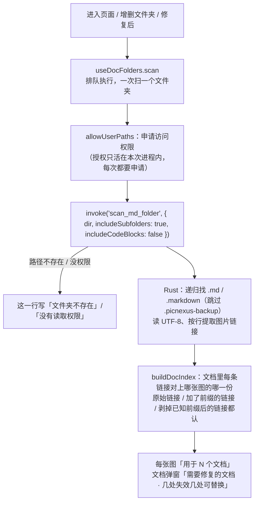
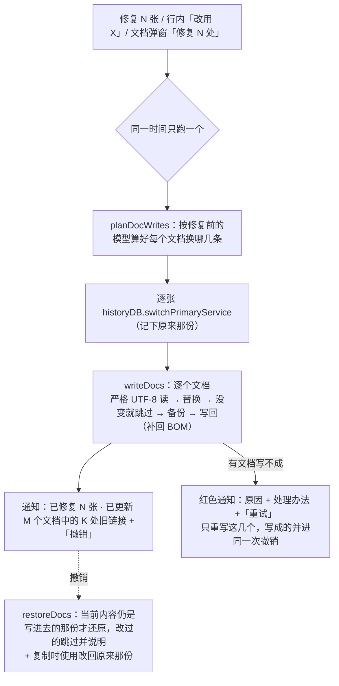

# 文档修复流程

> 链接健康页的「修复」= 把图片「复制时使用」的那份切到可访问的备份，并替换「文档文件夹」里 Markdown 文档中的旧链接（交接说明第 4 节规则 8）。
> 排查「文档没被更新」「用于 N 个文档对不上」「写回乱码」「撤销没还原」时查看此文档。

---

## 图 1：文档文件夹与索引

文档文件夹记在配置 `linkHealth.docFolders`（本机路径，云同步合并时保留本机的这一份）。进入链接健康页、增删文件夹、修复后各扫一次，结果只放内存。

> **关键源文件**：`src/views/health/useDocFolders.ts`（增删、扫描）、`src/views/health/docIndex.ts`（索引与修复计划，纯函数）、`src-tauri/src/commands/md_scanner.rs`（`scan_md_folder`）

- 只认 PicNexus 记录里的链接：文档里别处来的图片不检测、不计入、不替换。
- 一处引用「失效」= 它指向的那一份被查出失效；「可替换」= 这张图有能用的那份（复制时使用的那份可访问就用它，否则用改用的那份）。

## 图 2：修复与撤销

> **关键源文件**：`src/views/health/useHealthRepair.ts`（`repair`、撤销、通知）、`src/views/health/docFiles.ts`（`writeDocs`、`restoreDocs`、`describeDocError`）、`src/views/health/mdTextIo.ts`

### 备份路径不变量

备份放在 `<文档文件夹>/.picnexus-backup/<YYYYMMDD_HHmmss>/<相对路径>`，一文件一路径，否则撤销会把同一份备份写进两个文件：

1. Rust 扫描返回的路径已剥掉 Windows verbatim 前缀（`\\?\C:\x`），与对话框给的路径形态一致。
2. `relativeToFolder` 再剥一次、统一分隔符、大小写不敏感比对前缀。
3. 相对路径算不出来时用 `hash_basename`（FNV-1a 32 位，8 个十六进制字符），不退化成裸文件名。

每个文件夹只留最近 5 次备份。目录名在 Rust（`md_scanner.rs`）与前端（`docFiles.ts`）各写一份，由 `scripts/check-cross-language-constants.mjs` 守着：Rust 扫描靠它跳过备份目录，漂移了会把「修复前的原件」当正常文档再修一遍。

### 编码约束

只处理 UTF-8。plugin-fs 的 `readTextFile` 用非 fatal 的 `TextDecoder`，GBK 等字节会被静默换成 `�` 再写回——永久损坏原文。`mdTextIo.readUtf8TextFile` 读原始字节 + `TextDecoder('utf-8', { fatal: true })`，解不出来就抛 `NonUtf8FileError`，这个文档不备份、不写回。原文件的 BOM 记下来、写回时补回。

### 替换规则

`mdParser.replaceImageLinks` 只改图片语法（``、``）里的地址：跳过围栏代码块与行内代码（与 Rust 提取同一套 CommonMark 规则），普通链接、裸 URL 不动；按文档里的原样链接查替换表。

## 排查指南

| 现象 | 可能原因 | 对照位置 |
|------|---------|---------|
| 修复了，文档没被更新 | 没添加文档文件夹（通知只说切换了复制链接）；或文档里的链接不是这张图记录里的任何写法 | 图 1 `buildDocIndex` |
| 「用于 N 个文档」写「未被文档引用」，可文档里明明有 | 文档里的链接加了不认识的前缀；或扫描还没结束（`scanned` 为 false 时这一列不写） | 图 1 |
| 文件夹行写「文件夹不存在 / 没有读取权限」 | 换了电脑、路径改名，或系统拒绝访问；云同步不会带来别的电脑的文件夹 | 图 1 `statusOfError` |
| 红色通知「编码不受支持（非 UTF-8）」 | 原文件不是 UTF-8（记事本 ANSI / GBK）。转成 UTF-8 后重试 | 编码约束 |
| 红色通知「被其他程序占用」 | Windows os error 32 / 33：编辑器锁着文件。关掉后点「重试」 | `describeDocError` |
| 撤销后有个文档没还原 | 修复后又被编辑过：不还原免得盖掉新改动，备份仍在 `.picnexus-backup/` | 图 2 `restoreDocs` |
| 再扫一次失效数虚高 | `.picnexus-backup` 被扫了进来：检查两侧目录名是否一致（`npm run lint` 会拦） | 备份路径不变量 |
| 代码块里的图片链接没被换 | 设计行为：代码块里的是示例，不改 | 替换规则 |

---

## 相关文档

- [链接检测流程](./link-check-flow.md) — 失效是怎么判出来的、健康模型
- [补充备份流程](./batch-migrate-flow.md) — 同一页的另一个工具
