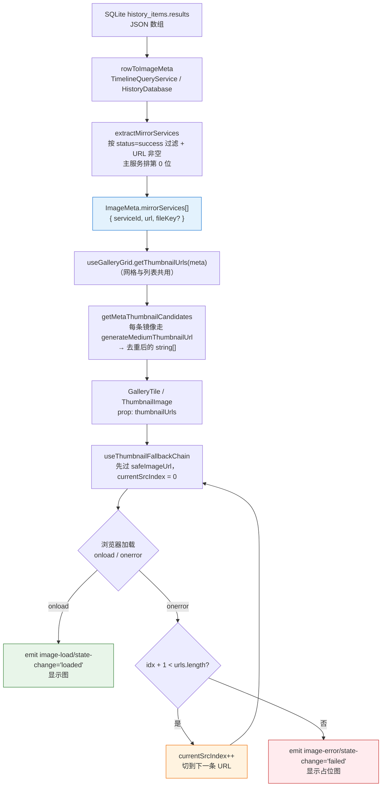
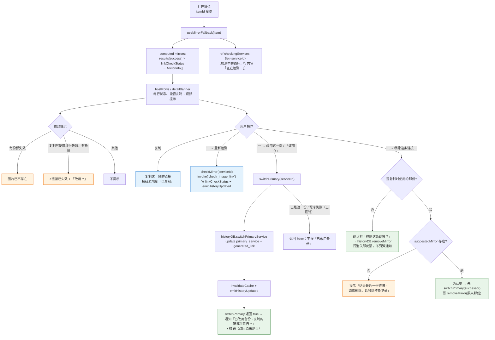
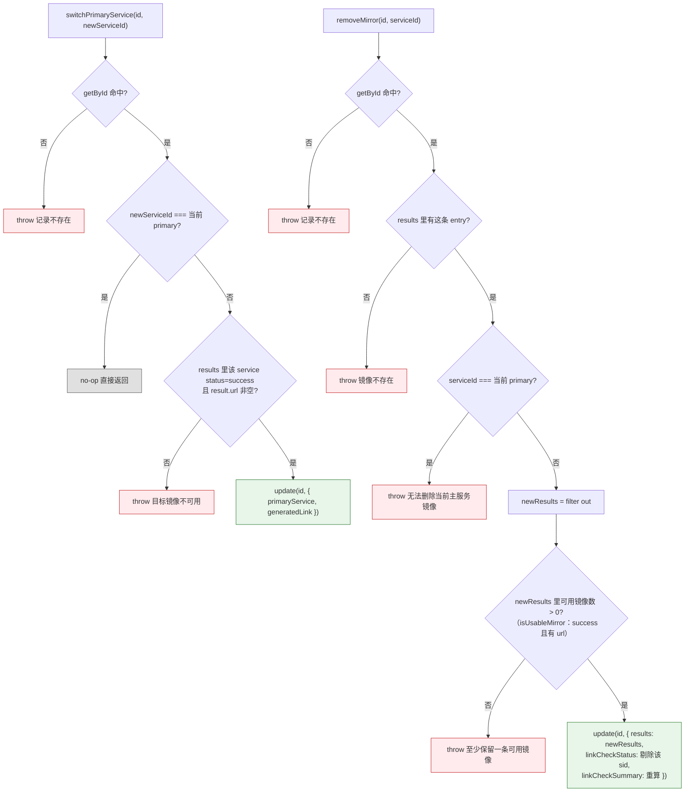

# 多图床备份 fallback 与切换流程

> 一张图片上传到多个图床时，图库如何选择显示的那份、「复制时使用」的那份失效如何兜底、用户如何改用备份 / 移除链接 / 重新检测单条。排查「图库里图片加载失败」「改用备份不生效」「移除链接报错」时查看本文档。
>
> **术语说明**：界面文案说「复制时使用」「备份」（不说「主链接 / 主图床」）；内部字段与类型名（`primaryService`、`MirrorInfo` / `MirrorCheckState` / `useMirrorFallback`、`switchPrimaryService`）沿用旧词源，保持代码侧稳定。

---

## 核心理念

每条 HistoryItem 的 `results` 数组存储了**所有成功/失败的图床上传记录**，复制时用的是其中一份：「复制时使用」（`primaryService` + `generatedLink`）。备份兜底分两层：

| 层级 | 场景 | 机制 | 用户感知 |
|------|------|------|---------|
| **层 1：视觉兜底** | 「复制时使用」那份在浏览器里 404 / 超时 | 缩略图候选链（`useThumbnailFallbackChain`）自动换下一份备份的地址 | 无感知，看到的一直是正常图 |
| **层 2：主动管理** | 链接检测已标记某份失效 | 图库详情面板（宽 340）的图床行：复制 / ⋯ 菜单（改用这一份 / 重新检测 / 在浏览器打开 / 移除这条链接…）；「复制时使用」那份失效时顶部琥珀提示 +「改用 X」 | 出问题才显示琥珀色 ⚠ + 原因，正常不打标记 |

**为什么不全自动改用备份？** 链接检测有误判（尤其防盗链 403 实际浏览器能看），自动改 DB 会把"能用的"换成"可能也能用的"。所以：**视觉兜底自动，数据层改动由用户点**——「改用」立即生效、不弹确认，通知里带「撤销」；「移除这条链接」会再确认一次。

---

## 图 1：层 1 视觉兜底数据流

浏览列表加载缩略图时，后端把 `results` JSON 里全部成功镜像抽成 `ImageMeta.mirrorServices[]`，前端组件按序尝试。主服务在数组首位，其余按 `results` 原顺序。

> **关键源文件**：
> - `src/types/image-meta.ts`（`extractMirrorServices`、`MirrorService`）
> - `src/services/database/TimelineQueryService.ts`（`rowToImageMeta`）
> - `src/services/database/HistoryDatabase.ts`（`rowToImageMeta`）
> - `src/composables/image/useThumbCache.ts`（`getMetaThumbnailCandidates`）
> - `src/composables/image/useThumbnailFallbackChain.ts`（先过 `safeImageUrl`，再按序试）
> - `src/views/gallery/GalleryTile.vue`（网格的格子）、`src/views/gallery/GalleryList.vue`（列表的缩略图走 `ThumbnailImage`，同一份候选链）

### 关键不变量

| 不变量 | 原因 |
|--------|------|
| `mirrorServices[0]` 总是当前主服务 | `extractMirrorServices` 把 `serviceId === primaryService` 单独抽出放首位 |
| 每条镜像必须有 `result.url` | 空 URL 无法作为 ``，直接跳过 |
| 滚动预热只取一条 | `useImagePreload` 只预热候选链里第一条通过 `safeImageUrl` 的地址（正是格子自己会先试的那条）；往后翻只在可视区域的 `` 真正失败时发生，避免浪费带宽 |
| 列表失败态不反映到 DB | 层 1 完全是客户端兜底。真正的"失效"判定只走 link-check |
| 同一 meta 对象 + 同一配置 → 候选数组引用稳定 | `getMetaThumbnailCandidates` 的 `WeakMap` 缓存**以 meta 对象本身为键**。图库网格在模板里逐格调用它，引用抖动会让格子全量 re-render |
| 镜像变化必然产生新的 `ImageMeta` 对象 | 改用备份/移除链接/重试补齐都先写 DB，再经 `emitHistoryUpdated` 让视图重查，`rowToImageMeta` 产出新对象 → WeakMap 天然未命中。**所以该缓存不接 cacheEvent、也不进 `clearThumbCache()`**；配置维度由条目里的指纹兜底——指纹包含前缀模板、知乎 source 开关/值、R2 缩略图代理开关、**以及当前会话的代理可达性**（[useThumbCache.ts:243-251](../../src/composables/image/useThumbCache.ts#L243)：代理探测失败时候选链会少一条，图库网格只认指纹，漏掉这项会停在"代理在前"的旧候选上不刷新） |

---

## 图 2：层 2 主动管理交互流

图库里管理备份的地方有两处：

- **详情面板**（单击一张图，右侧宽 340）：每个图床一行，状态只在需要时写（复制时使用 / 可能受限 / 图片已不存在 / 尚未检测 / 正在检测…），每行有「复制」和 ⋯ 菜单。「复制时使用」那份失效时，顶部琥珀提示「X链接已失效」+ 唯一主按钮「改用 Y」；每份都失效时提示「图片已不存在」。
- **灯箱**（双击 / 空格）：「复制时使用」那份加载不出来时，顶栏提示 +「换个图床」菜单：检测确认失效的写「X链接已失效，可切换图床查看」，断网、超时、没检测过的写「X图片加载失败，可切换图床查看」（不替检测下结论）。**只换这次看的那份**，不改「复制时使用」。

> **关键源文件**：
> - `src/composables/history/useMirrorFallback.ts`（派生态 + 改用 / 移除 / 单条检测）
> - `src/views/gallery/detailHosts.ts`（每行的状态与顶部提示，纯函数）
> - `src/views/gallery/GalleryDetail.vue`、`src/views/gallery/GalleryDetailHosts.vue`（详情面板）
> - `src/views/gallery/GalleryLightbox.vue`（「换个图床」）
> - `src/views/gallery/useGalleryActions.ts`（`announceSwitch`：「已改用备份」通知 + 撤销）
> - `src/services/database/HistoryDatabase.ts`（`switchPrimaryService`、`removeMirror`）

---

## 图 3：DB 层写入守卫

`switchPrimaryService` / `removeMirror` 都基于现有 `update(id, Partial<HistoryItem>)` 路径，但额外带三重守卫防止数据损坏。

> **关键源文件**：`src/services/database/HistoryDatabase.ts`（`switchPrimaryService`、`removeMirror`、`update`）

### 为什么删除"最后一条可用镜像"抛错而非自动删整条记录？

让用户做显式选择。如果自动连锁删除整条历史记录：
- 用户本意可能只是想清理某个失效链接
- 删整条会丢掉 timestamp/localFileName/favorite 状态等元信息
- 没有撤销机制时风险太高

所以详情在每份都失效时只**提示**「图片已不存在」，整条记录由用户自己点「移除记录」（带撤销）。

---

## 状态判定规则

`MirrorCheckState` 来自 `useMirrorFallback`，由 `item.linkCheckStatus[serviceId]` 推导：

| linkCheckStatus[sid] | MirrorCheckState | 详情行的状态（`detailHosts.hostRows`） | 可改用 |
|---------------------|------------------|---------|-------------|
| `{ isValid: true }` | `valid` | 不写（正常不打标记）；复制时使用的那份写「复制时使用」 | ✅ |
| `{ isValid: false, browserMightWork: true }` | `invalid` | 琥珀 ⚠「可能受限」 | ✅ |
| `{ isValid: false }` | `invalid` | 琥珀 ⚠「图片已不存在」，不能复制 | ❌ |
| `undefined`（未跑过检测） | `unchecked` | 「尚未检测」 | ✅ |

> **注意**：`isValid: false` 包含了所有 HTTP 4xx/5xx/timeout/network，也包括 link-check 的误判（尤其防盗链 403 + `browser_might_work=true` 的场景）。界面写「可能受限」。确认失效的那份不提供「改用这一份」，是**保护用户**免于切错。怀疑误报时，用 ⋯ 菜单的「重新检测」或「在浏览器打开」验证。

---

## 边界情况与处理

| # | 场景 | 行为 |
|---|------|------|
| 1 | 只有 1 条成功图床 | 详情只有一行，没有「改用这一份」；「上传到」勾了 2 个及以上图床时格子上常驻「仅 1 份」提示（只勾一个时张张如此，不标） |
| 2 | 全部图床链接失效 | 详情顶部「图片已不存在」；灯箱显示「X上的图片已不存在」（只是这次没加载出来、没检测过的写「X上的图片加载失败」） |
| 3 | 从未跑过链接检测 | 各行写「尚未检测」，⋯ 菜单「重新检测」可单条检测 |
| 4 | 防盗链误报失效 | ⋯ 菜单重新检测刷新；或「在浏览器打开」验证后手动改用 |
| 5 | 改用后的 `generatedLink` | DB 层写入时已同步更新为新的那份的 `result.url` |
| 6 | 删最后一条成功图床 | DB 层抛错；composable 层在「删复制时使用那份但无 successor」时前置提示「这是最后一份链接」，引导去「移除记录」 |
| 7 | 删复制时使用的那份（有 successor） | composable 先 `switchPrimary(successor)` 再 `removeMirror(原来那份)`，避免碰到 DB 层"不能删当前 primary"的守卫；第二步失败时提示「已改用 Y，但旧链接未移除」 |
| 8 | 单条重新检测并发 | `checkingServices` Set 按 serviceId 守卫，检测中的那行菜单项置灰 |
| 9 | 撤销 | 「改用」不确认、通知带撤销（改回原来那份）；「移除这条链接」先确认，无撤销 |
| 10 | linkCheckStatus 陈旧 | 详情显示的是上次检测的快照，用 ⋯ 菜单「重新检测」刷新 |
| 11 | `onerror` 触发后如何同步到 DB | 层 1 完全不同步。失效判定只通过 link-check 写入 `linkCheckStatus` |
| 12 | WebDAV 同步 | `switchPrimaryService` / `removeMirror` 都走 `update()`，但**不写 `timestamp`**（[HistoryDatabase.ts:260](../../src/services/database/HistoryDatabase.ts#L260) 逐列门控，两个调用方都没传这一列），本项目**没有脏标记/版本列机制**。云端合并（[HistoryMerge.ts](../../src/services/database/HistoryMerge.ts) 的 `mergeHistoryCollections`/`hasHistoryItemChanged`）判断"要不要同步"只看 `timestamp` + 收藏签名，于是改用备份、移除链接、详情里单条重新检测这类内容层改动，**不会**被"同步"（双向）、合并上传等常规同步路径带上云端——这些路径要么判定"无需上传"直接跳过，要么像双向同步那样无条件弹成功提示却什么都没真正推上去。只有手动执行"更多 → 覆盖云端"（整份覆盖，不经过 merge 比较）才能真正把这类改动带上云端。反过来，"覆盖本地"或换机器用云端数据恢复，都可能把本地已经处理掉的旧链接、原来复制时使用的那份原样带回来 |
| 13 | 批量操作多条记录 | 多选栏不提供改用 / 移除链接，只有复制（可指定从哪个图床复制）、重新检测、补充备份 |

---

## 排查指南

| 现象 | 可能原因 | 对照位置 |
|------|---------|---------|
| 图库里显示「图片加载失败」 | 该条 mirrorServices 所有地址都失败，或都被 `safeImageUrl` 拦下（明文 HTTP 未确认 / 内网地址）；或从未填充 mirrorServices | 图 1 `extractMirrorServices`；检查 `results` 是否都含 `result.url` |
| 详情里没有「改用这一份」 | 那份确认失效（`health = dead`），或它本来就是复制时使用的那份 | `GalleryDetailHosts.vue` 菜单项条件 |
| 没出现「X链接已失效」提示 | 复制时使用的那份没被链接检测标记失效；去跑检测或 ⋯ 菜单单条检测 | `detailHosts.detailBanner` |
| 单条检测没反应 | 该 serviceId 正在检测中（`checkingServices` 里），并发守卫拦截 | `useMirrorFallback.checkMirror` |
| 改用后其他视图图标没刷新 | `emitHistoryUpdated` 事件未被该视图监听 | `src/events/cacheEvents.ts`，检查 `onCacheEventType('history-updated')` 注册 |
| 显示失效但图片实际能看 | 链接检测误判（通常是防盗链 403）。⋯ 菜单重新检测，或在浏览器打开验证 | [link-check-flow.md 图 1](./link-check-flow.md#图-1服务感知请求流程) 防盗链分支 |
| 移除复制时使用那份提示「这是最后一份链接」 | 唯一剩余链接禁止移除（会丢整条记录）。用详情底部「移除记录」 | `useMirrorFallback.removeMirror` 复制来源分支 |
| 移除链接后 link-check 总计没变 | 该记录从未跑过 link-check（无 `previousSummary` 时不凭空造 summary），或改动被回退 | `removeMirror` 会经 `recomputeLinkCheckSummary` 重算总计，口径与 `stripServiceFromItem` 一致（`isUsableMirror`） |
| 改用了备份/移除了链接，点"同步"之后又变回去了 | 常规「同步」（双向）/合并上传只比较 `timestamp` + 收藏签名，镜像字段的改动不算数，云端那份还是旧的；之后再点「覆盖本地」或换机器用云端数据恢复，会把云端的旧链接 / 原来复制时使用的那份整份带回来 | 边界 12；[HistoryMerge.ts](../../src/services/database/HistoryMerge.ts) 的 `hasHistoryItemChanged`；真要把这类改动同步上云端，只能手动「更多 → 覆盖云端」 |

---

## 相关文档

- [历史查询流程](./history-flow.md) — 图库的读取、筛选、批量操作，备份管理是其上的扩展动作
- [同步流程](./sync-flow.md) — 增量/合并/双向同步的判定逻辑（只看 timestamp + 收藏签名），边界 12 的同步限制即来自这里
- [链接检测流程](./link-check-flow.md) — `linkCheckStatus` 的写入源，判定哪些镜像被标记失效
- [辅助功能流程 图 11](./auxiliary-flows.md#图-11链接检测流程) — 链接检测主流程
- [数据持久化流程](./data-persistence.md) — `results` JSON 字段的序列化位置
