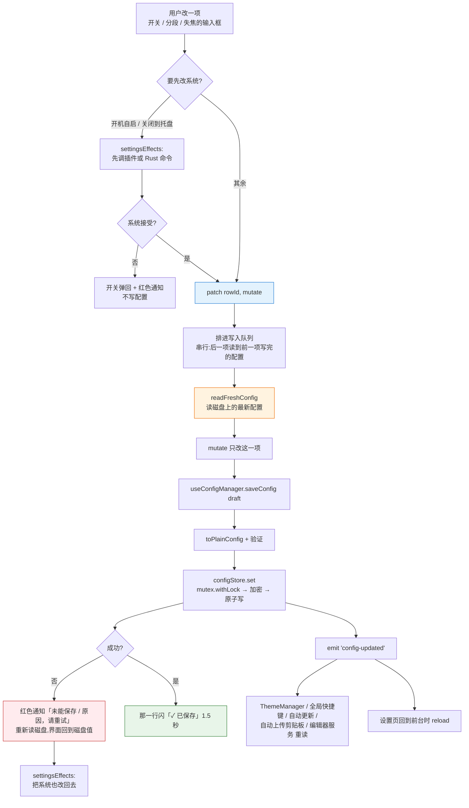
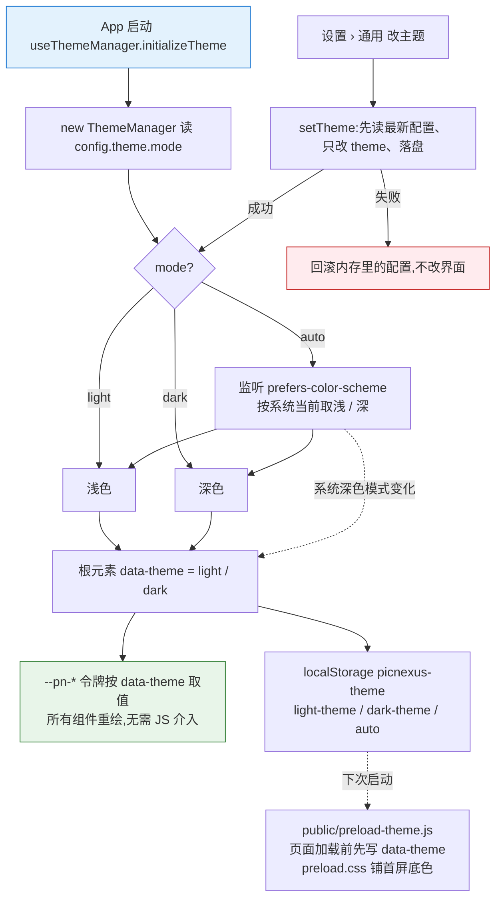
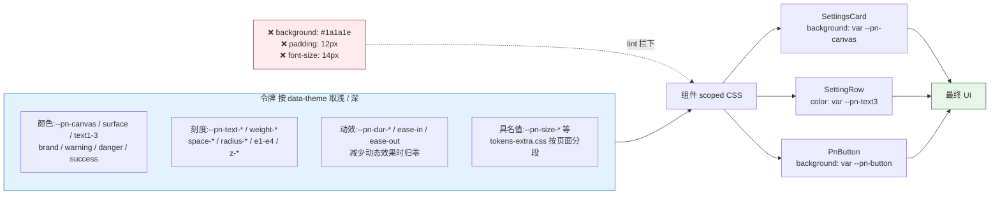
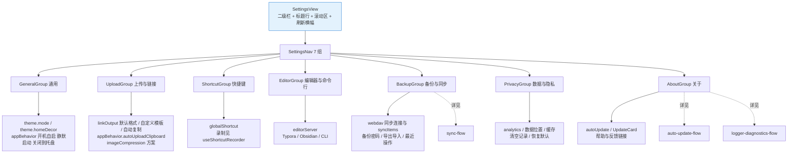
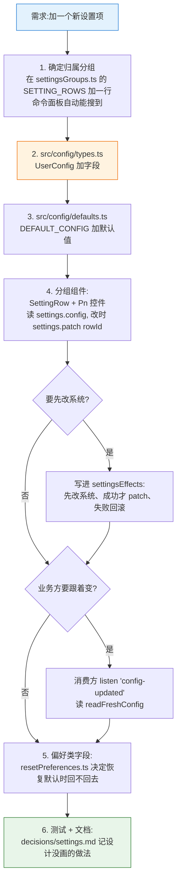

# 设置面板 + 主题架构流程

> 从「用户修改设置项」到「加密落盘 + 跨组件同步 + 主题切换生效」的完整闭环。**新增设置项、改主题切换逻辑、排查配置丢失/未持久化**时优先查看此文档。

## 概览

PicNexus 的配置系统绕开了 `tauri-plugin-store`,采用**自写 SimpleStore + AES-GCM 加密 + 互斥锁**的方案:

- **配置存储**:`configStore = new Store('.settings.dat')`,单例,**禁止再次 new**(CLAUDE.md 规定)
- **加密**:AES-GCM,支持"随机密钥"和"备份密码"两种格式(v2.8+)
- **并发控制**:全局互斥锁,防止多处同时写入导致数据损坏(v2.9+)
- **配置入口**:`useConfigManager()` composable,返回响应式 `config` + `loadConfig` + `saveConfig`；设置页只经 `useSettingsConfig().patch` 写配置(见图 1)
- **主题切换**:`ThemeManager` 在根元素写 `data-theme="light|dark"`,`--pn-*` 令牌按它取浅 / 深两套值
- **跨组件同步**:保存后 `emit('config-updated')`,其他 composable 通过 `listen('config-updated')` 重新读取
- **强制规则**:序列化 config 时必须先调 `toPlainConfig()` 剥离 Vue Proxy

---

## 图 1:设置页改一项(读最新 → 只改这一项 → 写 → 广播)

设置页不握表单副本:每改一项都从磁盘读最新配置、只改这一项、整份保存。副本整份回写会用旧值盖掉图床页、托盘、云同步刚写进去的东西;图床字段设置页从来不碰。

> **关键源文件**:`src/views/settings/useSettingsConfig.ts`(唯一写入口)、`src/views/settings/settingsEffects.ts`(要先改系统的几项)、`src/composables/useConfig.ts`、`src/store/instances.ts`



**要点**

- 文本类(模板、端口、压缩参数)离开输入框或停手半秒才 `patch`;开关、分段改了立刻 `patch`。
- 主题由 `ThemeManager.setTheme` 自己落盘(同样读最新配置、只改 `theme`),设置页随后 `reload`。
- 云同步合并 / 覆盖本机、从文件导入配置后,设置页顶部出现刷新横幅(「云端配置已下载，刷新后生效。」/「配置已导入，刷新后生效。」),点「刷新」整窗重新载入。

---

## 图 2:主题切换的运行时机制

`ThemeManager` 在三种模式(`light` / `dark` / `auto`)下写根元素的 `data-theme`,跟随系统时监听深色模式变化。

> **关键源文件**:`src/theme/ThemeManager.ts`、`src/composables/useTheme.ts`、`public/preload-theme.js`、`src/styles/tokens.css`



**关键细节**:

- **只有一个开关 `data-theme`**:组件只引用令牌(背景装饰 `BgDecor` 浅深画的图形不同,是唯一按 `[data-theme]` 切换的组件);灯箱、压缩预览这类始终深色的区域在容器上写 `data-theme="dark"`
- **先落盘再改界面**:避免界面已切换、磁盘写失败,下次启动又跳回旧主题
- **localStorage 只为首屏不闪**:`preload-theme.js` 在 Vue 挂载前按它写好 `data-theme`;真相源仍是配置里的 `theme.mode`
- **auto 模式的监听器**:`setTheme(mode)` 先移除旧监听再按需添加,避免重复触发
- Cookie 登录小窗按主窗口传来的 `?theme=` 写自己的 `data-theme`(`useLoginTheme.ts`、`login-titlebar.ts`)

---

## 图 3:令牌与组件

令牌分两份:`tokens.css`(设计稿导出,原样)与 `tokens-extra.css`(设计稿用到、导出没收录的具名值)。组件只写 `var(--pn-*)`,不写数值。详见 [tokens.md](../design/tokens.md)。

> **关键源文件**:`src/styles/tokens.css`、`src/styles/tokens-extra.css`、`src/styles/pn-base.css`、`docs/design/tokens.md`



---

## 图 4:设置页分组与职责

`src/views/settings/` 每组一个组件,`settingsGroups.ts` 是分组与每一行的表(命令面板的设置项也从这张表生成)。新增设置项时先判断归属哪一组。图床的连接、凭证与启用不在设置页，在图床页（路由 `/hosts`，`src/views/hosts/`，见 [HANDOFF §4](../design/redesign/handoff/HANDOFF.md)）；设置页从不写图床配置。各组设计没画、开发时补的做法见 [decisions/settings.md](../design/redesign/decisions/settings.md)。



### 图床「启用」的三个字段（别混淆）

| 字段 | 语义 | 谁写入 |
|------|------|--------|
| `config.availableServices` | 「已添加」的一半：图床在这里**并且**免配置或凭证已填，才算已添加（出现在图床页左栏、首页「上传到」、托盘） | 图床页 `hostConfig.connectHost` / `disconnectHost` / `restoreHost`（撤销）；首页一键加免配置图床 `useUploadController.enableNoConfigHost`；新手引导「开始使用」`useUploadController.applyConfigPatch` |
| `config.enabledServices` | 「启用」= 上传时传到它；图床页的「启用 / 停用」和首页「上传到」的勾选是同一个字段 | `useUploadController.toggleHost`（图床页 `useHosts.toggleEnabled` 也调它）、托盘菜单；连接成功时 `connectHost` 一并启用；新手引导第 2 步勾选京东 / 七鱼（「开始使用」时一次写入） |
| `config.services.*.enabled` | **已退化为死字段**：写入方一律写 `true`，唯一读取点 `MultiServiceUploader.filterConfiguredServices` 对任何已知服务都不可达。不要依赖它 | — |

配套规则：

- **判定「已添加 / 启用 / 出问题」只看 `useUploadController().hosts`**，图床页、首页与托盘菜单（`src/tray/installTray.ts`）共用这一份，不要各自再拼一遍。
- **移除图床 = 清掉凭证并移出两个列表**（通知带撤销，撤销按快照原样恢复，含原来的位置）；WebDAV / 自定义 S3 叫「删除这份」，同时删掉 profile 并 `syncProfileUploaders`。
- **公共风险图床**（`PUBLIC_RISK_SERVICES`）的启用一律先过 `usePublicRiskConfirm().ensureAccepted()`（P11 弹窗），它和新手引导是 `publicServiceRiskAccepted` 仅有的两个置位入口（引导第 2 步的勾选卡下面写着风险说明，勾选即视为确认，`onboardingModel.applyChoice`）；绕过这两处启用，会让上传时被静默过滤。
- `availableServices` **可以为空**（一个图床都没添加是正常状态：首页显示「没有图床」，图床页右侧直接是目录）。

---

## 新增设置项的标准流程



---

## 链接前缀（微博代理）数据结构

`config.linkPrefixConfig.prefixList` 是 `LinkPrefixItem[]`（不是字符串数组）：

```ts
interface LinkPrefixItem { name: string; template: string }
```

`template` 支持 4 种占位符，由 `src/utils/linkPrefixTemplate.ts` 解析：

| 占位符 | 含义 | 典型用法 |
|--------|------|---------|
| `{url}` | 完整原 URL | 显式声明位置 |
| `{url_no_scheme}` | 去掉 `https://` / `http://` | Jetpack 风格 |
| `{path}` | 去掉协议和域名，仅保留路径 | IPFS Scan 风格 |
| `{url_encoded}` | `encodeURIComponent` | 搜狗 / query 参数型 |

**兼容规则**：template 若不含任何占位符，拼接时自动在末尾追加 `{url}`，等价于旧版纯前缀行为。

默认列表定义在 [src/config/configInterface.ts](../../src/config/configInterface.ts) 的 `DEFAULT_LINK_PREFIXES`，当前包含搜狗图片 / CDN JSON / Jetpack / IPFS Scan 四项。

在图床页微博详情里选择与增删（[HostSettings.vue](../../src/views/hosts/HostSettings.vue) + [HostTemplateList.vue](../../src/views/hosts/HostTemplateList.vue)）：「不加前缀」= `enabled: false`，其余各项对应 `prefixList`；「添加模板…」弹窗填 `name` + `template`，改动即保存。

反向解析（MD 解析器把带前缀的 URL 剥回原始 URL）由 `stripPrefixTemplate()` 完成，[mdParser.ts](../../src/utils/mdParser.ts) 的 `stripKnownPrefixes` 遍历 `prefixList` 尝试匹配。

---

## 排查指南

| 现象 | 可能原因 | 对照图表位置 |
|------|---------|-------------|
| 改完设置刷新后丢失 | 没走 `useSettingsConfig().patch`,或 patch 失败(看「未能保存」通知与日志) | 图1 C、G1 |
| 保存报 `Converting circular structure to JSON` | 没调 `toPlainConfig`,直接序列化 Vue Proxy | 图1 L1 |
| 多处写配置偶尔丢数据 | 没过 `mutex.withLock`(自己 new Store 绕过了单例),或拿旧副本整份回写(设置页一律先 `readFreshConfig`) | 图1 D、M |
| 修改主题后部分组件没变色 | 该组件写了数值颜色,没引用 `--pn-*` 令牌(lint 会拦) | 图3 X |
| auto 模式系统切换不生效 | `setTheme('auto')` 没正确注册 mediaQuery listener | 图2 E3 |
| 启动时短暂闪一下另一种底色 | `public/preload-theme.js` 没读到 `picnexus-theme`,或 `preload.css` 的手抄色值与令牌不一致(`check-theme-token-copies` 会拦) | 图2 P |
| 保存后其他组件没重新响应 | 没 `listen('config-updated')`,或监听后没 unlisten 导致重复 | 图1 P |
| 配置文件打不开/解密失败 | 备份密码机制触发,启动时弹「还原备份配置」(D01) | [app-lifecycle](./app-lifecycle.md) |
| 新增字段迁移老配置报错 | 新字段没在 DEFAULT_CONFIG 加默认值,老 config 读到 undefined | 新增流程 C、D |
| 改了开机自启,系统和开关对不上 | 系统改成功后写配置失败,回滚也失败(看日志「回滚失败」) | 图1 G2 |
| 云同步后设置页还是旧值 | 下载的配置要刷新后生效,看页顶刷新横幅 | 图1 要点 |
| 样式被硬编码污染 | 违反 AGENTS.md,换成 `docs/design/tokens.md` 里的令牌 | 图3 |
| 新加的链接前缀没生效 / 搜狗风格 URL 不对 | template 占位符拼错,或调用方没过 `applyPrefixTemplate` 直接字符串拼接 | 链接前缀数据结构 |
| 新建的自定义 S3 / WebDAV 在上传界面看不到 | 还没「测试并连接」成功（草稿不保存），或凭证没填全（被 `unconfigured` 过滤挡住） | 图床「启用」的三个字段 |
| 改了 `services.*.enabled` 却毫无效果 | 该字段已退化为死字段，启用看 `enabledServices` | 图床「启用」的三个字段 |
| 图床页左栏有它，上传时却没传 | 它是「停用」（不在 `enabledServices`）；或是公共图床、还没同意风险提示 | 图床「启用」的三个字段 |

---

## 相关文档

- [设计规范总集](../design/) — tokens / themes / ui-patterns / settings-layout
- [数据持久化](./data-persistence.md) — `.settings.dat` 的加密存储细节
- [应用生命周期](./app-lifecycle.md) — `loadConfig` 的启动时机
- [IPC 命令层](./ipc-command-flow.md) — `emit/listen` 的事件系统基础
- [自动更新](./auto-update-flow.md) — `autoUpdateEnabled` 开关消费样例
- [日志与诊断](./logger-diagnostics-flow.md) — 「关于」里的「打开日志目录」
