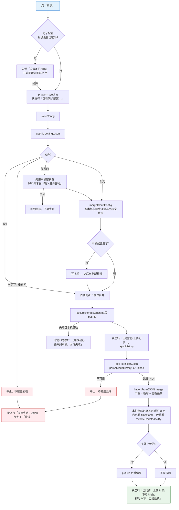
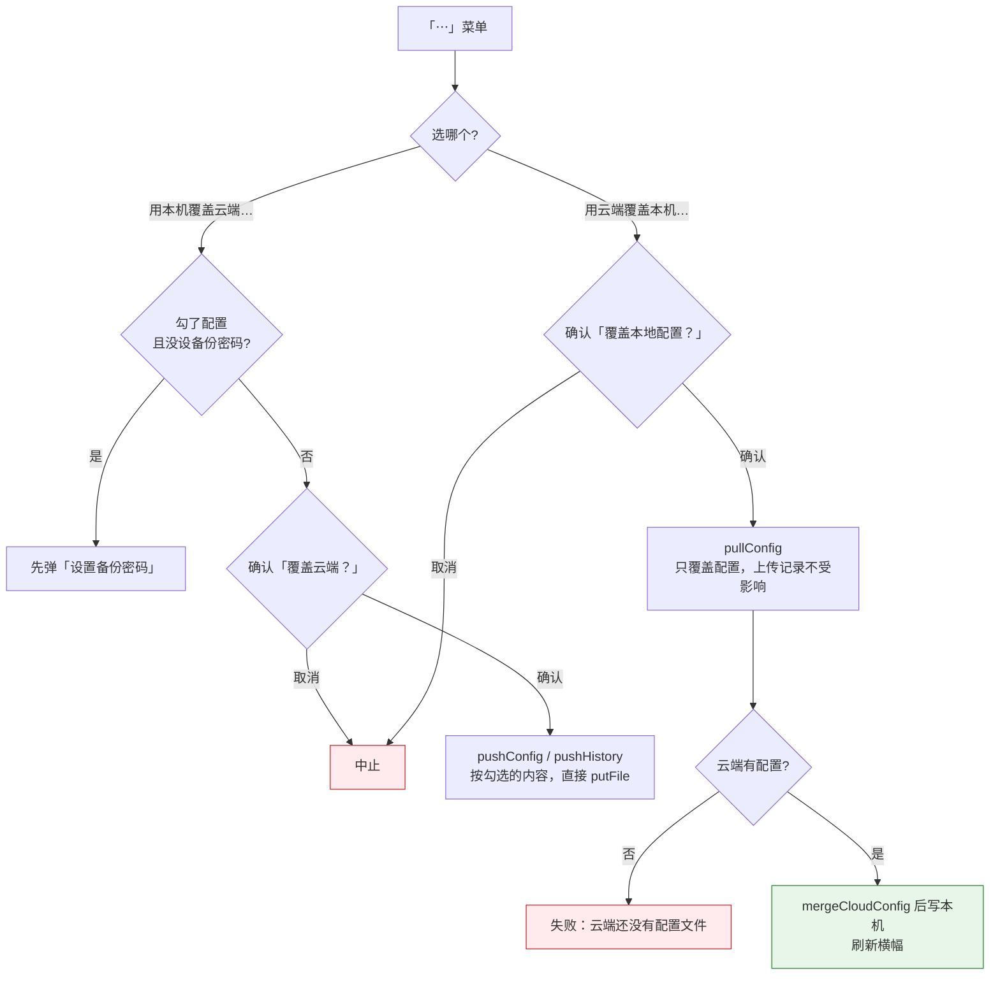

# 同步流程

> WebDAV 云同步的完整流程图解。排查同步失败、冲突、数据丢失时查看此文档。界面（设置 › 备份与同步，S05 / S11–S15）的做法见 [decisions/settings.md](../design/redesign/decisions/settings.md)「备份与同步」。

---

## 图 1：一次「同步」（先配置，后记录）

设置页云同步卡的「同步」按勾选的内容（`webdav.syncItems`）依次跑配置、上传记录，一步失败就停，已完成的照旧算数。状态是应用级的：同步中离开设置页照常跑完。

> **关键源文件**：`src/views/settings/useCloudSync.ts`（状态机）、`src/composables/backup-sync/ConfigSync.ts`、`src/composables/backup-sync/HistorySync.ts`

**要点**

- 配置文件一律加密上传（`secureStorage.encrypt`，备份密码模式），所以同步配置前必须设好备份密码：界面先弹设置密码，`syncConfig` / `pushConfig` 底层也会在联网前拒绝无密码调用（`NEED_BACKUP_PASSWORD`）。上传记录是明文 JSON，不加密。
- 下载的加密配置先用本机钥匙串里的密钥解（本机设过同一个备份密码就不问）；解不开（新设备、云端用的是别的密码）才弹「输入备份密码」，取消 = 整次同步回到空闲。
- 合并、覆盖本机、从文件导入配置都经 `mergeCloudConfig`：保留本机的 `webdav`（同步连接与 `syncItems`）和 `linkHealth.docFolders`（本机路径）。
- 每一步写一条「最近操作」（`sync_settings`、`sync_history`），失败的写原因；同步记录的说法由 `describeHistorySync` 生成（为 0 的一半不写、千分位）。

---

## 图 2：「⋯」里的两个覆盖操作

> **关键源文件**：`src/views/settings/CloudSyncCard.vue`、`useCloudSync.ts` 的 `overwriteCloud` / `overwriteLocal`

> **⚠️ 上传方向的「云端数据不可用」判定（防静默覆盖）**
>
> 「同步」两步都在拉取云端后把结果分成三态，只有第一态允许继续上传：
>
> | `getFile` 返回 | 含义 | 处置 |
> |---------------|------|------|
> | `null`（HTTP 404） | 云端还没有这个文件 | **首次同步的正常路径**，继续全量上传 |
> | `''`（200 + 空响应体） | 文件在，但是 0 字节 | **中止**，原因里指向「⋯ › 用本机覆盖云端…」 |
> | 合法 JSON 但不是数组 / 不是配置 | 文件在，但读不出来 | **中止** |
>
> 记录侧的判定收在 `backupSyncUtils.parseCloudHistoryForUpload`，配置侧在 `ConfigSync.readCloudConfig`。
> 中止原因的措辞刻意避开「文件不存在」/`404`/`not found`：`isWebDAVNotFoundError` 是**子串匹配**，
> 命中就会把中止当成「云端没这个文件」吞掉，静默退化回覆盖云端。
> 「用云端覆盖本机」方向反过来：`null` 的正确含义是「没东西可还原」，必须失败，不能当空配置继续。

---

## 排查指南

| 现象 | 可能原因 | 对照图表位置 |
|------|---------|-------------|
| 「同步」点了没反应 | 正在同步（按钮写「同步中」），或配置、上传记录都没勾（按钮置灰、状态行「未选择同步内容」） | 图1 |
| 每次同步都要输备份密码 | 本机钥匙串里的密钥与云端配置用的密码不一致（换过密码、云端是别的设备传的）；输一次对的密码即可继续 | 图1 C3 |
| 认证失败 (401) | WebDAV 用户名或应用密码错误；坚果云要填「应用密码」 | 图1 C1 |
| 远程路径不存在 (404) | 远程目录没建；首次同步 404 是正常的，只有 PUT 报 404 才是路径错 | 图1 C8 / D5 |
| 存储空间不足 (507) | 云端空间满 | 图1 C8 / D5 |
| 连接超时 | 网络问题或 WebDAV 服务器不可达；外部地址只收 HTTPS | 图1 C1 |
| 「同步未完成：云端改动已合并到本机，回传失败」 | 拉取合并已写进本机，上传那一步失败；本机已经变了，按横幅刷新，再「重试」 | 图1 CP |
| 「云端历史文件为空，已中止…」 | 云端 `history.json` 是 0 字节（多半是上次上传中断留下的）。这是**防覆盖保护**：如确定云端没有数据，用「⋯ › 用本机覆盖云端…」 | 图2 下方表 |
| 「云端历史数据格式错误：期望数组格式」 | 远端路径下的 `history.json` 不是 PicNexus 导出的格式 | 图2 下方表 |
| 合并后数据比预期少 | 远端文件缺少对应 ID，或旧备份没有收藏版本字段导致只能按已有版本合并 | 图1 D3 |
| 下载后提示「跳过 N 条格式无效记录」 | 云端记录缺必需字段（`timestamp` / `localFileName` / `primaryService` / `results`），不入库；本地同 id 的旧记录保留 | `ImportExportService.importHistoryFromJson` |
| 同步失败但文案是 `[object Object]` | `webdav.ts` 未解包 Tauri `AppError`；检查是否又改回了 `String(error)` | `src/types/errors.ts` |
| 下载后配置未生效 | 下载的配置刷新后生效，看设置页顶部的刷新横幅 | 图1 C7 |
| 历史记录下载后列表空 | `history-updated` 事件未触发视图刷新 | 图1 D2 |
| SSL 证书错误 | 自签名证书未被信任 | 图1 C1 |

---

## 相关文档

- [设置页架构](./settings-ui-architecture.md) — 备份与同步分组在设置页里的位置、刷新横幅
- [数据持久化流程](./data-persistence.md) — 配置存储和历史数据库的底层机制
- [历史查询流程](./history-flow.md) — 同步的历史数据来源与查询机制
- [敏感字段契约](../reference/patterns/sensitive-field-contract.md) — 同步连接密码的存法
- [休眠白屏修复](../reference/troubleshooting/sleep-resume-white-screen.md) — 休眠后 SQLite 连接丢失可能影响同步
