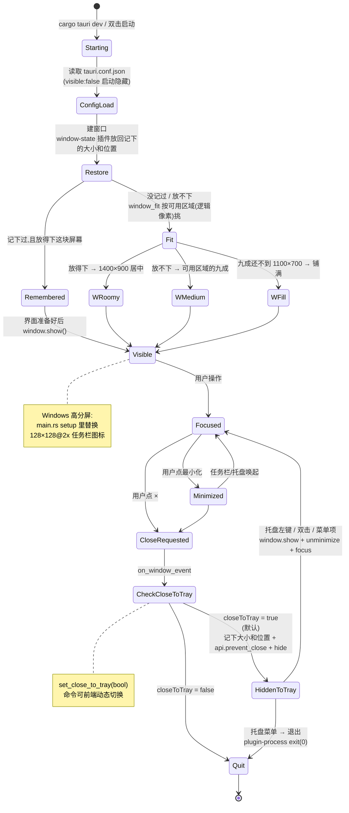
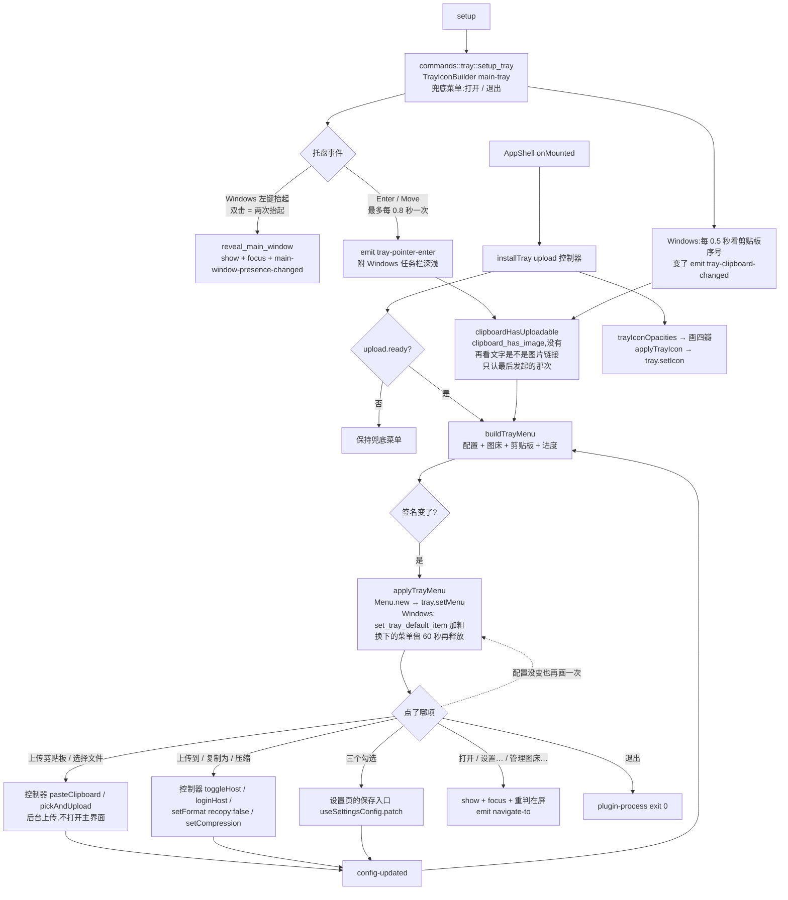
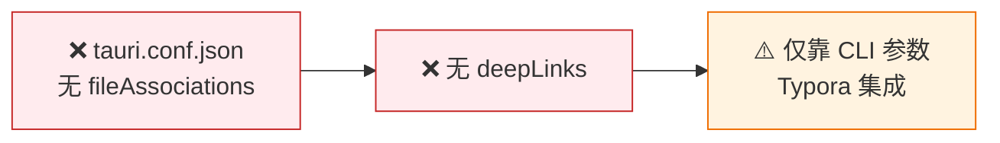

# 窗口 / 托盘 / 快捷键 / 文件关联流程

> 桌面集成层:窗口生命周期、关闭到托盘、系统托盘菜单、CLI 启动参数、以及全局快捷键/文件关联的实现状态。修改这些行为时优先查看此文档。

## 概览

PicNexus 是**单窗口 + 系统托盘** 架构:

- **窗口**:无标题栏(`decorations: false`,使用自定义装饰条),启动时隐藏(`visible: false`),界面准备好才显示。大小和位置由 `tauri-plugin-window-state` 记下、下次放回(只记这两样,不记最大化:Windows 上隐藏的窗口一最大化就会弹出来);没记过、或记下的放不下现在的屏幕(换了显示器)时,`window_fit.rs` 按这块屏幕扣掉任务栏后的可用区域、用逻辑像素挑:放得下就是 1400×900,放不下就取可用区域的九成,九成还不到 1100×700 就铺满。居中与铺满都按内容区算,Windows 给无边框窗口留的那圈看不见的拖拽边露在外面
- **关闭行为**:默认 `closeToTray = true`,点 × 只隐藏到托盘,不退出进程;可通过 `set_close_to_tray` 命令切换
- **系统托盘**:三个平台都有,点开是系统原生菜单(交接说明 8.6,T01–T08)。Rust 建图标与点击行为,菜单由主窗口前端按配置画;Windows 左键 / 双击打开主界面、右键菜单,macOS / Linux 点开即菜单(见图 2)
- **全局快捷键**:默认 `Ctrl+Shift+C` 上传剪贴板图片、`Ctrl+Shift+O` 选择文件上传,可在设置 › 快捷键改或整体关闭;上传走应用级上传控制器,与首页、托盘同一条路
- **浏览器快捷键**:主窗口不响应 WebView2 自带的 F5 / Ctrl+R 刷新、Ctrl+P 打印、Ctrl+F 查找栏(`browser_keys.rs`:建窗后在 `AcceleratorKeyPressed` 里逐键告诉浏览器别管,按键照常交给网页,图库的 Ctrl+F 才能聚焦搜索框);开发版留着 F12 等开发者工具键
- **原生右键菜单**:前端只在输入框里、选中的字上放行原生菜单(其余地方不弹,文字能不能选也由前端管,见 [ui-patterns.md](../design/ui-patterns.md)「不像网页」);放行的菜单再由 `browser_menu.rs` 在 `ContextMenuRequested` 里按菜单项名字过滤,只留撤销、重做、剪切、复制、粘贴、粘贴为纯文本、全选、Emoji、拼写建议(开发版另留「检查」),删完不剩就不弹。Edge 的「Import passwords」「Writing direction」名字都是 `other`,选中文字时的「复制链接到高亮」「打印」也去掉
- **单实例**:`tauri-plugin-single-instance`,再次启动只把已运行的主窗口唤起
- **文件关联**:`tauri.conf.json` 未配置 `fileAssociations`;命令行上传使用 `picnexus --service <serviceId> /path/to/img.jpg`,Typora 使用 `--profile typora`,Obsidian 走 HTTP Server。
- **CLI PATH**:设置页的 CLI 开关会同步管理命令入口。Windows 写入用户级注册表;macOS / Linux 创建 `~/.local/bin/picnexus` 符号链接,AppImage 优先链接到 `$APPIMAGE`。

---

## 图 1:窗口生命周期与关闭到托盘

展示应用启动后,主窗口如何创建、显示、最小化、关闭(到托盘)的完整状态机。

> **关键源文件**:`src-tauri/tauri.conf.json`(L17~L33 windows 配置)、`src-tauri/src/main.rs`(`setup` 里的自适应大小、`on_window_event` 关闭到托盘、`set_close_to_tray` 命令)



---

## 图 2:托盘原生菜单

托盘图标由 Rust 建好;菜单内容由主窗口前端从「上传控制器」的配置、图床与上传进度推出来,再用 Tauri 菜单接口画成系统原生菜单。配置在前端加密保存,Rust 读不到,所以菜单只能在前端算。

> **关键源文件**:`src-tauri/src/commands/tray.rs`(建托盘、点击 / 悬停、剪贴板序号、Windows 默认项加粗、任务栏深浅)、`src/tray/trayMenuModel.ts`(配置 → 菜单,纯函数)、`src/tray/trayProgress.ts`(上传进度 → 状态行与花瓣,纯函数)、`src/tray/nativeTray.ts`(画菜单与图标)、`src/tray/installTray.ts`(外壳里常驻:何时重画、点了交给谁)、`src/composables/appPresence.ts`(主窗口在不在屏 → 通知走应用内还是系统通知)



### 同步契约

- **托盘、首页「上传到」、设置页改的是同一份配置**:托盘读 `useUploadController()` 的 `config` / `hosts`,写也走同一个控制器(图床、格式、压缩)或设置页的保存入口(三个勾选)。别处改了配置,控制器收到 `config-updated` 刷新,托盘跟着重画;不要在托盘里另读一份配置。
- **只在菜单「长什么样」变了时重建**(行的 JSON 签名),进度百分比不在菜单里。点完一项后签名没变的也再画一次:系统菜单点勾选项时自己就把勾翻过去了,而配置可能没变(点已选中的格式、点「登录失效」的图床、取消风险确认)。
- **换下来的菜单留 60 秒才释放**:用户看着菜单时可能连着重建几次(上传中每个图床传完一次),正在显示的那份若被销毁,Windows 上会出错。
- **剪贴板状态**:图片或一条图片链接(文字)都算有,与快捷键、首页粘贴同一个判断(`useClipboardImage.clipboardHasUploadable`),别在托盘里另写一套。Windows 靠剪贴板序号(悬停也会重查,但资源管理器转发托盘鼠标移动有延迟,只靠悬停会慢一拍);macOS 靠悬停;Linux 收不到托盘事件,第一项一直可点。
- **托盘发起的上传不打开主界面**:结果靠通知。`useToast` 在主窗口隐藏或最小化时把普通通知改发系统通知(带「撤销」的仍留在应用内);「在不在屏」由 `appPresence` 判断——焦点、尺寸变化、Rust 关到托盘 / 从托盘打开时发的 `main-window-presence-changed`、前端自己 `show()` / `hide()` 之后都会重判,几次判断同时进行时只认最后发起的那次。

托盘写法与平台差异(右列、⚠、状态行、图标颜色)见 [decisions/tray.md](../design/redesign/decisions/tray.md) 与 [README 平台限制记录](../design/redesign/README.md#平台限制记录)。

---

## 图 3:CLI 模式与文件关联(当前实现)

展示 `picnexus --service r2 /path/to/img.jpg` 从命令行启动的流程。普通 CLI 上传必须显式传入图床名;Typora 保留独立配置档 `picnexus --profile typora /path/to/img.jpg`;Obsidian 继续调用本地 HTTP Server。

Obsidian 插件 ID 为 `picnexus`，手动安装目录为 `<vault>/.obsidian/plugins/picnexus/`。插件只连接 `http://127.0.0.1:<port>`，端口必须和桌面端设置一致；发布与上架流程见 [Obsidian 插件发布指南](../reference/guides/obsidian-plugin-release.md)。

> **关键源文件**:`src-tauri/src/cli.rs`、`src-tauri/src/commands/cli_config.rs#save_cli_config`、`%APPDATA%/us.picnex.app/cli-config.json`

```mermaid
flowchart TD
    A[外部调用<br/>picnexus arg] --> B[main.rs 启动前]
    B --> C[cli::parse_args]

    C --> D{ARGV 含什么?}
    D -- --help --> D1[打印帮助<br/>exit 0]
    D -- --version --> D2[打印版本<br/>exit 0]
    D -- --service id path --> D3[普通 CLI 上传模式]
    D -- --json --service id path --> D4[JSON 输出模式]
    D -- --profile typora path --> D6[Typora 上传模式]
    D -- path / 缺少 --service --> D7[打印可用图床和示例<br/>exit 1]
    D -- 无参数 --> D5[进入 GUI 模式<br/>启动 Tauri Builder]

    D3 --> E[读取 cli-config.json<br/>APPDATA/us.picnex.app]
    D4 --> E
    D6 --> E

    E --> F{配置有效?}
    F -- 否 --> F1[stderr 输出错误<br/>exit 1]
    F -- 是 --> S{模式}
    S -- 普通 CLI --> G1[按 --service 从 services 表取图床]
    S -- Typora --> G2[读取 profiles.typora]

    G1 --> H[HTTP 请求 → 图床 API]
    G2 --> H
    H --> I{成功?}
    I -- 是 JSON 模式 --> I1[stdout:<br/>{url, width, height}]
    I -- 是 普通模式 --> I2[stdout: url]
    I -- 否 --> I3[stderr: 错误<br/>exit 1]

    I1 & I2 --> Z[exit 0]
    I3 --> Z

    D5 --> GUI[tauri::Builder 正常启动]

    %% 特点
    note1[⚠️ 每次 CLI 上传都是<br/>独立进程,无单实例守护<br/>与 GUI 实例不通信]:::noteStyle
    D3 -.-> note1

    style A fill:#e3f2fd,stroke:#1976d2
    style GUI fill:#e8f5e9,stroke:#2e7d32
    style Z fill:#e8f5e9,stroke:#2e7d32
    classDef noteStyle fill:#fff3e0,stroke:#ef6c00
```

### CLI PATH 管理

设置 › 编辑器与命令行的命令行卡片（`src/views/settings/useEditorCards.ts`）调用 `get_cli_path_status` / `add_cli_to_path` / `remove_cli_from_path` 管理快捷命令。CLI 开关打开时会尝试启用命令入口并导出 `services` 配置;关闭时会移除命令入口并停止导出普通 CLI 配置。

- Windows:读写 `HKEY_CURRENT_USER\Environment\Path`,加入或移除当前可执行文件目录,变更后广播 `WM_SETTINGCHANGE`。
- macOS / Linux:创建或删除 `~/.local/bin/picnexus` 符号链接。普通包链接到 `current_exe()`;AppImage 运行时若存在 `$APPIMAGE`,优先链接到该真实 AppImage 路径。
- 若 `~/.local/bin/picnexus` 已存在但不是符号链接,或符号链接指向非当前 PicNexus 可执行文件,后端会拒绝覆盖/删除并提示用户手动处理。
- macOS 默认 PATH 通常没有 `~/.local/bin`;此时后端仍返回 `supported: true`,但 `in_path: false`,并在 `message` 中给出一次性 shell 配置命令。

---

## 图 4:文件关联(未实现)



**启用文件关联的步骤**:
1. `tauri.conf.json` 加 `bundle.fileAssociations: [{ ext: ["png","jpg"], role: "Editor" }]`
2. 在 `main.rs` 的 `tauri_plugin_single_instance::init` 回调里把 `argv` 转发到主窗口(插件已加载,现在只唤起窗口)
3. 前端 `listen("open-file", ...)` 接收文件路径,交给 `useUploadController().uploadFiles`

---

## 插件清单(Cargo.toml)

| 插件 | 用途 | 本图关联 |
|------|------|----------|
| `tauri-plugin-autostart` | 开机自启 | — |
| `tauri-plugin-sql` | SQLite 驱动 | [db-migration-flow](./db-migration-flow.md) |
| `tauri-plugin-dialog` | 文件对话框 | — |
| `tauri-plugin-fs` | 文件系统 | — |
| `tauri-plugin-clipboard-manager` | 剪贴板 | [上传流程](./upload-flow.md) |
| `tauri-plugin-notification` | 系统通知 | — |
| `tauri-plugin-shell` | 打开外部链接；token sidecar 由 Rust `portable::run_sidecar` 管理 | — |
| `tauri-plugin-http` | HTTP 客户端 | — |
| `tauri-plugin-global-shortcut` | 全局快捷键 | 概览 |
| `tauri-plugin-updater` | 自动更新 | [auto-update-flow](./auto-update-flow.md) |
| `tauri-plugin-process` | 进程管理 / relaunch | — |
| `tauri-plugin-log` | 日志系统 | [logger-diagnostics](./logger-diagnostics-flow.md) |
| `tauri-plugin-window-state` | 记住主窗口大小和位置(固定 2.4:2.5 起要 Tauri 2.12) | 图1 Restore |

---

## 排查指南

| 现象 | 可能原因 | 对照图表位置 |
|------|---------|-------------|
| 点 × 直接退出而不是隐藏 | `CloseToTrayState` 被设为 `false` | 图1 CheckCloseToTray |
| 托盘一直只有「打开 / 退出」两项 | 前端没画成正式菜单:`installTray` 没装上、`upload.ready` 一直为假,或 `TRAY_ID` 两边不一致(`check-cross-language-constants` 会拦) | 图2 R / FB |
| 托盘勾选与首页 / 设置页对不上 | 托盘另读了一份配置,或没走控制器 / 设置页保存入口;点完没强制重画(系统菜单自己翻的勾没纠正) | 图2 同步契约 |
| 剪贴板里有图,托盘第一项仍是灰的(或反过来) | Windows 剪贴板序号线程没起;macOS 没收到悬停;Linux 本来就不刷新 | 图2 CW / HV |
| 托盘里上传后什么提示都没有 | 主窗口隐藏时 `appPresence` 仍判「在屏」,通知进了看不见的应用内;或系统通知权限被拒 | 图2 同步契约 |
| Windows 上「打开 PicNexus」没加粗 | `set_tray_default_item` 失败(看日志「设置托盘默认项失败」),或默认项的位置算错 | 图2 AM |
| 托盘图标在任务栏上看不清 | Windows 任务栏深浅读取失败(按深色任务栏画了白色);Linux 浅色面板固定白色是已知限制 | 图2 IC |
| 启动时窗口一闪而过 | `visible:true` 配置下 `show()` 时机错乱,应保持 `visible:false` + 代码控制显示;或在隐藏的窗口上调了 `maximize()`(Windows 上会直接把窗口显示出来,所以不记最大化、小屏用铺满) | 图1 Visible |
| 每次打开窗口都回到屏幕中间 | 记录没写成:常驻托盘时只在关到托盘、正常退出两处写盘,直接结束进程前没关过窗口就记不下;文件在系统配置目录的 `.window-state.json`,便携版在 `data/window-state.json` | 图1 Restore |
| 换了显示器后窗口还是上次的大小 | 记下的大小放得下现在的屏幕时照用,只有放不下才重新按屏幕挑;想重来就删掉上一行的记录文件 | 图1 Fit |
| Windows 任务栏图标模糊 | 没加载 128×128@2x 大图标 | 图1 note |
| CLI 裸路径调用不上传 | 普通 CLI 必须传 `--service <serviceId>`;裸路径会打印可用图床和示例后退出 | 图3 D7 |
| `picnexus --service r2` 报未知图床 | 设置页尚未保存对应图床配置,或该图床不支持 CLI 导出 | 图3 F1 |
| Typora 调用 `picnexus --profile typora` 报错 | `cli-config.json` 缺失或 Typora 图床未配置 | 图3 F1 |
| CLI 上传成功但 GUI 历史没更新 | CLI 是独立进程,不与 GUI 实例共享 DB 连接 | 图3 note1 |
| macOS 打开 CLI 后仍提示 PATH 未生效 | `~/.local/bin` 不在当前 shell PATH;按设置页 message 把 export 行加入 `~/.zshrc` 后新开终端 | CLI PATH 管理 |
| AppImage 打开 CLI 后命令失效 | 符号链接可能指向旧的 `/tmp/.mount_*` 临时挂载;应确认当前运行时存在 `$APPIMAGE`,再手动移走旧链接后重新打开 CLI | CLI PATH 管理 |
| 按 F5 整个界面刷新了、Ctrl+F 弹出浏览器的查找栏 | `disable_browser_accelerator_keys` 没装上(看日志「关闭浏览器快捷键失败」),或 WebView2 Runtime 低于 1.0.2210.55(逐键关闭要这个版本) | 概览 |
| 输入框右键菜单里又出现 Edge 的项(导入密码、打印……) | `trim_browser_context_menu` 没装上(看日志「精简右键菜单失败」);或新版 WebView2 改了菜单项名字,对照开发版日志「右键菜单原有 …」改 `KEPT_ITEMS` | 概览 |
| 全局快捷键按了没反应 | 设置 › 快捷键里关掉了;或组合键被别的程序占用(启动时会提示「全局快捷键未生效」) | 概览 |
| 设置 `fileAssociations` 拖图标打开无反应 | **当前未实现**,还要在单实例回调里转发 `argv` | 图4 |

---

## 相关文档

- [系统总览](./system-overview.md) — 宏观架构分层
- [应用生命周期](./app-lifecycle.md) — 启动初始化顺序
- [IPC 命令层](./ipc-command-flow.md) — 托盘事件与命令的登记
- [上传流程](./upload-flow.md) — CLI 上传链路复用的上传器
